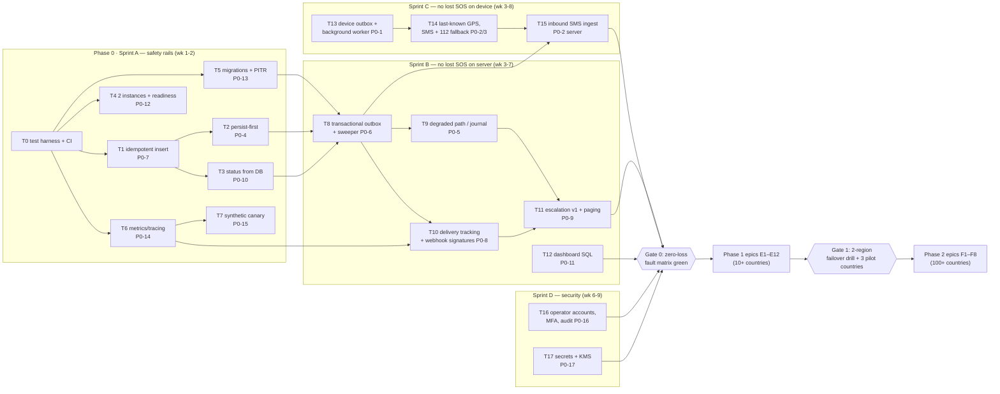
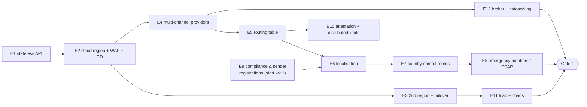

# DEVI Global Readiness (Zero-Loss SOS, PSR & Security) Implementation Plan

> **For agentic workers:** REQUIRED SUB-SKILL: Use superpowers:subagent-driven-development (recommended) or superpowers:executing-plans to implement this plan task-by-task. Steps use checkbox (`- [ ]`) syntax for tracking.

**Goal:** Implement every recommendation in the PSR & Security assessment (P0-1…P0-17, P1-1…P1-12, P2-1…P2-8) in a safe order, with tests that prove no SOS is lost, so DEVI can launch in 10+ countries and then scale to 100+.

**Architecture:** Fix the "lost SOS" paths on the current stack first (Phase 0: device outbox, persist-first, transactional outbox, delivery tracking, escalation, observability). Then make the backend stateless and multi-provider behind a channel-adapter interface, run it in two regions, and localise it (Phase 1: 10+ countries). Finally split into regional cells with a global directory and data-residency controls (Phase 2: 100+ countries). Every external partner is integrated behind one adapter contract with signature-verified webhooks, contract tests and a synthetic canary.

**Tech Stack:** Node.js ESM + Express 4 + `node:test` (backend), Supabase Postgres + pgmq, Flutter/Dart + `flutter_test` + `integration_test` (app), React 19 + Vite (web), GitHub Actions (CI), k6 (load), Toxiproxy (fault injection).

**Spec:** [`docs/DEVI_PSR_SECURITY_ASSESSMENT.md`](../../DEVI_PSR_SECURITY_ASSESSMENT.md) (read with [`docs/DEVI_ARCHITECTURE_ANALYSIS.md`](../../DEVI_ARCHITECTURE_ANALYSIS.md)).

## Global Constraints

- **Never block a real SOS.** Abuse controls, auth failures, CAPTCHA, attestation failures, closed countries and quota limits may only *degrade* an SOS (e.g. dashboard + control room only), never reject it.
- Delivery semantics: **at-least-once**, consumers idempotent on `(alert_id, recipient_hash, channel, attempt)`. Duplicates are acceptable; losses are not.
- An alert is committed only after the DB transaction commits (sync replica from Phase 1). The API answers `202 {alertId, status:"COMMITTED"}` and does **not** wait on providers.
- SLOs (spec §2): commit p99 < 1 s; first send p99 < 5 s after commit; first delivered p95 < 30 s; unacknowledged → control room ≤ 3 min; committed alerts lost = 0; regional RTO < 5 min.
- Escalation timings (v1 defaults, configurable per country): no delivery receipt in **60 s** → next channel; no human ack in **180 s** → next guardian, then control room; control room re-paged every **60 s** until claimed.
- Phone numbers are **E.164** everywhere (`utils/phone.js` `canonicalPhone`). No `+91` or `Asia/Kolkata` defaults in send, format or aggregate paths after Task 21.
- All PII (names, numbers, addresses, coordinates, job payloads) stays encrypted with `utils/encryption.js` (`enc:v3`, AAD bound to table.column + row id). New tables follow the same rule.
- All timers are durable (DB rows with `next_action_at`, later a workflow engine), never in-process `setTimeout` for correctness.
- Every inbound partner webhook verifies the partner's signature before reading the body. Unsigned → 403 (dev may bypass only when the secret is unset *and* `NODE_ENV !== 'production'`, matching the existing Meta webhook rule).
- Backend tests use `node:test` + `node:assert/strict` and factories with injected dependencies (the existing `createSosNotify({queue, senders})` pattern). No test calls a real partner.
- Schema changes ship as versioned migrations only (Task 5). Runtime "column missing" fallbacks are removed.
- Branch per phase (`phase-0-zero-loss`, `phase-1-multi-country`, `phase-2-cells`); small commits; each task ends green on CI.

## Review Focus

Inputs and conditions the spec implies but no task's main tests would naturally exercise. Each has a pinned test in the owning task.

1. **SOS with no GPS fix at all** (location off, indoors). The alert must still commit and notify with a "location unavailable, call her" text, then update when a fix arrives. → Task 2, test `commits and notifies without coordinates`.
2. **The same SOS arrives by HTTPS *and* by the SMS fallback** (or from two regions). There must be exactly one alert and one notification round. → Task 15, test `SMS ingest with a known idempotency key returns the existing alert`.
3. **A provider status webhook arrives before the send result is stored** (fast "delivered" racing the `SENT` write). It must not be lost or overwrite a later state. → Task 10, test `status received before SENT is kept and applied in order`.
4. **The user marks herself safe while escalation is mid-flight.** Every pending job stops, no further calls, and guardians get a "she is safe" message. → Task 11, test `resolve cancels pending jobs and sends all-clear once`.
5. **The device clock is wrong** (`captured_at` days off, or in the future). The server must use its own commit time for ordering, SLOs and expiry, and keep the device time only as metadata. → Task 1, test `future or stale captured_at does not change committed_at`.

---

## 0. Order of work at a glance



| Order | Task / Epic | Spec IDs | Why this position |
|---|---|---|---|
| 0 | T0 Test harness + CI | — | Everything after needs app-level tests and CI |
| 1 | T1 Idempotent insert | P0-7, R7 | Live duplicate-alert bug; tiny change; unblocks outbox |
| 2 | T2 Persist-first | P0-4, PF1 | Shrinks the crash window before bigger refactors |
| 3 | T3 Status from DB | P0-10, RL3 | One-line class of bug that can stop retries |
| 4 | T4 Two instances + readiness | P0-12, RL1-2 | Cheap availability win; forces statelessness checks |
| 5 | T5 Migrations + PITR | P0-13, RL5-6 | Required before adding tables |
| 6 | T6 Observability | P0-14, R10 | Must exist before changing delivery so regressions are visible |
| 7 | T7 Canary | P0-15 | End-to-end proof running before and after each change |
| 8 | T8 Transactional outbox + sweeper | P0-6, R3 | Core server zero-loss guarantee |
| 9 | T9 Degraded path | P0-5, R1 | DB-down survival; builds on the outbox job shape |
| 10 | T10 Delivery tracking + signatures | P0-8, R4, SE3 | Needs `delivery_jobs` from T8 |
| 11 | T11 Escalation + paging | P0-9, R5 | Needs delivery states from T10 |
| 12 | T12 Dashboard SQL | P0-11, R8, PF4 | Independent; before data grows |
| 13 | T13 Device outbox | P0-1, R2 | Parallel track (mobile team) |
| 14 | T14 SMS/112 fallback, last-known GPS | P0-2, P0-3 | Builds on T13 |
| 15 | T15 Inbound SMS ingest | P0-2 server side | Lets the T14 SMS reach the server; idempotent with T1 |
| 16 | T16 Operator accounts / MFA / audit | P0-16, SE1-2 | Before more operators and countries |
| 17 | T17 Secrets + KMS | P0-17, SE4 | Before multi-region key distribution |
| 18-29 | E1–E12 | P1-1…P1-12 | See §Phase 1 order |
| 30-37 | F1–F8 | P2-1…P2-8 | See §Phase 2 order |

---

## 1. Test strategy (applies to every task)

### 1.1 Test layers

| Layer | Tool | Location | Runs | Proves |
|---|---|---|---|---|
| Unit | `node:test` | `backend/test/*.test.js` | every push | pure logic: idempotency, state machine, routing, signatures, formatting |
| App/route | `node:test` + `supertest` against `createApp(deps)` | `backend/test/routes/*.test.js` | every push | HTTP contracts, status codes, auth, degraded responses |
| DB integration | `node:test` against Supabase local (`supabase start`) | `backend/test/integration/*.int.test.js` | every PR | SQL functions, constraints, RLS, migrations apply cleanly |
| Partner contract | recorded fixtures + signature vectors per adapter | `backend/test/contracts/<partner>/*.test.js` | every push | request shape we send, webhook shapes we parse, signature checks |
| Partner sandbox | real sandbox/test credentials | `backend/test/sandbox/*.sbx.test.js` | nightly | credentials, templates and endpoints still work |
| Fault injection (zero-loss matrix) | Toxiproxy + fake providers + process kill | `backend/test/zero-loss/*.zl.test.js` | every PR touching SOS paths + nightly | **every committed alert reaches `ACKNOWLEDGED`, `CONTROL_ROOM_CLAIMED` or `RESOLVED`** under each injected fault |
| Flutter unit/widget | `flutter_test` | `frontend/test/` | every push | outbox, retry, fallbacks, UI states |
| Device E2E | `integration_test` on Firebase Test Lab (Android) + Xcode Cloud/BrowserStack (iOS) | `frontend/integration_test/` | nightly | app kill, reboot, airplane mode, permissions |
| Load | k6 | `loadtest/*.js` | weekly + before each gate | commit p99 and first-send p99 at 10× peak |
| Security | Semgrep, gitleaks, `npm audit`, OWASP ZAP baseline, Dependabot | CI | every PR / weekly | no known vulns, no secrets, no new high findings |
| Synthetic E2E | canary script (T7) | scheduled job | every 5 min per provider × country | real delivery to test handsets |
| DR / chaos drills | runbooks | `docs/runbooks/` | quarterly | RTO/RPO in practice |

### 1.2 The zero-loss fault matrix (the acceptance test for "foolproof")

`backend/test/zero-loss/matrix.zl.test.js` drives N = 200 SOS per scenario through `createApp` with fake providers and asserts the invariant:

```js
// invariant checked after each scenario drains (fake clock advanced 15 min)
assert.equal(lostAlerts(db), 0);           // sent by a client but no committed row and no journal entry
assert.equal(unterminated(db), 0);         // committed but not ACKNOWLEDGED / CONTROL_ROOM_CLAIMED / RESOLVED
assert.ok(maxDuplicateAlertsPerKey(db) === 1);
```

| # | Injected fault | Introduced by |
|---|---|---|
| Z1 | Process killed after INSERT, before dispatch | T8 |
| Z2 | Queue unavailable at enqueue | T8 |
| Z3 | DB unavailable for 2 min | T9 |
| Z4 | Same idempotency key sent concurrently ×5 | T1 |
| Z5 | Geocoders hang 30 s | T2 |
| Z6 | WhatsApp accepts, then webhook `failed` | T10 |
| Z7 | Voice call `no-answer` / `busy` | T10 |
| Z8 | Nobody acknowledges | T11 |
| Z9 | WhatsApp token expired (permanent) | T10/T11 |
| Z10 | Webhook delivered twice / out of order | T10 |
| Z11 | Primary provider down for a channel | E5 |
| Z12 | Whole region down | E3 |
| Z13 | Home cell down, SOS lands in a foreign cell | F2 |

Each task that introduces a fault class adds its scenario. The matrix must be green at every gate.

### 1.3 CI pipeline (created in T0, extended later)

`.github/workflows/ci.yml` jobs: `backend-unit` → `backend-integration` (Supabase local) → `zero-loss` → `web-lint-build` → `flutter-test` → `security-scan`. Nightly: `sandbox`, `device-e2e`. Weekly: `load`.

---

## 2. External partner integration framework

Every partner sits behind one adapter contract so it can be added, swapped or failed over without touching SOS logic.

### 2.1 Adapter contract (created in Task 10, used by all channel partners)

`backend/src/channels/types.js` (JSDoc types):

```js
/**
 * @typedef {'push'|'whatsapp'|'sms'|'voice'|'ott'} Channel
 * @typedef {{ jobId:string, alertId:string, to:string, locale:string, tz:string,
 *             victimName:string, place:string, mapsUrl:string, trackUrl:string, callToken?:string }} SendRequest
 * @typedef {{ accepted:boolean, providerMsgId?:string, error?:{ code:string, permanent:boolean } }} SendResult
 * @typedef {{ providerMsgId:string, status:'sent'|'delivered'|'read'|'failed'|'answered'|'no_answer'|'busy'|'acked',
 *             at:string, error?:{code:string, permanent:boolean} }} StatusEvent
 * @typedef {{ name:string, channel:Channel, countries:string[]|'ALL',
 *             send(req:SendRequest):Promise<SendResult>,
 *             verifyWebhook(req:{headers:object, rawBody:Buffer, url:string, body:object}):boolean,
 *             parseWebhook(body:object):StatusEvent[],
 *             health():Promise<{ok:boolean, detail?:string}> }} ChannelAdapter
 */
```

### 2.2 Partner register

| Partner | Purpose | Phase / task | Onboarding lead time & prerequisites | Webhook auth | Test approach | Fallback |
|---|---|---|---|---|---|---|
| **Meta WhatsApp Cloud API** | SOS + OTP messages | today; T10 tracking; E6 per-language templates | Business verification, display name, template approval **per language**, permanent System User token, messaging-tier upgrades (request early) | `X-Hub-Signature-256` (exists) | contract fixtures for `messages` + `statuses`; Meta test number nightly | BSP WhatsApp, SMS |
| **WhatsApp BSP** (Infobip / Twilio / Gupshup / 360dialog: pick 1) | second WhatsApp sender, separate number and quality rating | E4 | BSP contract, second WABA + number, same templates re-approved | BSP-specific HMAC | contract + sandbox | Meta direct, SMS |
| **SMS providers** (≥ 2: e.g. Twilio + Infobip/Vonage; local aggregator where required) | SOS SMS to guardians, inbound SMS ingest (T15), OTP fallback | T15, E4 | **Per-country sender registration**: India TRAI DLT (entity + template IDs), US A2P 10DLC / toll-free verification, alphanumeric sender-ID registration in many countries. Allow 2–8 weeks per country | `X-Twilio-Signature`; provider HMAC | contract + sandbox; test handsets per country via canary | second SMS provider, voice |
| **Voice** (Twilio, Plivo today; add Exotel/Vonage/local carrier as needed) | IVR call + press-1 ack | T10 status + signatures; E5 routing | Caller-ID (CLI) rules per country, local numbers where required, CPS limit raise | `X-Twilio-Signature`, `X-Plivo-Signature-V3` | contract fixtures for answer/gather/status; sandbox calls nightly | other voice provider |
| **Push: FCM + APNs** | instant guardian notification (guardian app / web push) | E4 | Firebase project, APNs key, guardian app or PWA | n/a (outbound); delivery via app ack endpoint | unit + device E2E | other channels |
| **OTT** (LINE, Viber, Telegram, KakaoTalk via BSP) | where WhatsApp is not dominant | F5 | Official account per OTT, template approvals | provider HMAC | contract + sandbox | SMS, voice |
| **Google Maps Geocoding** | place names (async after T2) | T2, E6 | Billing, key restriction by IP | n/a | fixture tests; timeout tests | coordinates-only text. **Remove Nominatim and BigDataCloud from production** (public-instance usage policy) or self-host |
| **Cloudinary** | evidence storage (Phase 2 feature flag) | E2 per-region folders; F3 residency | Per-region accounts or a residency-capable provider | signed delivery URLs | contract tests on upload/refs | S3/GCS per cell |
| **Supabase / Postgres provider** | DB, queue | T5 PITR; E3 replicas; F1 per cell | Paid plan with PITR, read replicas, project per cell | n/a | integration suite on local Supabase | managed Postgres per cell |
| **PagerDuty / Opsgenie** | page operators and on-call engineers | T11, T6 | Service per country control room + engineering | Events API v2 routing key | contract fixture, sandbox service | second pager + SMS to supervisor |
| **Sentry + Grafana Cloud (OTel)** | errors, metrics, traces | T6 | Org, DSNs, data-scrubbing rules (no PII) | n/a | unit test that PII is scrubbed | logs |
| **Play Integrity / App Attest** | device attestation for paid-send abuse | E10 | Play Console + Apple setup | Google/Apple token verification | unit with fixture tokens | degrade, never block SOS |
| **Cloud KMS + Secret Manager** | key and secret storage | T17 | Cloud account, IAM roles | n/a | fake KMS in unit tests; integration nightly | — |
| **Cloudflare (or cloud LB/WAF)** | edge, WAF, DDoS, health-checked failover | E2, E3 | DNS move, WAF rules with an SOS allow-path | n/a | synthetic checks | direct regional hostnames in the app |
| **Temporal Cloud** (or Step Functions) | durable escalation timers at scale | F4 | Namespace per cell | mTLS | workflow replay tests | DB timer worker from T11 |
| **Emergency services / PSAP partners** (e.g. national 112 systems, RapidSOS-type aggregators where available) | hand off location to official responders | E8 (dial), F6 (data integration) | Government or partner agreements per country; availability varies, so confirm per country | partner-specific | partner sandbox if offered | one-tap local emergency dial |

### 2.3 Partner onboarding checklist (per partner, per country)

- [ ] Contract/DPA signed; data-processing location recorded in `docs/partners/<partner>.md`
- [ ] Credentials in Secret Manager (T17); never in `.env` on servers after T17
- [ ] Adapter implements `ChannelAdapter`; contract tests with recorded request/response and webhook fixtures
- [ ] Webhook signature verification test (valid, wrong secret, changed body, missing header, replayed)
- [ ] Error codes mapped to `{code, permanent}`, with a table test covering every documented code we've seen
- [ ] Rate limits and throughput recorded in `config/providers/<partner>.json`; load test at the limit
- [ ] Health check implemented; alert rule added (T6)
- [ ] Canary (T7) enabled for this partner × country with a test handset
- [ ] Failover drill: disable partner in staging → traffic moves within SLO

---

# PHASE 0: Zero-loss SOS on the current stack

### Task 0: Test harness, app factory and CI

**Files:**
- Create: `backend/src/app.js`, `backend/test/helpers/fakeDb.js`, `backend/test/helpers/fakeProviders.js`, `backend/test/helpers/fakeClock.js`, `.github/workflows/ci.yml`
- Modify: `backend/src/server.js` (only `listen` + `socketService.init` + worker start remain), `backend/package.json` (add dev dep `supertest`; scripts `test:int`, `test:zl`)
- Test: `backend/test/routes/app.test.js`

**Interfaces:**
- Produces: `createApp(deps?: { db?, queue?, senders?, clock?, geocoder? }) => express.Application` (defaults to real deps); `fakeDb()` returning a Supabase-shaped chain (`from().insert().select().single()`, `.rpc(name,args)`) backed by in-memory tables with unique constraints that raise `{code:'23505', message}`; `fakeProviders()` returning `senders` with programmable results; `fakeClock(startMs)` with `now()` and `advance(ms)`.

- [ ] **Step 1: Write failing test** `GET /api/health returns 200 from createApp()` and `unknown route returns 404 JSON`.
- [ ] **Step 2: Run** `cd backend && npm test` → FAIL (`createApp` not found).
- [ ] **Step 3: Move** middleware and route wiring from `server.js` into `createApp(deps)` in `src/app.js`; `server.js` imports it and listens.
- [ ] **Step 4: Run** `npm test` → all existing 12 suites + new test PASS.
- [ ] **Step 5: Add CI** `.github/workflows/ci.yml` with jobs `backend-unit` (`npm ci && npm test`), `web-lint-build` (`npm ci && npm run lint && npm run build`), `flutter-test` (`flutter test`), `security-scan` (gitleaks + `npm audit --audit-level=high`). Push the branch; expected: all green.
- [ ] **Step 6: Commit** `git commit -m "test: app factory, fakes and CI pipeline"`

### Task 1: Idempotent SOS insert (P0-7, R7)

**Files:**
- Create: `backend/src/services/sosStore.js`
- Modify: `backend/src/services/sos.service.js:139-175` (delete the schema fallbacks; call `insertSosAlert`), `backend/src/routes/sos.routes.js:78-101`
- Test: `backend/test/sosStore.test.js`, `backend/test/zero-loss/matrix.zl.test.js` (create, scenario Z4)

**Interfaces:**
- Produces: `insertSosAlert(db, payload) => Promise<{ alert: object, duplicate: boolean }>`. On `23505` for `idempotency_key`, it reads and returns the existing row with `duplicate:true`. Any other error throws. `committed_at` is server time.

- [ ] **Step 1: Write failing tests**
  - `same idempotency key inserted twice → one row, second call duplicate:true`
  - `five concurrent inserts with one key → exactly one row`
  - `missing column error is thrown, never retried without fields`
  - `future or stale captured_at does not change committed_at` (Review Focus 5): `captured_at` = now + 3 days → row `created_at` equals the fake clock; `captured_at` kept in its own field.
- [ ] **Step 2: Run** `node --test test/sosStore.test.js` → FAIL.
- [ ] **Step 3: Implement** `insertSosAlert` in `sosStore.js`; route path returns the existing alert (and its control token only under the existing same-device/owner rule) when `duplicate`.
- [ ] **Step 4: Add zero-loss scenario Z4** (5 concurrent triggers with one key → 1 alert, 1 dispatch per recipient).
- [ ] **Step 5: Run** `npm test && npm run test:zl` → PASS.
- [ ] **Step 6: Commit** `fix(sos): atomic idempotent insert, drop schema fallbacks`

### Task 2: Persist first, geocode asynchronously (P0-4, PF1)

**Files:**
- Create: `backend/src/services/sosEnrich.service.js`
- Modify: `backend/src/services/sos.service.js:94-108`, `backend/src/services/geocode.service.js` (bounded LRU, 10k entries, geohash-7 keys; production providers = Google only)
- Test: `backend/test/sosEnrich.test.js`

**Interfaces:**
- Consumes: `insertSosAlert` (T1).
- Produces: `createSosEnricher({ db, geocoder, socket }) => { enqueue(alertId, lat, lng): void }`. It updates `location_address` (encrypted) and broadcasts `incident:location` `{alertId, place}`. The message text for no fix is the constant `NO_LOCATION_TEXT` (existing).

- [ ] **Step 1: Write failing tests**
  - `insert happens before any geocoder call` (geocoder fake records call order; insert must come first)
  - `geocoder hanging 30 s does not delay the trigger response beyond 1 s` (fake clock)
  - `commits and notifies without coordinates` (Review Focus 1): lat/lng null → row committed, WhatsApp job text contains `NO_LOCATION_TEXT`, no geocode call
  - `geocode cache evicts beyond 10,000 entries`
- [ ] **Step 2: Run** → FAIL.
- [ ] **Step 3: Implement** the enricher; trigger route inserts with `location_address = GPS lat,lng` text, then `enqueue`.
- [ ] **Step 4: Add zero-loss scenario Z5.** Run `npm test && npm run test:zl` → PASS.
- [ ] **Step 5: Commit** `perf(sos): commit before geocoding; bounded geocode cache`

### Task 3: Alert status read from the DB only (P0-10, RL3)

**Files:**
- Modify: `backend/src/services/sosNotify.service.js:47` (`alertStatus` reads DB status, not `liveTrackSessions`), `backend/src/services/sos.service.js:473-503` (`resolveSosAlert` throws on DB error), `backend/src/routes/sos.routes.js:367-406` (return `503 {retry:true}` on failure)
- Modify app: `frontend/lib/services/api_service.dart:342-360` (`resolveEmergencyAlert` retries on 503 with backoff 1, 2, 4, 8 s)
- Test: `backend/test/sosNotify.test.js` (extend), `backend/test/routes/resolve.test.js`

- [ ] **Step 1: Write failing tests:** `worker keeps retrying when memory says RESOLVED but DB says ACTIVE`; `resolve returns 503 when the DB update fails and nothing is marked resolved in memory`.
- [ ] **Step 2: Run** → FAIL. **Step 3: Implement.** **Step 4: Run** → PASS (incl. `flutter test`).
- [ ] **Step 5: Commit** `fix(sos): DB is the source of truth for alert status`

### Task 4: Two instances, process manager, deep readiness (P0-12)

**Files:**
- Create: `backend/ecosystem.config.cjs` (PM2, `instances: 2`, `exec_mode: 'cluster'`), `backend/src/routes/ready.routes.js`, `docs/runbooks/deploy.md`
- Modify: `deploy/nginx/devi-api.macvelsoftware.com.nginx.conf` (upstream with 2 ports + `max_fails`), `backend/src/routes/index.js` (mount `/ready`)
- Test: `backend/test/routes/ready.test.js`

**Interfaces:**
- Produces: `GET /api/ready` → `200 {db:'ok', queue:'ok', whatsapp:'ok'|'degraded', voice:'ok'|'degraded'}`; `503` if the DB or queue fails. Providers are reported degraded but do not fail readiness.

> Two instances expose the in-memory state problems (SC1–SC4). Until E1, run PM2 with `instances: 2` only after T1 and T3 are merged, and pin admin WebSocket clients with NGINX `ip_hash` for the `/ws` location.

- [ ] **Step 1: Failing tests:** `ready is 503 when db probe throws`; `ready is 200 with whatsapp degraded when token check fails`.
- [ ] **Step 2–4:** implement, run → PASS.
- [ ] **Step 5: Staging check:** `pm2 start ecosystem.config.cjs && pm2 kill-instance 0` → `curl /api/ready` keeps returning 200.
- [ ] **Step 6: Commit** `ops: PM2 cluster, readiness probe, NGINX upstream`

### Task 5: Versioned migrations, PITR and restore drill (P0-13)

**Files:**
- Create: `backend/supabase/migrations/20261110000000_baseline.sql` (concatenate today's `db/*.sql` in the documented order), `backend/supabase/config.toml`, `docs/runbooks/restore.md`
- Modify: `.github/workflows/ci.yml` (job `backend-integration`: `supabase start && supabase db reset && npm run test:int`), `backend/db/README.md` (old files now historical)
- Test: `backend/test/integration/schema.int.test.js`

- [ ] **Step 1: Failing integration test:** `all tables have RLS on and anon has no privileges` (query `pg_tables.rowsecurity`, `has_table_privilege('anon', …)`); `sos_history.idempotency_key is unique`.
- [ ] **Step 2–4:** write the baseline migration, run `npm run test:int` → PASS.
- [ ] **Step 5: Ops:** enable PITR on the Supabase plan; perform and record one restore into a scratch project (`docs/runbooks/restore.md` with timings).
- [ ] **Step 6: Commit** `db: versioned migrations, RLS integration test, restore runbook`

### Task 6: Observability (P0-14)

**Files:**
- Create: `backend/src/observability/metrics.js`, `backend/src/observability/tracing.js`, `backend/src/observability/scrub.js`, `ops/alerts/devi-alerts.yaml`
- Modify: `backend/src/app.js` (`/metrics` behind an admin key or private network), SOS route, `sosNotify.service.js`, IVR routes
- Modify app/web: add Sentry (`sentry_flutter`, `@sentry/react`) with PII scrubbing
- Test: `backend/test/observability.test.js`

**Interfaces:**
- Produces (Prometheus names, used by every later task):
  - `devi_sos_received_total{source="https|sms|journal"}`
  - `devi_sos_committed_total`, `devi_sos_commit_seconds` (histogram)
  - `devi_delivery_total{channel,provider,country,status}`
  - `devi_first_delivery_seconds`, `devi_first_ack_seconds` (histograms)
  - `devi_alerts_unacknowledged` (gauge)
  - `devi_queue_oldest_seconds{queue}`
  - `scrub(obj) => obj` removing phone numbers, names and coordinates

- [ ] **Step 1: Failing tests:** `trigger increments received and committed and observes commit latency`; `scrub removes E.164 numbers, lat/lng and victimName from an event`.
- [ ] **Step 2–4:** implement with `prom-client` + `@opentelemetry/sdk-node`; run → PASS.
- [ ] **Step 5:** commit `ops/alerts/devi-alerts.yaml` with the alarm table from spec §12 (unacknowledged > 3 min pages and is never muted).
- [ ] **Step 6: Commit** `feat(obs): metrics, tracing, PII scrubbing, alert rules`

### Task 7: Synthetic SOS canary (P0-15)

**Files:**
- Create: `backend/scripts/sos-canary.js`, `ops/canary/targets.json` (`[{country, provider, channel, testNumber}]`, numbers from Secret Manager after T17)
- Modify: `backend/src/routes/sos.routes.js` (accept `is_test_mode:true` only with the `x-admin-key` header: skip control room and paging, mark the row `is_test_mode`)
- Test: `backend/test/canary.test.js`

**Interfaces:**
- Produces: `runCanary({api, targets, timeoutMs=60000}) => Promise<{target, delivered:boolean, ms:number}[]>`; exits non-zero when 2 consecutive runs fail for a target. Exposes `devi_canary_success{country,provider,channel}`.

- [ ] **Step 1: Failing tests:** `test-mode SOS never reaches the control room or pager`; `test-mode without admin key is treated as a real SOS` (never block a real SOS); `canary fails a target after 60 s without delivered status`.
- [ ] **Step 2–4:** implement; run → PASS.
- [ ] **Step 5: Schedule** every 5 min (cron/GitHub scheduled workflow or the cloud scheduler) against staging and production; page on 2 consecutive failures.
- [ ] **Step 6: Commit** `feat(ops): synthetic SOS canary`

### Task 8: Transactional outbox, delivery jobs and sweeper (P0-6, R3)

**Files:**
- Create: `backend/supabase/migrations/20261124000000_delivery_jobs.sql`, `backend/src/services/outbox.service.js`, `backend/src/workers/sweeper.js`, `backend/src/workers/relay.js`
- Modify: `backend/src/routes/sos.routes.js` (trigger = one RPC, then `202`), `backend/src/services/sosNotify.service.js` (consumes jobs by `job_id`; job payload unchanged and encrypted)
- Test: `backend/test/integration/createSosAlert.int.test.js`, `backend/test/sweeper.test.js`, zero-loss Z1, Z2

**Interfaces:**
- SQL: tables `delivery_jobs(id uuid pk, alert_id fk, recipient_enc text, recipient_hash text, channel text, role text, priority int, state text check in ('pending','sent','delivered','acked','failed','exhausted','cancelled'), attempt int, next_action_at timestamptz, updated_at)` with unique `(alert_id, recipient_hash, channel)`; `outbox(id bigserial, aggregate_id uuid, event_type text, payload jsonb, published_at timestamptz null)`.
- SQL function: `create_sos_alert(p_alert jsonb, p_jobs jsonb) returns table(alert_id uuid, duplicate boolean)`. Inserts alert (`on conflict (idempotency_key) do nothing`), jobs and one `outbox` row `SOS_COMMITTED` in one transaction.
- JS: `commitSosAlert(db, {alert, jobs}) => Promise<{alertId, duplicate}>` (replaces `insertSosAlert` in the route; T1's function stays for internal use).
- JS: `sweepStaleJobs({db, publish, now, staleAfterMs = 30000}) => Promise<number>` re-publishes jobs in `pending`/`sent` whose `next_action_at < now - staleAfterMs`.
- JS: `relayOutbox({db, publish, batch = 100}) => Promise<number>` marks `published_at`.

- [ ] **Step 1: Failing integration tests:** `alert, jobs and outbox row are created atomically`; `failure inserting a job rolls back the alert`; `duplicate key returns duplicate:true and creates no new jobs`.
- [ ] **Step 2: Failing unit tests:** `sweeper republishes a pending job older than 30 s once`; `relay publishes each outbox row exactly once across two concurrent relays` (`for update skip locked`).
- [ ] **Step 3: Run** → FAIL. **Step 4: Implement** migration, service, workers. The trigger route responds `202` after commit, then dispatches the first sends from the relay path (not the request).
- [ ] **Step 5: Zero-loss Z1** (kill after commit) and **Z2** (queue down): run `npm run test:zl` → 0 lost.
- [ ] **Step 6: Update app** `api_service.dart` to accept `202`, and poll `GET /api/sos/:id/status` (new route, control-token auth) every 3 s for 2 min to show delivery state. Test in `frontend/test/sos_status_poll_test.dart`.
- [ ] **Step 7: Commit** `feat(sos): transactional outbox, delivery jobs, relay and sweeper`

### Task 9: Degraded path when the database is down (P0-5, R1)

**Files:**
- Create: `backend/src/services/sosJournal.js`, `backend/src/workers/journalReplay.js`
- Modify: `backend/src/routes/sos.routes.js`
- Test: `backend/test/sosJournal.test.js`, zero-loss Z3

**Interfaces:**
- Produces: `appendJournal(entry) => Promise<void>` (append-only JSONL, `fsync` per entry, encrypted with field `journal.sos`, path from `SOS_JOURNAL_DIR`); `replayJournal({db, commit}) => Promise<{replayed, skipped}>` (idempotent via the idempotency key); trigger response on DB failure: `202 {alertId: <uuid>, status:'ACCEPTED_DEGRADED'}`, and sends dispatched directly through `sosNotify.dispatch` without queue dependence.

- [ ] **Step 1: Failing tests:** `DB down: alert journaled, WhatsApp and voice still sent, 202 degraded`; `replay after DB returns commits once and creates no duplicate sends`; `journal file contains no plaintext phone or name`; `guest without guardians in degraded mode still alerts the control room`.
- [ ] **Step 2–4:** implement; run → PASS.
- [ ] **Step 5: Zero-loss Z3** (DB down 2 min) → 0 lost.
- [ ] **Step 6: Commit** `feat(sos): durable journal and DB-down delivery path`

### Task 10: Delivery tracking, partner webhooks and signatures (P0-8, R4, SE3)

**Files:**
- Create: `backend/supabase/migrations/20261201000000_delivery_attempts.sql`, `backend/src/channels/types.js` (§2.1), `backend/src/channels/whatsappMeta.adapter.js`, `backend/src/channels/twilioVoice.adapter.js`, `backend/src/channels/plivoVoice.adapter.js`, `backend/src/channels/registry.js`, `backend/src/routes/webhooks.routes.js`, `backend/src/services/callToken.js`
- Modify: `backend/src/server.js` / `app.js` (move the Meta webhook into `webhooks.routes.js`), `backend/src/routes/ivr.routes.js` (no `victim`/`loc` query params; read from the call token), `backend/src/services/ivr.service.js`, `backend/src/services/whatsapp.service.js`
- Test: `backend/test/contracts/meta/*.test.js`, `backend/test/contracts/twilio/*.test.js`, `backend/test/contracts/plivo/*.test.js`, `backend/test/deliveryState.test.js`, zero-loss Z6, Z7, Z9, Z10

**Interfaces:**
- SQL: `delivery_attempts(id, job_id fk, provider, provider_msg_id unique, status, error_code, at, raw_hash)`.
- `applyStatusEvent(db, event: StatusEvent) => Promise<'applied'|'stale'|'unknown'>`. State only moves forward along `sent < delivered < read < acked`. `failed`/`no_answer`/`busy` set the job to `pending` with `next_action_at = now` unless `permanent`.
- `registry.forChannel(channel, country) => ChannelAdapter[]` (ordered; today Meta for WhatsApp; Plivo then Twilio for `+91`, Twilio then Plivo otherwise, keeping the current rule).
- `issueCallToken(jobId) => string` / `readCallToken(token) => {jobId}|null` (encrypted, 15 min expiry).
- Webhook routes: `POST /api/webhooks/meta`, `POST /api/webhooks/twilio/voice-status`, `POST /api/webhooks/plivo/voice-status` (plus existing IVR answer/gather moved to verify signatures).

- [ ] **Step 1: Failing contract tests (per partner):** outbound request body matches the recorded fixture; webhook fixtures parse to the expected `StatusEvent[]`; signature tests (valid, wrong secret, altered body, missing header, wrong URL for Twilio).
- [ ] **Step 2: Failing state tests:** `delivered after read is ignored`; `failed WhatsApp re-queues the job for the next channel`; `no-answer call is redialed once then moves to next channel`; `duplicate webhook is idempotent`; `status received before SENT is kept and applied in order` (Review Focus 3: store unknown `provider_msg_id` events in `delivery_attempts` with `job_id null` and apply them when the send result is written).
- [ ] **Step 3: Failing security tests:** `IVR answer URL contains no name, number or place`; `IVR gather without a valid signature is 403`.
- [ ] **Step 4: Run** → FAIL. **Step 5: Implement.** **Step 6: Zero-loss Z6, Z7, Z9, Z10** → 0 lost.
- [ ] **Step 7: Partner config:** in Meta, Twilio and Plivo consoles, point status callbacks to the new URLs (staging first); record in `docs/partners/*.md`.
- [ ] **Step 8: Commit** `feat(delivery): adapters, signed status webhooks, delivery state tracking`

### Task 11: Escalation engine v1 and operator paging (P0-9, R5)

**Files:**
- Create: `backend/src/services/escalation.policy.js`, `backend/src/workers/escalation.worker.js`, `backend/src/integrations/pager.js`, `backend/supabase/migrations/20261208000000_escalation.sql`
- Modify: `backend/src/routes/sos.routes.js` (resolve cancels jobs), dashboard routes (`POST /api/dashboard/claim/:alertId`)
- Test: `backend/test/escalation.policy.test.js`, `backend/test/escalation.worker.test.js`, `backend/test/contracts/pagerduty/*.test.js`, zero-loss Z8

**Interfaces:**
- SQL: `sos_history` gets `escalation_level text default 'GUARDIANS'` (`GUARDIANS → NEXT_CHANNEL → CONTROL_ROOM → OPERATOR_PAGED`), `claimed_by`, `claimed_at`; table `escalation_policies(country text pk, deliver_timeout_s int default 60, ack_timeout_s int default 180, repage_s int default 60, control_room_ref text)`.
- `nextEscalationStep(state: {alert, jobs, acks, now}, policy) => {action:'none'|'next_channel'|'next_recipient'|'control_room'|'page'|'repage', jobs?: object[]}` (pure).
- `pager.trigger({alertId, country, severity:'critical'}) => Promise<{dedupKey}>`, `pager.resolve(dedupKey)` (PagerDuty Events API v2; Opsgenie adapter with the same interface).

- [ ] **Step 1: Failing table-driven policy tests:** no delivery at 60 s → `next_channel`; delivered, no ack at 180 s → `next_recipient`; all exhausted → `control_room`; control room unclaimed 60 s → `page`, then `repage` every 60 s; guest without guardians starts at `control_room`; acked → `none`; resolved → `none`.
- [ ] **Step 2: Failing worker tests:** `resolve cancels pending jobs and sends all-clear once` (Review Focus 4); `operator claim stops repaging and resolves the page`.
- [ ] **Step 3–5:** implement; run → PASS; zero-loss Z8 → every alert ends `ACKNOWLEDGED`, `CONTROL_ROOM_CLAIMED` or `RESOLVED`.
- [ ] **Step 6: Partner setup:** a PagerDuty service per control room + one engineering service; routing keys in Secret Manager.
- [ ] **Step 7: Commit** `feat(escalation): durable escalation policy, worker and paging`

### Task 12: Dashboard on SQL (P0-11, R8, PF4)

**Files:**
- Create: `backend/supabase/migrations/20261215000000_dashboard_sql.sql` (functions `dashboard_stats(p_tz text, p_days int)`, `dashboard_incidents(p_status text, p_before timestamptz, p_limit int)`; indexes `(status, created_at desc)`, `(user_id, created_at desc)`, `(country, created_at desc)`)
- Modify: `backend/src/services/dashboard.service.js` (delete `fetchAll`/`MAX_ROWS`; decrypt only the returned page), `web/src/pages/admin/SosListPage.jsx` (keyset "Load more")
- Test: `backend/test/integration/dashboard.int.test.js`

- [ ] **Step 1: Failing integration tests:** `stats count 25,000 seeded alerts correctly`; `incident list pages beyond row 20,000`; `day buckets follow p_tz`.
- [ ] **Step 2–4:** implement; run `npm run test:int` → PASS; record p95 for 100k rows (< 300 ms target).
- [ ] **Step 5: Commit** `perf(dashboard): SQL aggregates and keyset pagination`

### Task 13: Durable device outbox and background delivery (P0-1, R2)

**Files:**
- Create: `frontend/lib/services/sos_outbox.dart`, `frontend/lib/services/sos_delivery_worker.dart`
- Modify: `frontend/pubspec.yaml` (add `sqflite`, `workmanager`), `frontend/lib/screens/sos_screen.dart:375-600` (press → `SosOutbox.enqueue`, UI reads outbox state; remove the widget-owned retry loop), `frontend/android/app/src/main/AndroidManifest.xml` (`RECEIVE_BOOT_COMPLETED`), iOS `Info.plist` (`BGTaskSchedulerPermittedIdentifiers`)
- Test: `frontend/test/sos_outbox_test.dart`, `frontend/integration_test/sos_kill_resume_test.dart`

**Interfaces:**
- `class SosOutboxEntry { String idempotencyKey; double? lat; double? lng; double? accuracy; DateTime capturedAt; List<String> recipients; String state; /* pending|committed|degraded|resolved */ String? alertId; int attempts; }`
- `SosOutbox.enqueue(SosOutboxEntry) → Future<void>` (written before any network call)
- `SosOutbox.pending() → Future<List<SosOutboxEntry>>`
- `SosOutbox.markCommitted(String key, String alertId) → Future<void>`
- `SosDeliveryWorker.run({required SosTransport transport}) → Future<int>` (attempt order: primary URL → secondary URL list from `ApiService.endpoints`; backoff 3, 5, 10, 15, 30 s then every 30 s while not committed and not resolved)
- `abstract class SosTransport { Future<SosSendResult> send(SosOutboxEntry e, Uri endpoint); }`

- [ ] **Step 1: Failing tests:** `entry persisted before transport is called`; `entry survives a new SosOutbox instance (app restart)`; `same idempotency key reused across all retries`; `worker stops when the user resolves`; `secondary endpoint used when primary times out`.
- [ ] **Step 2: Run** `flutter test test/sos_outbox_test.dart` → FAIL. **Step 3: Implement.** **Step 4: Run** → PASS.
- [ ] **Step 5: Device E2E** `sos_kill_resume_test.dart`: press SOS in airplane mode → kill app → disable airplane mode → relaunch not required; within 60 s the server (mock) receives exactly one SOS. Run on Firebase Test Lab (Android 10–15) and an iOS 16–18 matrix.
- [ ] **Step 6: Commit** `feat(app): durable SOS outbox with background delivery`

### Task 14: Last-known location, SMS fallback and local emergency number (P0-2, P0-3)

**Files:**
- Create: `frontend/lib/config/emergency_numbers.dart` (ISO country → number list, e.g. `IN: ['112']`, `US: ['911']`, `GB: ['999','112']`, `AU: ['000']`; full ITU list), `frontend/lib/services/sms_fallback.dart`
- Modify: `frontend/lib/services/location_service.dart` (`lastKnown()` first, then `updates`), `sos_screen.dart` (fallback UI), `sos_delivery_worker.dart`
- Test: `frontend/test/sms_fallback_test.dart`, `frontend/test/emergency_numbers_test.dart`

**Interfaces:**
- `LocationService.lastKnown() → Future<LocationResult?>`
- `SmsFallback.compose(SosOutboxEntry e, {required String locale}) → String` with the format `DEVI SOS <idempotencyKey> <lat>,<lng> <mapsUrl>` (machine-readable first line for T15, human text after)
- `SmsFallback.open(List<String> to, String body) → Future<bool>` via an SMS **intent** (no `SEND_SMS` permission: Play policy)
- `emergencyNumbersFor(String iso2) → List<String>`

- [ ] **Step 1: Failing tests:** `SOS is enqueued with last-known position before a fresh fix`; `fallback offered after 20 s without commit`; `message contains key, coordinates and maps link and fits 160 GSM-7 chars when coordinates exist`; `no coordinates → message says location unavailable`; `every ISO country in the allowed list has an emergency number`.
- [ ] **Step 2–4:** implement; run → PASS.
- [ ] **Step 5: Commit** `feat(app): last-known GPS, SMS fallback and local emergency number`

### Task 15: Inbound SMS ingest (server side of P0-2)

**Files:**
- Create: `backend/src/routes/smsInbound.routes.js`, `backend/src/channels/smsInbound.parser.js`
- Test: `backend/test/smsInbound.test.js`, `backend/test/contracts/twilio/sms-inbound.test.js`

**Interfaces:**
- `parseSosSms(body: string) => {idempotencyKey, lat, lng}|null`
- `POST /api/webhooks/sms/inbound/:provider` (signature verified) → `commitSosAlert` with `source:'sms'`, sender number as `userPhone`.

- [ ] **Step 1: Failing tests:** `SMS ingest with a known idempotency key returns the existing alert` (Review Focus 2); `malformed SMS from a registered user still creates an SOS` (never block); `unsigned inbound webhook is 403`.
- [ ] **Step 2–4:** implement; run → PASS.
- [ ] **Step 5: Partner:** buy an inbound-capable number per launch country (record in `docs/partners/sms.md`); configure the webhook.
- [ ] **Step 6: Commit** `feat(sos): inbound SMS SOS ingestion`

### Task 16: Operator accounts, MFA, cookie sessions, audit log (P0-16, SE1, SE2)

**Files:**
- Create: migration `…_operators.sql` (`operators(id, email, role check in ('global_admin','country_admin','operator','auditor'), countries text[], totp_secret_enc, disabled)`, `audit_log(id bigserial, operator_id, action, alert_id, at, ip_hash)`, append-only via trigger), `backend/src/routes/operator.routes.js`, `backend/src/middlewares/session.js`
- Modify: `backend/src/routes/admin.routes.js` (deprecate the env admin after migration), `web/src/config/api.js` (remove `localStorage` token; `credentials:'include'`; CSRF header), `deploy/nginx/snippets/devi-web-security-headers.conf` (strict CSP)
- Test: `backend/test/routes/operator.test.js`, `backend/test/audit.test.js`

**Interfaces:**
- Session cookie `devi_op` (httpOnly, Secure, SameSite=Strict, 15 min sliding, 12 h max) + `x-csrf-token`.
- `requireRole(...roles)` and `requireCountry(alertCountry)` middlewares.
- `audit(opId, action, alertId)` called on view, export, claim, note and resolve.

- [ ] **Step 1: Failing tests:** `login requires valid TOTP`; `operator cannot read another country's alert`; `every incident view writes one audit row`; `audit rows cannot be updated or deleted`; `request without CSRF header is 403`.
- [ ] **Step 2–4:** implement (`otplib` for TOTP; OIDC SSO optional later); run → PASS.
- [ ] **Step 5: Commit** `feat(security): operator accounts, MFA, RBAC by country, audit log`

### Task 17: Secret manager and KMS envelope encryption (P0-17, SE4)

**Files:**
- Create: `backend/src/config/secrets.js`, `backend/src/utils/keyProvider.js`, `docs/runbooks/key-rotation.md`
- Modify: `backend/src/config/security.js` (read from `loadSecrets()`), `backend/src/utils/encryption.js` (data key from `keyProvider`; format `enc:v4:<kmsKeyRef>:<wrappedDekId>:…`; v1–v3 still readable)
- Test: `backend/test/keyProvider.test.js`, `backend/test/encryption.test.js` (extend)

**Interfaces:**
- `loadSecrets({provider:'env'|'gcp'|'aws'|'vault'}) => Promise<Record<string,string>>`
- `createKeyProvider({kms}) => { currentKey(): Promise<{id, key:Buffer}>, keyById(id): Promise<Buffer> }` (data keys cached in memory ≤ 1 h)

- [ ] **Step 1: Failing tests:** `v3 values still decrypt after switching to v4`; `v4 value from region A key cannot be decrypted with region B key`; `secret loader refuses to start in production when a secret is missing` (keeps current behaviour).
- [ ] **Step 2–4:** implement with a fake KMS; run → PASS.
- [ ] **Step 5: Ops:** create KMS key ring per environment; migrate secrets; run `npm run rotate:key -- --apply`; record in the runbook.
- [ ] **Step 6: Commit** `feat(security): secret manager and KMS envelope encryption`

### Gate 0: exit criteria (must all hold before Phase 1)

- [ ] Zero-loss matrix Z1–Z10 green on CI for 14 consecutive days
- [ ] Canary success ≥ 99.9 % for 14 days on all India targets
- [ ] Load test: 50 SOS/s for 10 min → commit p99 < 1 s, first send p99 < 5 s
- [ ] Restore drill completed and documented; RPO measured
- [ ] Pen test of API, dashboard and app: no open critical/high findings

---

# PHASE 1: 10+ countries (epics)

Each epic gets its own detailed plan (same format as Phase 0) when it starts, because it depends on decisions taken at that time (cloud vendor, BSP choice, pilot countries). Below: order, scope, interfaces fixed now, tests and partner work.

**Order:** E1 → E2 → (E3 ∥ E4 → E5) → E6 → E7 → E8 → E9 → E10 → E11 → E12, with E9 (compliance) started in week 1 because partner and regulator lead times are the longest.



| Epic | Spec | Scope (fixed decisions) | Key tests | Partners |
|---|---|---|---|---|
| **E1 Stateless API** | P1-1, SC1–SC4 | Delete `live-sessions.js` usage; dedupe in DB (partial unique index `one ACTIVE alert per user` is **not** used: a user may need a second alert; rely on the idempotency key + 15-min window query). Redis (`ioredis`) for `rate-limit-redis`, recipient counters, OTP foreign counter, WS fan-out via Redis pub/sub. Interface: `createSharedState({redis}) => {incr(key, ttlS), pubsub}` | Two app instances in one test process share limits and WS events; Redis down → SOS still accepted (limits fail open for SOS, closed for OTP) | Managed Redis |
| **E2 Cloud region, WAF, CD** | P1-2, SE9 | Containerise (`backend/Dockerfile`), deploy to managed compute in the region nearest the DB; private DB networking; Cloudflare/WAF with SOS paths excluded from challenges; blue/green via CI | Smoke + canary after each deploy; WAF rule test: `/api/sos/*` never challenged | Cloud provider, Cloudflare |
| **E3 Second region + failover** | P1-3, R6 | Hot standby region: cross-region DB replica, health-checked DNS/LB failover, app endpoint list `[primary, secondary, alt-domain]` (T13). Runbook `docs/runbooks/region-failover.md` | Zero-loss **Z12** (region down) in staging; quarterly drill with RTO < 5 min recorded | Cloud DB, DNS |
| **E4 Multi-channel providers** | P1-4, SC6 | Adapters (`ChannelAdapter`): `sms.twilio`, `sms.<second>`, `whatsapp.<bsp>`, `push.fcm`, `push.apns`; guardian acknowledgement endpoint `POST /api/ack/:token` used by push/link/SMS reply | Contract tests per adapter (§2.3); sandbox nightly; **Z11** provider down | SMS ×2, BSP, FCM/APNs |
| **E5 Provider routing table** | P1-5 | Table `provider_routes(country, channel, provider, priority, sender_id, caller_id, enabled, cost_cap)`; health scorer `providerHealth(provider, country) => 0..1` from `devi_delivery_total`; `routeFor(country, channel) => ChannelAdapter[]` replaces registry rules | Routing table tests; failover when health < 0.8; cost cap degrades to cheaper channel, never to none | all channel partners |
| **E6 Localisation** | P1-6, R9 | Remove `Asia/Kolkata` and `+91` defaults (`whatsapp.service.js:47-56`, `ivr.service.js:66-73`, `phone.js:7`, `dashboard.service.js:26`); `tz` from device (`captured_tz`) or GPS → `tz-lookup`; template catalogue `templates(name, channel, locale, provider_template_id, approved)`; IVR prompts per locale; app ARB files + RTL | Golden tests: message per locale and tz; `no code path formats time without a tz` (grep test); E.164-only test on all adapters | Meta template approvals per language, voice TTS languages |
| **E7 Country control rooms** | P1-7 | `control_rooms(country, schedule, languages, pager_service, whatsapp, sms, phone)`; operator console with claim/ack, filtered by `operators.countries` (T16) | Escalation picks the room on duty for the alert's country/time; no room on duty → global fallback room | PagerDuty, partner NGOs |
| **E8 Emergency numbers / PSAP** | P1-8 | One-tap dial (T14) for all launch countries; per-country partner integration where an official API exists (record availability in `docs/partners/psap.md`) | Every launch country has a verified number; PSAP adapter contract tests where integrated | National 112/911 bodies, aggregators |
| **E9 Compliance pack** | P1-9 | DPIA, consent text per country (versioned in `legal/`), guardian opt-in message flow, retention jobs (`retention_policies(country, table, days)`), sender registrations (DLT, 10DLC, sender IDs) | Retention job deletes/anonymises by country; guardian without opt-in gets only the first SOS + opt-in prompt (confirm with legal) | Regulators, carriers, legal counsel |
| **E10 Attestation + distributed limits** | P1-10, SE7 | Play Integrity / App Attest verdict on `/sos/trigger` and `/auth/otp/send`; failed verdict → SOS degraded (dashboard + control room only), OTP rejected | Fixture tokens: valid, tampered, missing; `attestation failure never rejects SOS` | Google, Apple |
| **E11 Load + chaos** | P1-11 | k6 scripts `loadtest/sos-burst.js` (10× peak), Toxiproxy scenarios, game-day runbook | Gate 1 numbers below | — |
| **E12 Broker + autoscaling** | P1-12, SC8 | Replace pgmq polling with SQS/Pub/Sub (keep `QueueService` interface: `send/read/delete/archive`) + DLQ with page; workers autoscale on queue age | Queue contract tests run against both pgmq and the broker; DLQ message pages within 1 min | Cloud broker |

**Also in Phase 1:** E-sec items: user JWT 1 h + rotating refresh token with server-side revocation (SE8); cert pinning with a backup pin (SE12); least-privilege DB roles per service (SE5); guardian-link view log and revoke button (SE11); Semgrep/CodeQL + SBOM in CI (SE10).

### Gate 1: exit criteria (10+ countries)

- [ ] Zero-loss Z1–Z12 green; region failover drill RTO < 5 min, 0 lost alerts
- [ ] Load: 10× forecast peak (≈ 50 SOS/s, ≈ 450 sends/s) for 30 min within SLOs
- [ ] 3 pilot countries live for 30 days with canary ≥ 99.9 % per country × channel
- [ ] Every launch country has the **Country Launch Kit** (§4) complete
- [ ] External pen test + DPIA signed off

---

# PHASE 2: 100+ countries (epics)

**Order:** F1 → F2 → F3 → F4 → F5 → F7 → F8, with F6 (operations) growing alongside.

| Epic | Spec | Scope | Key tests | Partners |
|---|---|---|---|---|
| **F1 Cells + global directory** | P2-1 | Cell = full stack (API, DB, broker, workers) per region (IN, EU, NA, APAC, ME, LatAm; in-country cells where law requires). `directory(user_hash, home_cell)` replicated globally; `resolveCell(userHash) => cellId` | Cell isolation test: cell A outage → cell B unaffected; directory unavailable → last cached mapping used | Cloud regions, DB per cell |
| **F2 Accept anywhere, route home** | P2-2 | Any cell commits an SOS (`foreign_alerts` table), delivers it, then reconciles to the home cell; idempotency key global (UUIDv4) | Zero-loss **Z13**; duplicate across cells = 1 alert after reconciliation | — |
| **F3 Residency + per-cell keys** | P2-3 | KMS key ring per cell; compliance-as-code `policies/<country>.yaml` (`residency_cell`, `retention_days`, `channels_allowed`, `consent_version`); CI check that every allowed country has a policy | Policy lint test; data written only in the policy's cell; cross-cell key cannot decrypt | KMS, legal |
| **F4 Workflow engine** | P2-4 | Port `nextEscalationStep` into a Temporal (or Step Functions) workflow per alert; DB worker kept as fallback | Workflow replay tests; kill a worker mid-escalation → resumes | Temporal Cloud |
| **F5 Provider marketplace + OTT** | P2-5 | Cost and quality scoring per route; OTT adapters (LINE, Viber, Telegram, KakaoTalk) where dominant; local sender IDs | Contract tests per new adapter; routing picks OTT where the recipient is reachable there | OTT BSPs, local carriers |
| **F6 Operations** | P2-6 | Follow-the-sun on-call, regional SRE, error budgets per cell, quarterly game days | Game-day scorecards | PagerDuty |
| **F7 i18n at scale** | P2-7 | ICU catalogues, 40+ languages, translation pipeline with review, RTL screenshots in CI | Pseudo-locale test; missing-key test fails CI | Translation vendor |
| **F8 Disaster mode** | P2-8 | Detect bursts (> 10× baseline per region in 5 min): prioritise first notifications over retries, raise provider limits via pre-agreed process, status banner in app | Burst load test: first-send p99 < 10 s at 100× baseline; retries resume after the burst | Providers (pre-negotiated limits) |

### Gate 2: exit criteria (100+ countries)

- [ ] Zero-loss Z1–Z13 green per cell
- [ ] Each cell passed a full-cell failure drill; cross-cell acceptance verified
- [ ] Compliance policy file + Country Launch Kit for every live country
- [ ] Error budget policy enforced for 2 quarters

---

## 4. Country Launch Kit (repeat for every new country)

A country goes live only when every box is ticked. Store as `docs/countries/<ISO2>.md`.

- [ ] **Legal:** DPIA addendum, consent and terms text translated, retention set, residency cell decided (`policies/<ISO2>.yaml`)
- [ ] **Numbers:** E.164 parsing verified for mobile ranges (libphonenumber metadata up to date)
- [ ] **WhatsApp:** templates approved in the country's languages; sender number tier adequate for forecast
- [ ] **SMS:** sender registration done (e.g. DLT/10DLC/sender ID), ≥ 2 providers routed, inbound SOS number live (T15)
- [ ] **Voice:** caller ID compliant, ≥ 2 providers routed, IVR prompts in local language(s), press-1 tested on local carriers
- [ ] **Push:** guardian app or web push available in that store/region
- [ ] **Emergency:** local emergency number(s) verified; PSAP partner status recorded
- [ ] **Control room:** on-duty schedule, languages, pager service, escalation contacts
- [ ] **Canary:** test handsets on ≥ 2 local carriers; canary green for 7 days
- [ ] **Load:** country forecast added to capacity model; provider limits confirmed in writing
- [ ] **Allow-lists:** add to `ALLOWED_COUNTRIES` (later: country policy file) and, if decided, `GUEST_SOS_COUNTRIES`
- [ ] **Runbook:** country-specific partner contacts and failover steps

---

## 5. Coverage check against the spec

| Spec ID | Covered by |
|---|---|
| P0-1 … P0-17 | T13, T14 (+T15), T14, T2, T9, T8, T1, T10, T11, T3, T12, T4, T5, T6, T7, T16, T17 |
| P1-1 … P1-12 | E1 … E12 |
| P2-1 … P2-8 | F1 … F8 |
| R1–R10 | T9, T13, T8, T10, T11, T4/E3, T1, T12, E6, T6 |
| SE1–SE12 | T16, T16, T10, T17, Phase 1 E-sec, E2 (CSP), E10, Phase 1 E-sec, E2, T0/Phase 1, Phase 1 E-sec, Phase 1 E-sec |
| PF1–PF9 | T2, T8 (202), E2, T12, T12, T2, E5 (caller ID config), E6, E1/E2 (workload split) |
| SC1–SC10 | E1, E1, E1, E1, F1, E4/E5, E5, E12, T12, T16 |
| RL1–RL9 | T4, T4, T3, T1, T5, T5, T10/T11 (token expiry pages), T0/E11, T9/T11 |
