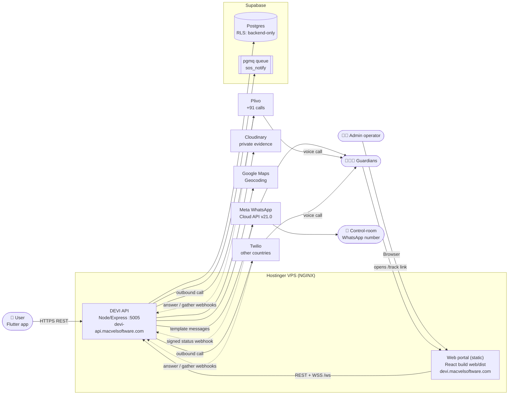
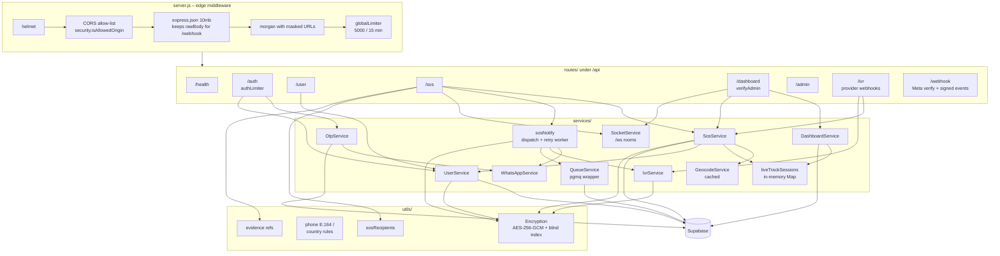
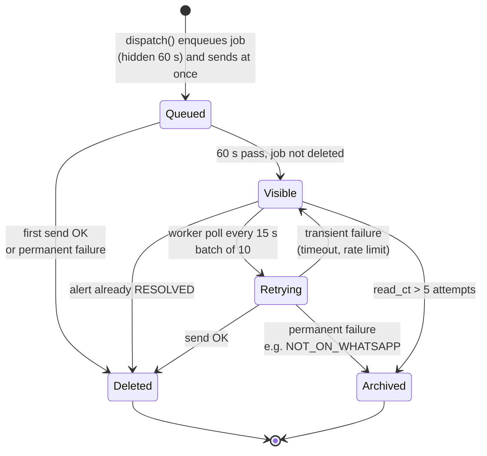
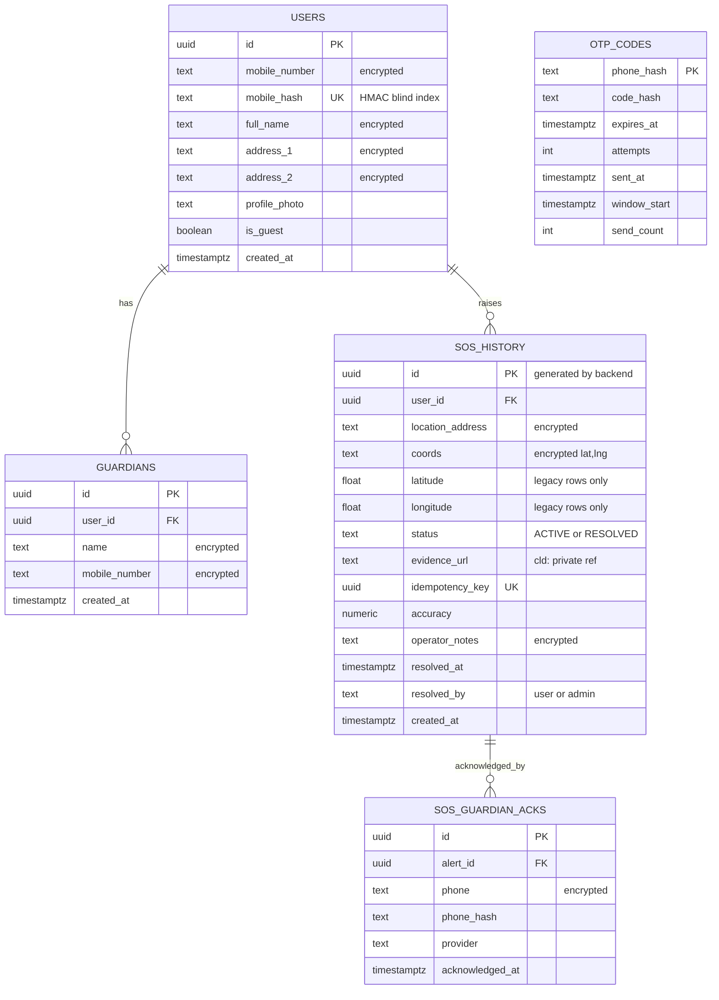
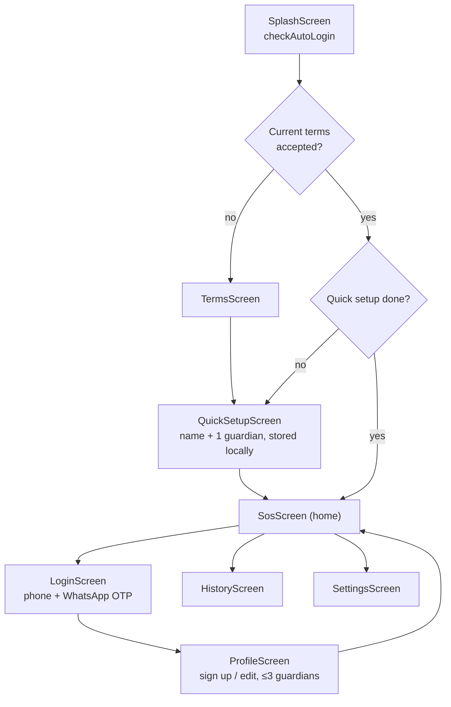
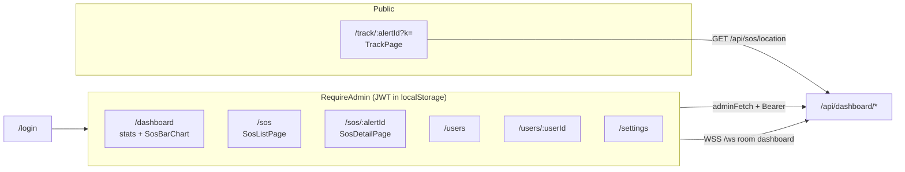
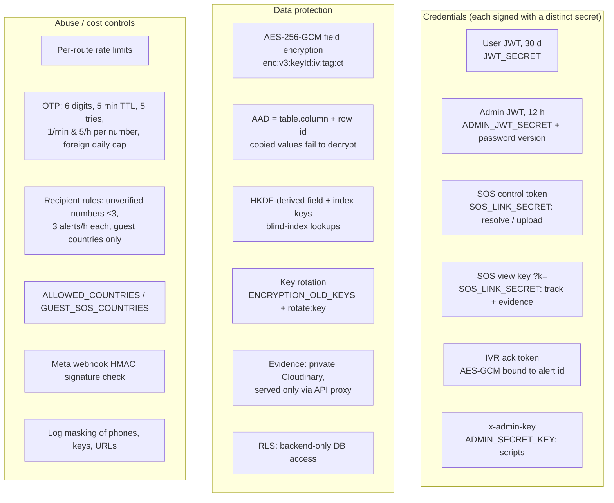
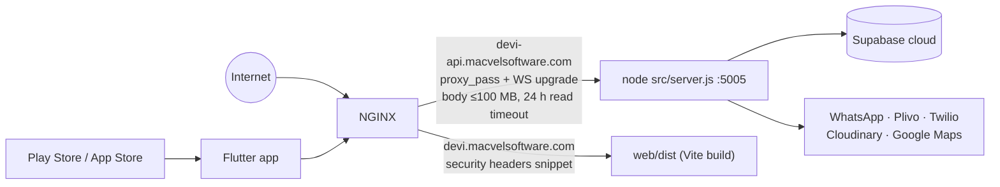

# DEVI – Architecture Analysis

> Generated from the current source code on 2026-11-04. Where this differs from
> `docs/DEVI_SYSTEM_ARCHITECTURE.md`, this file reflects the code; see [§12](#12-documentation-drift).

---

## 1. Summary

DEVI is a women-safety SOS system with three deployable parts and one managed data platform:

| Part | Tech | Role |
|---|---|---|
| **Mobile app** (`frontend/`) | Flutter 3 (Dart ^3.13), Android native Kotlin service | User presses SOS; sends GPS + guardians to the API |
| **Backend API** (`backend/`) | Node.js (ESM), Express 4, `ws`, Supabase JS | REST API, admin WebSocket, WhatsApp/IVR dispatch, retry queue |
| **Web portal** (`web/`) | React 19 + Vite 8 + React Router 7 | Admin control-room dashboard and public guardian "track" page |
| **Data** | Supabase Postgres + Supabase Queues (pgmq) | Users, guardians, SOS history, OTP codes, IVR acks, notify queue |

External services: **Meta WhatsApp Cloud API** (alerts + OTP), **Plivo** and **Twilio** (IVR voice calls),
**Cloudinary** (private evidence storage), **Google Maps Geocoding** (reverse geocode).

**Phase 1 scope (as coded today):** SOS → WhatsApp + IVR call to guardians (or control room) → admin dashboard.
There is **no live location streaming**: the WebSocket is admin-only, and the guardian link shows the
location where SOS was pressed. Evidence recording is behind a feature flag that is **off**
(`kEvidenceRecordingEnabled = false`).

---

## 2. System context



---

## 3. Repository layout

```text
DEVI_APP/
├── backend/                 Node.js API (ESM)
│   ├── src/
│   │   ├── server.js        HTTP + WS bootstrap, helmet, CORS, WhatsApp webhook, starts retry worker
│   │   ├── config/          env.js, security.js (secrets + prod checks + CORS), supabase.js, cloudinary.js
│   │   ├── middlewares/     auth.middleware.js (all token types), rateLimiter.js, error.js
│   │   ├── routes/          health, auth, user, sos, dashboard, admin, ivr  (mounted under /api)
│   │   ├── services/        sos, user, dashboard, otp, whatsapp, ivr, sosNotify, queue, socket, geocode, live-sessions
│   │   └── utils/           encryption (AES-256-GCM), phone (E.164), sosRecipients, evidence, coords, logMask, password
│   ├── db/                  schema.sql + incremental migrations (rls, otp, sos-queue, guardian-acks, sos-coords, resolved-by)
│   ├── scripts/             key rotation / re-encryption, admin password hash, provider test calls
│   └── test/                node:test unit tests (12 files)
├── frontend/                Flutter app (Android / iOS / Web; desktop scaffolds unused)
│   ├── lib/
│   │   ├── main.dart        MaterialApp + named routes
│   │   ├── screens/         splash, login, profile, sos, history, settings, onboarding/{terms, quick_setup}
│   │   ├── services/        api_service, app_state, location, emergency_* , sms, sound, permission, onboarding
│   │   │                    (*_mobile / *_web / *_stub = conditional-import platform implementations)
│   │   ├── widgets/         SOS cards, OTP sheet, guardian dialog, inputs, branding
│   │   └── config/features.dart   feature flags (evidence recording OFF)
│   └── android/.../kotlin/  MainActivity.kt (method channels), EmergencyService.kt (foreground service)
├── web/                     React + Vite
│   └── src/
│       ├── App.jsx          routes: /login, /dashboard, /sos, /sos/:id, /users, /users/:id, /settings, /track/:id
│       ├── config/api.js    API/WS base URLs, admin token in localStorage, adminFetch()
│       ├── pages/           LoginPage, TrackPage, admin/* pages
│       └── components/admin AdminLayout, ui, SosBarChart
├── deploy/nginx/            reverse-proxy configs for API and web + security headers snippet
└── docs/                    architecture docs, IVR/SMS/WhatsApp analysis, provider guides (PDF)
```

---

## 4. Backend architecture

### 4.1 Layers



### 4.2 API surface

| Method & path | Auth | Purpose |
|---|---|---|
| `GET /api/health` | – | Liveness |
| `POST /api/auth/otp/send` | otpLimiter | WhatsApp OTP for `login` or `signup` |
| `POST /api/auth/login` | otpLimiter | Verify OTP → 30-day user JWT |
| `POST /api/auth/refresh` / `GET /api/auth/verify` | User JWT | Silent refresh / check |
| `GET /api/user/countries` | – | Countries open for sign-up |
| `GET /api/user/profile/:phone` | User JWT | Profile + guardians |
| `PUT /api/user/profile` | optional JWT | Create / update profile and guardians |
| `POST /api/user/guest` | guestSyncLimiter | Register a `GUEST_…` id |
| `POST /api/sos/trigger` | sosTriggerLimiter (10/min), optional JWT | **Create SOS, dispatch WhatsApp + IVR** |
| `GET /api/sos/location/:alertId?k=` | SOS view key | Location for guardian track page |
| `GET /api/sos/evidence/:alertId?k=` | View key or admin | Proxy to private Cloudinary asset |
| `POST /api/sos/upload-evidence` | SOS control headers, 10/10 min | Upload recording (Phase 2) |
| `POST /api/sos/resolve/:alertId` | control token / owner / admin | "I am safe" |
| `POST /api/sos/claim` | User JWT | Move guest alerts to the account after sign-in |
| `POST /api/sos/history/guest`, `GET /api/sos/history/:phone` | proof tokens / JWT | History |
| `GET /api/sos/history` | Admin | All history |
| `POST /api/admin/login`, `GET /api/admin/verify` | adminLoginLimiter / admin | Dashboard login (hashed password) |
| `GET /api/dashboard/stats \| incidents \| incidents/:id \| users \| users/:id` | Admin JWT | Dashboard data |
| `POST /api/dashboard/add-note`, `POST /api/dashboard/resolve/:alertId` | Admin JWT | Operator notes / close |
| `ALL /api/ivr/{plivo,twilio}/{answer,gather}`, `/plivo/status` | Signed ack token in URL | IVR XML + "press 1" acknowledgement |
| `GET/POST /webhook` | Verify token / `x-hub-signature-256` | Meta webhook |

### 4.3 Realtime (WebSocket `/ws`)

Admin dashboard only. A client joins the `dashboard` room with an admin token; the server pings every 30 s and drops dead sockets.

| Event | Emitted when |
|---|---|
| `sos:new` | SOS created (sent **before** WhatsApp finishes) |
| `incident:whatsapp` | Per-recipient WhatsApp delivery summary known |
| `incident:evidence` | Evidence uploaded |
| `incident:resolved` / `status` | Alert resolved by user or admin |

---

## 5. End-to-end SOS flow

```mermaid
sequenceDiagram
    autonumber
    actor U as User
    participant App as Flutter app
    participant API as Express API
    participant DB as Supabase
    participant WS as WebSocket /ws
    participant N as sosNotify
    participant Q as pgmq sos_notify
    participant WA as WhatsApp API
    participant IVR as Plivo / Twilio
    actor G as Guardian

    U->>App: Tap (5 s countdown) or hold ~1.5 s
    App->>App: LocationService.getCurrentLocation()
    App->>API: POST /api/sos/trigger {lat,lng,accuracy,idempotencyKey,contacts}
    API->>DB: findExistingSos(idempotencyKey / active by user)
    alt duplicate
        API-->>App: 200 duplicate + controlToken only for same device/owner
    else new alert
        API->>DB: geocode if needed, insert sos_history (coords + address encrypted)
        API->>WS: sos:new → dashboard
        API->>API: pickSosRecipients (verified vs unverified, limits)
        Note over API: no guardians → ADMIN_WHATSAPP control room
        par for each recipient
            API->>N: dispatch('ivr') — not awaited
            N->>Q: enqueue job, hidden 60 s
            N->>IVR: call (+91 → Plivo first, else Twilio first; fallback to other)
        and
            API->>N: dispatch('whatsapp') — awaited
            N->>Q: enqueue job, hidden 60 s
            N->>WA: template message with Maps + /track link
            N->>Q: delete job if sent or permanent failure
        end
        API->>WS: incident:whatsapp
        API-->>App: 201 {alert, whatsapp summary, controlToken}
    end
    App->>App: minimize app (Android)
    WA-->>G: WhatsApp alert
    IVR-->>G: Voice call
    G->>IVR: presses 1
    IVR->>API: /api/ivr/{provider}/gather?sosId&ack
    API->>DB: insert sos_guardian_acks (verified ack token)
    G->>API: opens /track/:alertId?k= → GET /api/sos/location
    U->>App: "I am safe"
    App->>API: POST /api/sos/resolve/:alertId (controlToken)
    API->>DB: status RESOLVED, resolved_by='user'
    API->>WS: incident:resolved
```

**Client-side resilience** (`sos_screen.dart`): if the trigger request fails, the app retries delivery with fresh
GPS and falls back to placing a **direct phone call to the first guardian** (`SmsService.makePhoneCall`).

### 5.1 Notification retry state machine (`sosNotify.service.js`)



Job payloads (phone, name, location) are encrypted with the alert id as AAD before entering the queue.

---

## 6. Data model (Supabase Postgres)



Plus the pgmq queue `sos_notify` (`pgmq.q_sos_notify` / archive `pgmq.a_sos_notify`).
**All tables have RLS enabled with no policies** and privileges revoked from `anon`/`authenticated`: only the
backend's service-role key can read or write. In-memory state (`liveTrackSessions`) caches active alerts and is
rebuilt from the database after a restart.

---

## 7. Mobile app (Flutter)

### 7.1 Navigation



Users can raise an SOS **without an account** (guest id `GUEST_…`); after sign-in, guest alerts are claimed
(`POST /api/sos/claim`) and locally saved guardians are merged into the account.

### 7.2 Key services

| Service | Responsibility |
|---|---|
| `AppState` (singleton `ChangeNotifier`) | Session, guest id, guardians (max 3), JWT in `flutter_secure_storage`, guest alert proof tokens |
| `ApiService` | All HTTP calls; base URL switches between live server, `localhost:5005` (web debug) and `10.0.2.2` (emulator) |
| `LocationService` | Readiness check + high-accuracy fix via `geolocator` |
| `EmergencyForegroundService` | Dart side of `MethodChannel('com.devi.app/emergency')`: `start`, `stopRecording`, `stop`, `minimize` |
| `EmergencyMediaService` / `EmergencyRecorder*` | 2-minute evidence recording + upload (**disabled by feature flag**) |
| `SmsService` | Native call/SMS fallback through `MainActivity` channel (`makeCall`, `sendSms`) |
| `SoundService` | Siren playback (`audioplayers`) |
| `PermissionService` | Platform permission requests (mobile / web / stub) |
| `OnboardingService` | Terms version + quick-setup state |

Platform differences are handled with Dart **conditional imports** (`*_mobile.dart`, `*_web.dart`, `*_stub.dart`).

### 7.3 Android native layer

- `MainActivity.kt`: two method channels: emergency control and permissions/telephony.
- `EmergencyService.kt`: foreground service (CameraX recording + location) used when recording is enabled.
- Manifest currently requests: Internet, Call Phone, Read Contacts, Fine/Coarse Location, Foreground Service, Wake Lock.
  Camera, microphone and notification permissions are **explicitly removed** until Phase 2.

---

## 8. Web portal (React)



- Admin JWT is valid for 12 h; `adminFetch` redirects to `/login` on 401.
- The track page is opened from the WhatsApp link and needs only the HMAC **view key** (`?k=`); the link expires 24 h after the alert is resolved.

---

## 9. Security architecture



In production, `config/security.js` refuses to start when a required secret is missing or two secrets are the same.

| Limiter | Window | Max |
|---|---|---|
| global (`/api`) | 15 min | 5000 |
| auth | 15 min | 15 |
| admin login | 15 min | 10 |
| OTP | 15 min | 30 |
| guest sync | 15 min | 30 |
| evidence upload | 10 min | 10 |
| SOS trigger | 1 min | 10 |

---

## 10. Deployment



Deploy (from `README.md`): `git pull` → `backend: npm install` + restart Node → `web: npm install && npm run build`.
Database changes are **manual SQL files** run in the Supabase SQL editor (`backend/db/*.sql`), each idempotent.

---

## 11. Architectural observations

**Strengths**
- Strong data protection: per-field AES-GCM with row-bound AAD, key IDs, rotation scripts, blind indexes, and DB locked by RLS.
- Graceful degradation: idempotent triggers, a dashboard broadcast before the slow WhatsApp call, an IVR provider fallback, a durable retry queue, and a phone-side direct-call fallback.
- Cost and abuse controls on every paid channel (OTP, WhatsApp, voice).
- `QueueService` isolates the queue backend, so it could move to Redis/BullMQ or Kafka by changing one file.

**Risks / improvement areas**
1. **Single Node process with in-memory state** (`liveTrackSessions`, WS rooms, foreign-OTP daily counter). Horizontal scaling would need Redis or similar, and a restart resets the OTP counter.
2. **No process manager or container definition** in the repo (README says `<restart Node process>`). Consider PM2/systemd or Docker, plus health-check alerting.
3. **Manual DB migrations** with no migration runner or applied-version table. Ordering mistakes (e.g. the RLS note) can break SOS.
4. **No CI configuration** in the repo, though there are 12 backend tests and 2 Flutter tests.
5. **IVR webhooks** are authenticated by the encrypted ack token, not by Plivo/Twilio request signatures. Adding provider signature validation would harden them.
6. **Hard-coded production URLs** in `web/src/config/api.js` and `api_service.dart`. Build-time env config would ease staging environments.
7. **Large UI files** (`profile_screen.dart` ≈1.4k lines, `sos_screen.dart` ≈760) would benefit from extracting state/controllers.
8. Flutter desktop scaffolds (Windows/Linux/macOS) exist but aren't part of the product.

---

## 12. Documentation drift

`docs/DEVI_SYSTEM_ARCHITECTURE.md` is out of date against the code:

| Old doc says | Code today |
|---|---|
| Live GPS streamed over WebSocket every 2 s; signal-lost watchdog | No live tracking; WS is admin-only; `signal.watchdog.js` and `socket_service.dart` do not exist |
| Phone login with no OTP | WhatsApp OTP login/sign-up (`otp.service.js`, `otp_codes`) |
| Up to 5 guardians | Max **3** (`MAX_GUARDIANS`, `AppState.maxGuardians`) |
| 2-min evidence recording active | Disabled by `kEvidenceRecordingEnabled = false`; permissions removed |
| `DashboardPage.jsx` + `components/dashboard/*` | `AdminLayout` + `pages/admin/*` multi-page dashboard |
| No IVR / queue | Plivo/Twilio IVR with press-1 acks and pgmq retry queue |
