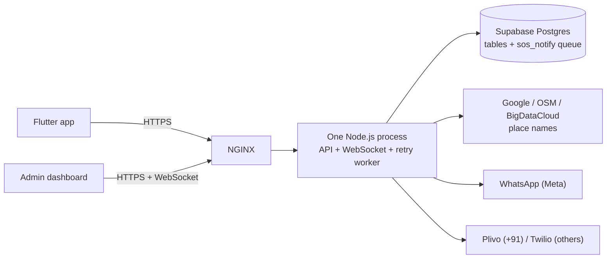
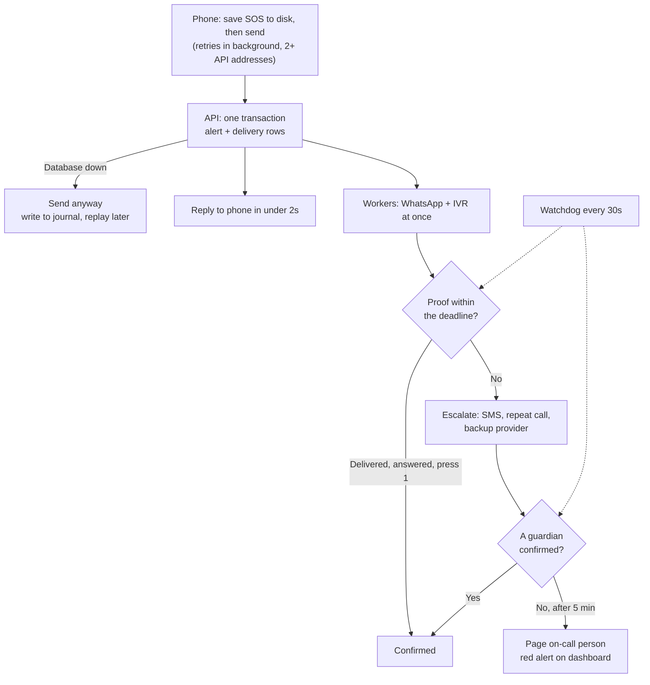
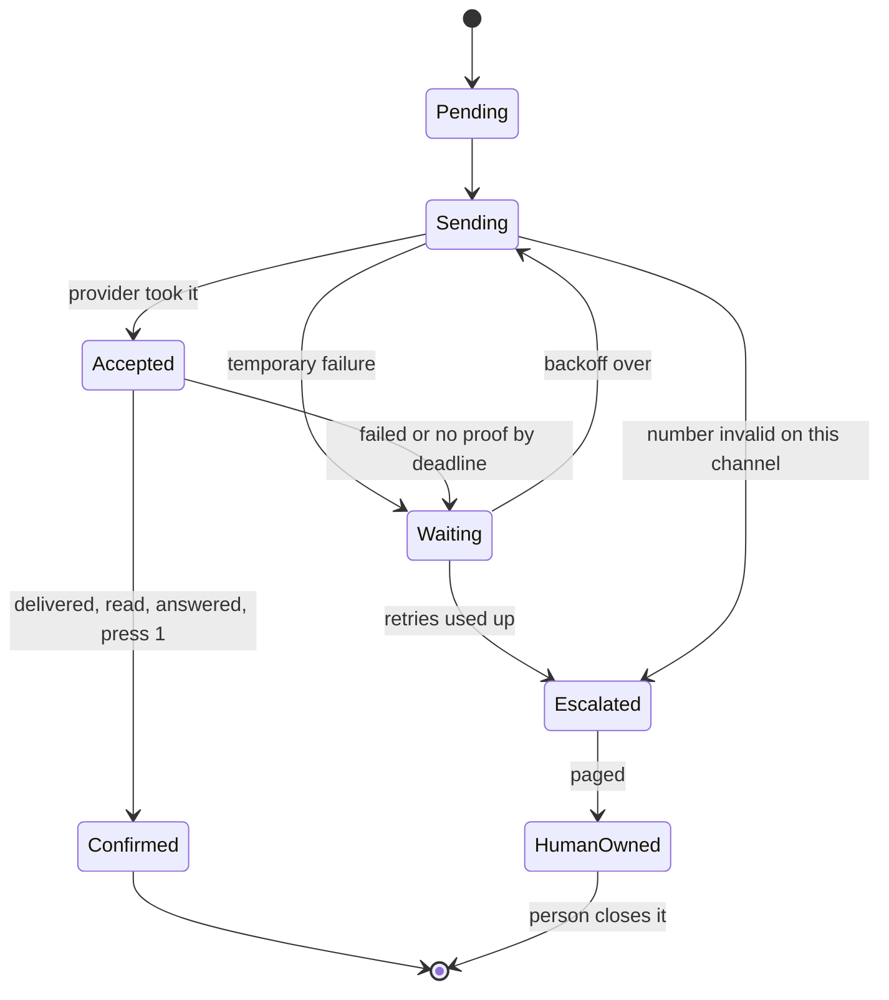

# DEVI: Performance, Scalability, Reliability and Security Analysis

**Goal:** host DEVI in 10+ countries, with a path to 100+, without losing a single SOS.
**Date:** 5 Nov 2026, status updated 10 Nov 2026. **Code checked:** commit `8c549fc`, then again at `980190f` for the fix status.

---

## 1. Summary

**DEVI is not ready for 10+ countries yet, mainly because SOS messages can still be lost.** The security base and the retry queue are good starting points. But today there are 13 ways an alert can fail to reach a guardian, and 4 of them are critical. Most fail silently.

The most urgent finding is a bug. Most WhatsApp errors are treated as "token expired" and are never retried, so the retry queue does not cover them.

**What matters most:**

1. **Fix the 4 critical message-loss paths first** (section 3). None needs new infrastructure. This is 1 to 2 weeks of work.
2. **Treat "sent" and "delivered" as different things.** Today a job is finished when Meta or the call provider accepts it, not when a guardian gets it.
3. **Build a delivery engine that never gives up silently** (section 7). Every alert ends either confirmed by a person or in front of a person.
4. **Then scale.** One server in one place is fine for today's testing. It is not fine for an emergency product.

**An honest limit:** no system can promise a message reaches a phone that is switched off. What we can promise is stronger and testable: **no alert is ever dropped silently.** This needs a person on call 24x7 at the end of the chain, which DEVI does not have today. That is a business decision (section 13).

### Scorecard (10 Nov 2026)

Out of 5, for where DEVI stands today against the goal at the top. "Before" is 5 Nov, when this report was written. Live tests on 10 Nov: health check, normal SOS, send marking (L3) and IVR signatures passed. WhatsApp delivery statuses (L4) did not arrive, because the Meta webhook is not subscribed to `messages` yet. The other live tests are still to run.

| Area | Before | Now | What holds it back | To reach 4 or more |
|---|---|---|---|---|
| SOS delivery (no silent loss) | 2 | **3.5** | L1 to L5 closed in code, but most of it is not yet tested live. No SMS (L7), the app stops retrying when closed (L9), one API address (L10), no person at the end of the chain (L11). | Pass the live tests, subscribe the webhook, then L9 and L13 in the app. SMS in the next phase. |
| Performance | 3 | **4** | The dashboard still runs in the SOS process. Evidence uploads sit in memory (P5, Phase 2). | Upload evidence straight to storage before Phase 2. |
| Scalability | 1.5 | **2** | One process on one shared VPS, state in memory (S1), a slow retry worker (S2), provider limits unknown (S3). | Stage A: containers, Redis, a separate worker, a load test. |
| Reliability and operations | 1.5 | **3** | Health check and monitor are in place, but no one is paged (no on-call person), the database is on the Free plan without backups (REL4), and development shares production (REL5). | Paid Supabase with backups, separate development, a second server. |
| Security | 3 | **3.5** | Signatures, token revoke, 2FA, retention, audit log and a spend cap are in code; most is not yet checked live. Shared secrets and database, the shared admin login still on, no account deletion or privacy text, no penetration test. | Live tests, separate development, `ADMIN_ENV_LOGIN=off`, deletion and privacy text. What is left is mostly business work, not code. |
| Country readiness | 1.5 | **1.5** | India time zone, English only, `+91` assumed, WhatsApp-only sign-in. | Section 9, per country. |
| **Overall** | **2** | **3** | Code is ahead of what has been checked live, and the business decisions in section 13 are still open. | Live tests, then the business items above. |

### Fix status (checked against code on 10 Nov 2026, commit `980190f`)

All 138 backend tests pass locally (10 Nov). **No real SOS test has been run on the live server since these fixes.** Check that `980190f` is deployed and that pm2 uses `backend/ecosystem.config.cjs`.

**Done in code (11):**

- **L1:** WhatsApp errors are classified by code. `OAuthException` means an expired token only with code `190`.
- **L6, REL7:** up to 15 retries over about 2 hours, with gaps of 1, 2, 5 and 10 minutes, varied by 20%.
- **L8:** the SOS route no longer refuses by IP. Over the IP limit, saved guardians are still sent to, and only unverified numbers wait.
- **P1, P2:** the alert is saved first, and the send waits at most 1 second for a place name.
- **`'Tamil Nadu'` fallback removed (section 9).**
- **REL3:** graceful shutdown (`src/utils/shutdown.js`). On a restart, sends in progress get up to 10 seconds to finish, and pm2's `kill_timeout` is 12 seconds.
- **REL6:** the worker catches errors in each pass and each job, and the process logs unhandled rejections instead of stopping.
- **From the senior's assessment:** the duplicate alert race (R7), and retry decisions use the saved status (P0-10, worker part).

**Done on 10 Nov 2026 (not deployed yet, 304 backend tests pass):**

- **P4:** `liveTrackSessions` (`src/services/live-sessions.js`) finds an SOS through an index, not by scanning every session. Sessions not touched for 24 hours are dropped, and at most 50,000 are kept. Every reader falls back to the database. A dropped session loses only the WhatsApp result shown on the dashboard.
- **L5, restart part:** an accepted call also leaves a "watch" job in the queue for about 5 minutes. The status webhook deletes it. If the webhook never arrives, for example because the server restarted and forgot the call, the watch job comes back. A guardian who pressed 1 is then left alone, and anyone else is redialled. This counts as a redial, so the 3-redial limit still applies.
- **Paging (L5, L7, L11 and part of REL2):** a new `pager.service.js` calls the on-call number (`ONCALL_PHONE`) and sends it a WhatsApp. It pages when retries give up, when nobody answers the redials, when a WhatsApp token, template or setting failure stops every alert, when no call provider can place a call, and when an SOS has no guardian and no control room number. An alert page forwards the SOS itself, with the name and map link. The same problem is paged at most once every 15 minutes. An alert page is skipped when the alert is resolved or a guardian pressed 1. **`ONCALL_PHONE` must be set in the live `.env`, or nothing is paged.**
  - Known limits: the page WhatsApp uses the SOS template, because no ops template is approved yet, so it reads "DEVI system: <problem> has triggered an emergency alert". Pages are kept in memory and are not retried after a restart. If WhatsApp and both call providers are down together, the page cannot get out either. This needs an outside pager such as PagerDuty (T11).

- **L5, press 1:** only press 1 confirms a call, and it stops calls to that guardian only. Every other guardian keeps being called. A call picked up without press 1, or by voicemail, is redialled like an unanswered one, up to the same 3-redial limit. A retry already queued for a guardian who then pressed 1 is dropped. Press 1 does not stop that guardian's WhatsApp retries, because the WhatsApp carries the map link. All guardians are called at once, so "next guardian" means paging, which is done above. **With this, L5 is done.**

- **L3:** the send plan (who gets the SOS, and which sends the limits stopped) is saved encrypted in the same insert as the alert, with `dispatch_started_at`. Once every send has its retry job queued, the alert gets `dispatched_at`. An ACTIVE alert with no `dispatched_at` 30 seconds after it was taken on was cut off by a crash, restart or error. A resumer (`src/services/sosDispatch.service.js`, every 15 seconds, and at once when the app sends the SOS again) takes it on with a conditional update, so only one server sends it, and sends the saved plan. A crash after some sends were queued sends those twice, never zero times. Alerts older than 2 hours are not resumed. **Run `backend/db/sos-dispatch.sql` in Supabase before deploying.** Until then SOS works as before, without this protection, and every SOS logs an error.

- **L2:** when saving the alert fails, the SOS is sent anyway from the request (`src/services/sosOffline.service.js`). It is kept in memory, so the app's retry is a duplicate, and written to an encrypted journal file on the server's disk (`src/services/sosJournal.js`, `SOS_JOURNAL_DIR`, default `backend/data/sos-journal`), with the result of each send. The app gets a normal 201 with `degraded: true`, and the on-call person is paged. For a logged-in user the numbers the app sent count as saved guardians, because the account cannot be read. Every 30 seconds, and at start, the journal is replayed. Each alert is saved under the id its messages already used, at its real time, and only the sends that did not get through are sent again, now with retry jobs. An alert closed during the outage is saved closed. One older than 2 hours is saved but not sent again.
  - Known limits: during the outage there is no retry queue, so a send that fails waits for the database. Press 1 and "I am safe" cannot be saved during the outage, and "I am safe" is lost if the server also restarts. The journal is per server and must survive a deploy, so do not delete `backend/data/`. Journal lines are encrypted with the field key, so a key rotation must keep the old key until the journal is empty.

- **L4:** a WhatsApp Meta accepted is watched like a call. The webhook now reads each status (sent, delivered, read, failed) and saves it by message id in `whatsapp_statuses` (`db/whatsapp-status.sql`, no phone number stored). Delivered or read ends it. Failed is sent again with the usual gaps, unless the number is not on WhatsApp, in which case the call still goes. A template failure also pages. A watch job (about 5 minutes) covers a restart by reading the saved status. "Sent" but never delivered means the phone is off, so it is left to the call. No status at all means the webhook is not reaching the server, so it pages instead of sending every WhatsApp again. **Run `backend/db/whatsapp-status.sql` in Supabase, and check that the Meta webhook is subscribed to `messages`.**
  - Known limits: the dashboard still shows "sent" from the first answer and does not yet show delivered or failed. Statuses for OTP messages are saved too, and the table needs a retention rule (S5).

- **REL1, REL2:** `GET /api/health/deep` (`src/services/health.service.js`) checks the database, the retry queue's backlog (`db/sos-health.sql`), that the retry worker is running, the L2 journal, the WhatsApp token, the Plivo balance, and the Twilio account (active, not trial, balance), plus whether `ONCALL_PHONE` is set. It answers 503 when a check fails, so an uptime monitor can alert on the status code. It needs the `X-Health-Key` header (`HEALTH_CHECK_KEY`) or an admin login, because it shows balances. A monitor runs it every 5 minutes and pages the on-call person for each failing check. The public `/api/health` stays shallow. **Run `backend/db/sos-health.sql` in Supabase.**
  - Not covered yet: WhatsApp template approval status (needs the WhatsApp Business Account id) and the messaging tier, which are checked by hand in Meta.

- **P3, S4:** the dashboard (`src/services/dashboard.service.js`) no longer loads whole tables. Lists are counted, filtered (status, IST dates, user) and paged by the database, and only the rows on the page and their users are decrypted. The home page numbers come from `dashboard_stats` (`db/dashboard.sql`), with no decryption. Without that function they are counted with separate queries. A detail page loads one record. Search has to read decrypted names, numbers and places, so it scans the newest 10,000 rows in batches of 1,000 and gives way to other requests between batches. A whole alert id is looked up directly. The 20,000-row cut-off is gone. **Run `backend/db/dashboard.sql` in Supabase** (function and indexes).
  - Known limits: search covers the newest 10,000 SOS and users, and says `searchLimited` when there are more (the web page does not show this yet). The dashboard still runs in the SOS process. Running it as a separate service is part of Stage A.

- **S5:** daily retention (`db/retention.sql`). Ended retry jobs and WhatsApp statuses go after 30 days, sign-in code rows after 7, and SOS send plans are cleared after 7. SOS history is kept until a legal period is set (`RETENTION_SOS_DAYS`). The health check warns when retention is missing or late. **Run `backend/db/retention.sql` in Supabase.**

**Partly done (2):**

- **L13:** the server part is covered by L3: a repeat press after a cut-off send now sends. Still open: the app forgets the active SOS after a restart (T13, app side).

- **L7:** still open: SMS. Planned for the next phase with MSG91. The committed code has no SMS today.

**Still open:** everything else. All 4 critical message-loss paths (L1 to L4) are now closed in code. See the tracker below.

### Status tracker

| Area | Done | Partly done | Open |
|---|---|---|---|
| Message loss (section 3) | L1, L2, L3, L4, L5, L6, L8 | L7 (SMS), L11 (paged, not staffed), L13 (app side) | L9, L10, L12 |
| Performance (section 4) | P1, P2, P3, P4 | | P5 |
| Scalability (section 5) | S4, S5 | | S1, S2, S3 |
| Reliability (section 6) | REL1, REL2, REL3, REL6, REL7 | | REL4, REL5 |
| Target design (section 7) | | | All building blocks |
| Country readiness (section 9) | `'Tamil Nadu'` fallback | | Time zone, language, `+91`, SMS OTP |
| Security (section 10) | Names in call URLs, token revoke, operator accounts with 2FA, audit log, daily spend cap | IVR signatures (log mode, verified live), shared admin login (until `ADMIN_ENV_LOGIN=off`), retention (SOS history kept until the legal period is decided) | Separate secrets and database, account deletion and privacy text, key service, pentest |

### How to read the evidence

Each finding says how we know it:

- **Code:** read directly in the source.
- **Tested:** run locally with fake providers and no database.
- **Notes:** from project notes up to 4 Nov 2026, not rechecked today.
- **Assumption:** a planning estimate, not a measurement.

**No load test has ever been run.** This report has no production traffic numbers, and capacity figures are calculated.

---

## 2. Current State

### How it works today

An SOS runs in this order (**Code**, `backend/src/routes/sos.routes.js`):

1. Look up the user and check for a duplicate.
2. Look up the place name, if not cached.
3. Save the alert in Supabase.
4. Tell the dashboard.
5. For each guardian, send WhatsApp and IVR, and save a retry job at the same time.

### What is already good

- **Retry queue:** jobs survive a server crash, and retries stop when the user is safe.
- **Idempotency:** a repeated SOS does not create a second alert.
- **Two call providers:** Plivo and Twilio back each other up.
- **Encryption is not a bottleneck:** about 92,000 encrypts and 147,000 decrypts per second on a development laptop (**Tested**).
- **Honest app behaviour:** the app tells the user when an alert did not get through, retries, and calls the first guardian if the server cannot be reached.
- **Clean queue boundary:** only `queue.service.js` knows where jobs are stored.
- **Phone numbers:** E.164 everywhere, so the data model is already international.
- **Security base:** OTP login, field encryption, row-level security, signed WhatsApp webhooks, private evidence and rate limits.

### Hosting today (**Notes**)

One process (`devi-backend`) under pm2 on a Hostinger VPS, shared with other apps. One API hostname. One Supabase project, shared by the development team and production. Twilio is on a Trial account, so its backup calls reach only verified numbers. Plivo is prepaid.

---

## 3. Where an SOS Can Be Lost Today

Ordered by severity. Each one below is a real path, not a theory.

### Critical

**L1. Most WhatsApp errors are never retried.**
- **What happens:** `classifyMetaError` checks `error.type === 'OAuthException'` first and returns `TOKEN_EXPIRED`. Meta's own error example uses that type. `TOKEN_EXPIRED` counts as permanent, so the retry job is deleted.
- **Proof (Tested):** with Meta's documented error shape, rate limit `130429`, pair limit `131056`, unknown error `131000` and not-on-WhatsApp `131026` all came back as `TOKEN_EXPIRED` with no retry. Not yet confirmed against a live Meta failure.
- **Effect:** in a rate limit or Meta incident, alerts are dropped at once. The app, dashboard and logs show the wrong reason. Only network errors and timeouts are really retried.
- **Fix:** check specific codes first. Treat `OAuthException` as a token problem only for code `190`.

**L2. If the database is down, the server sends nothing.**
- **What happens:** the user lookup and alert insert must succeed before any send (**Code**). The queue lives in the same database, so it fails at the same moment.
- **Effect:** in a Supabase outage, no server WhatsApp or IVR goes out. The app retries and calls one guardian. A guest with no guardian has nothing.
- **Fix:** if the database fails, send anyway from the request data and write the alert to a local journal, then replay it later. Section 7 adds a second durable store.

**L3. A crash at the wrong moment silently cancels an alert.**
- **What happens:** the alert is saved first, and the retry job is created later. If the server dies between them, the alert exists with no job. The app retries with the same key, the server finds the alert, answers "duplicate" and skips sending (**Code**, step 1 of `/sos/trigger`).
- **Effect:** the app reports success and guardians get nothing.
- **Fix:** save the alert and its delivery rows in one database transaction. On a duplicate, finish unfinished sends instead of skipping.

**L4. "Accepted" is treated as "delivered".**
- **What happens:** the job is deleted when Meta accepts the message. The webhook logs delivery statuses and throws them away, so a later `failed` is ignored (**Code**, `server.js`).
- **Effect:** a message Meta accepts but cannot deliver is lost with no retry, and the dashboard shows it as sent.
- **Fix:** record webhook statuses against each send and act on them.

### High

**L5. An unanswered call is the end of the story.**
A busy, unanswered or voicemail call counts as success, because the provider accepted it (**Code**). Plivo's hangup status is only logged, and Twilio has no status callback at all. The press-1 result is saved but drives nothing.
**Fix:** use call status and press 1 to retry and move to the next guardian.

**L6. The system gives up after about 6 minutes, and only tells a log file.**
Retries are fixed at 60 seconds, 5 times (**Code**). A Meta or Plivo incident longer than that exhausts every job. The `GAVE UP` line goes to a log nobody watches.
**Fix:** retry for much longer with growing gaps, and page a person.

**L7. There is no third channel.**
The code has no server SMS (**Code**). If both WhatsApp and calls fail, for example with an expired token and an empty balance, nothing else is tried. Token and template failures also delete the job, though a person could fix them in minutes.
**Fix:** add SMS, and keep jobs alive for fixable failures.

**L8. The SOS rate limit can refuse a real emergency.**
`/sos/trigger` allows 10 calls a minute per IP (**Code**). Mobile networks put many users behind one IP, and the app's own retries count too. A busy event or disaster in one city is exactly when this fires.
**Fix:** limit by device or account. Never limit by IP alone on this route.

**L9. The app's retry stops when the app closes.**
The retry loop and its key live in memory and need the screen alive (**Code**, `sos_screen.dart`). If the phone kills the app, or the user closes it, an undelivered SOS stops trying.
**Fix:** save pending alerts to disk and retry from a background worker.

**L10. One server, one hostname.**
A VPS failure, bad deploy or DNS problem stops all alerts. The app knows only one API address (**Code**).
**Fix:** several instances, and a second API address built into the app.

**L11. An SOS with no guardian may reach nobody.**
With no guardian and no `ADMIN_WHATSAPP`, only the dashboard is told, and it is a view-only panel with no one on duty (**Code**, **Notes**).
**Fix:** require a guardian, or staff a control room (section 13).

### Medium

**L12. Limits we chose can block a real alert.**
Unverified numbers get 3 alerts an hour, and guests cannot alert foreign numbers (**Code**). These stop paid abuse, and the app is told. But each is still a guardian not reached.
**Fix:** verify guardians with a one-time confirmation, so real ones have no limit.

**L13. After an app restart, the active SOS is forgotten.**
In normal use a second press cannot happen: the button stays "I Am Safe". But active SOS state lives in memory, so after the app is killed the user loses "I Am Safe", and a new press within 15 minutes is treated as a duplicate and sends nothing (**Code**).
**Fix:** save the active alert and control token on the phone (with T13), and let a repeat press after a restart send to anyone not yet confirmed.

---

## 4. Performance

**P1. Place-name lookup delays the emergency.**
The app always sends a Maps link, so an uncached SOS looks up a place name before saving or sending. Three services are tried in turn, for up to 10.5 seconds (3.5 + 4 + 3) (**Code**).
**Fix:** send first and look up the place name afterwards. The WhatsApp link uses coordinates anyway. The first IVR call can use the name if it arrives within about a second.

**P2. A slow SOS can outlast the app's timeout.**
In the worst case, place lookup (10.5s) plus the WhatsApp wait (5s) is over 15.5 seconds, but the app waits only 12 (**Code**). The app then reports failure while the server is still sending.
**Fix:** answer the app as soon as the alert is safely stored. The target is under 2 seconds. P1 removes most of the wait.

**P3. The dashboard can freeze SOS handling.**
Each dashboard request loads whole tables and decrypts every row, in the same process that handles SOS (**Code**). At 20,000 rows per table that is about 180,000 decrypts, or about 1.2 seconds of blocked server on a laptop (**Tested** speed, calculated total). Every new SOS makes open dashboards refresh, so load peaks during an incident.
**Fix:** run the dashboard API separately, with database paging and summary tables.

**P4. Memory grows without limit.**
`liveTrackSessions` and the geocode cache are never cleaned (**Code**). Each SOS scans all sessions, so it slows down over time.
**Fix:** look up by key, and expire old entries. This is also needed before running several instances.

**P5. Evidence uploads sit in server memory (Phase 2).**
Each upload holds up to 60 MB in RAM (**Code**). A few at once could crash the SOS server.
**Fix:** upload directly from the phone to storage before Phase 2 goes live.

---

## 5. Scalability

**S1. The app cannot run as two instances yet.**
These live in one process's memory (**Code**), so a second instance would break or weaken them:
- Rate limit counters and the per-number recipient limit.
- The foreign OTP daily count.
- WebSocket rooms, so dashboards on another instance miss alerts.
- Open alert sessions, including WhatsApp results shown on the dashboard.

**Fix:** move these to Redis.

**S2. The retry worker is slow by design.**
It handles 10 jobs every 15 seconds, one at a time, so at most 40 jobs a minute. In an outage with 5-second timeouts, one pass takes about 50 seconds, so about 10 jobs a minute. For scale, 100 alerts with 3 guardians make 600 jobs (2 channels each): 15 to 60 minutes to clear (calculated).
**Fix:** a separate worker process with concurrent sends per provider.

**S3. Provider limits will hit before server limits.**
- **WhatsApp daily limit:** a new business portfolio can message 250 unique users in 24 hours, shared across its numbers. It rises through 2,000, 10,000 and 100,000 to unlimited. OTP messages count too. **Our tier is unknown, so check it first.**
- **WhatsApp speed:** 80 messages a second per number by default. This is fine for now.
- **Twilio calls:** 1 call a second by default, and extra calls wait in a queue. 300 calls would take 5 minutes. Twilio pages disagree on the self-serve limit (5 or 30), so check the console.
- **Plivo:** limits not confirmed. Check with Plivo.

**S4. Dashboard data stops at 20,000 rows.**
`fetchAll` cuts off silently, so totals become wrong with no warning (**Code**).
**Fix:** same as P3.

**S5. The queue archive grows forever.**
No code cleans `a_sos_notify` (**Code**).
**Fix:** a retention rule, which is also a legal need.
*Done on 10 Nov 2026: `db/retention.sql` plus `src/services/retention.service.js`, once a day in batches. By default ended retry jobs and WhatsApp statuses are kept 30 days, sign-in code rows 7, and SOS send plans (guardian numbers) are cleared after 7. SOS history itself is kept until `RETENTION_SOS_DAYS` is set, because that period is a legal decision. Evidence files in Cloudinary and pm2 log files are not covered: use a Cloudinary rule and `pm2-logrotate`.*

---

## 6. Reliability and Operations

**REL1. No monitoring.** Failures live only in pm2 logs. The health check does not test the database, queue or providers (**Code**).

**REL2. Silent provider failure.** Nothing watches Plivo balance, Twilio status, WhatsApp token validity or template status (**Code**). Any of these can end alerts for all users.

**REL3. Deploys interrupt alerts.** There is no graceful shutdown (**Code**). A restart cuts sends in progress. Other apps also share this box and pm2, so they compete for its resources (**Notes**).

**REL4. Backups are unconfirmed.** Our Supabase plan is not known. Free has no automatic backups and pauses after a week idle. Pro keeps 7 days of daily backups, and Point-in-Time Recovery is a paid add-on.

**REL5. Development and production share a database (Notes).** One mistake or test can damage real alerts. A full data wipe has already happened twice in testing, which is fine now but not after launch.

**REL6. Worker errors are not caught.** `startWorker` has no `catch` and the process has no rejection handler (**Code**). An unexpected error would stop the process. I did not find a realistic trigger today, but this is cheap to close.

**REL7. Retries all fire together.** A fixed 60 seconds with no randomness means a recovering provider gets every retry at once.

---

## 7. Target Design: No Silent Loss

### The rules

1. **Store before anything else, in one transaction.** The alert and one delivery row per guardian per channel commit together.
2. **Send never depends on one system.** If the database fails, send anyway and journal it.
3. **Accepted is not done.** A delivery is finished only by proof: delivered, read, answered, or press 1.
4. **Every alert has a deadline.** A watchdog checks for unfinished ones.
5. **Giving up means telling a person.** There is no silent end state.
6. **Sending twice is acceptable. Sending zero times is not.**
7. **Only three things stop an alert:** a guardian confirms, the user says they are safe, or a person closes it.

### Delivery flow

### State of each delivery

### Proposed escalation timeline

These timings are proposals, for the product team to confirm.

- **0 seconds:** WhatsApp and a voice call to all guardians.
- **60 seconds:** SMS to anyone with no delivery proof. Failed calls go to the backup provider.
- **2 minutes:** call again anyone with no answer.
- **5 minutes, no guardian confirmed:** page the on-call person and raise a red alert.
- **Until closed:** keep trying with growing gaps (1, 2, 5, 10 minutes), up to a set limit such as 2 hours, while the person handles it.

### The building blocks

**Delivery table (outbox).** A new `sos_deliveries` table holds one row per guardian and channel, with state, attempts, next try, provider, provider message ID and deadline. It replaces "is there a job left?" with a full record of each alert. Keep it in Postgres so it commits with the alert, which is the key advantage of a database queue.

**Provider status webhooks.** Match Meta statuses and Plivo and Twilio call statuses to delivery rows by message ID. Verify all signatures, which also closes a pending security item.

**Separate workers.** They run apart from the API, use `FOR UPDATE SKIP LOCKED` or pgmq to share work, and apply per-provider speed limits and circuit breakers.

**Watchdog.** It runs separately and alarms if it stops running itself.

**Emergency journal.** For L2. Start with a local disk journal on each instance. At Phase 2 use a managed queue on another provider, such as Amazon SQS, so a Supabase outage has a durable place to write.

**Device outbox.** The phone saves the SOS before sending and retries in the background with Android WorkManager, including after a restart. It keeps the direct phone call. Sending SMS directly from the phone would need a restricted Play permission, so check Google's policy first. Opening the SMS app with the text filled in is the safe option.

---

## 8. Scaling Path

### Why region count is not the first problem

For one SOS, network distance adds a fraction of a second. Provider sends take seconds. So **10+ countries do not need servers in 10+ countries**, unless a country's law says so. Reliability in one well-run region matters far more.

### Stage A: up to about 10 to 15 countries

- **Region:** one main cloud region across 2 or more availability zones.
- **API:** at least 3 stateless containers behind a load balancer, on a managed service such as AWS ECS or Google Cloud Run. Move away from the shared VPS.
- **Workers:** a separate service, at least 2 instances.
- **Dashboard API:** separate from the SOS API.
- **Redis:** managed, for shared limits and WebSocket messages. This matches the earlier decision to add Redis at 2+ servers.
- **Database:** Supabase on a paid plan with Point-in-Time Recovery, sized by load tests. Separate development and production.
- **Queue:** keep Postgres (`sos_deliveries` plus pgmq). Kafka is not needed.
- **Edge:** CDN and DDoS protection in front of the API.
- **Standby:** a tested restore procedure into a second region.

### Stage B: about 15 to 50 countries

- **Warm standby region** with a database replica and a practised failover.
- **Country configuration in the database,** not code: provider order, template, voice, language, time zone, limits, legal notes.
- **Second WhatsApp route** through a Business Solution Provider, plus two SMS vendors.
- **Regional data storage** where law requires it.

### Stage C: 100+ countries

- **Regional cells.** Separate full stacks, for example India, EU, Americas, Middle East and Asia-Pacific. An outage in one cell does not touch the others, and data stays in its legal zone.
- **Thin global router.** Sends each user to their cell and holds no personal data.
- **Managed event stream.** Consider Kafka or similar here, when volume across cells needs it. Move through `queue.service.js`, keeping the outbox.
- **Local providers.** No single vendor is best everywhere. Build a per-country routing table with automatic health-based switching.
- **Round-the-clock operations.** Regional on-call and a country launch checklist.

---

## 9. Country Readiness

**Hardcoded for India today (Code):**

- **Time:** WhatsApp alert time is always `Asia/Kolkata`. A guardian in Dubai would see the wrong time in an emergency. The dashboard is the same.
- **Location bug:** the geocoder falls back to `'Tamil Nadu'` when a region is missing, so a foreign SOS could name the wrong place. Remove this now.
- **Language:** WhatsApp is `en_US`, voice is `en-IN`, and the app has no translations. A guardian who does not read English may not understand an emergency.
- **Numbers:** `+91` is assumed for 10-digit numbers in some paths.
- **WhatsApp-only OTP:** a user without WhatsApp cannot sign up. WhatsApp is weak or blocked in some markets, so SMS OTP is needed.

**Needed per country before launch:**

- Delivery tested on real local numbers, on all channels.
- Sender rules met (India DLT, US 10DLC, and others).
- Approved WhatsApp templates in the local language.
- Local voice and SMS text.
- Costs known, with a spend alert.
- Legal review, with terms and privacy text.
- An honest statement of what DEVI is. It is not an emergency service.

Add a country only when its checklist passes. `ALLOWED_COUNTRIES` already supports this.

---

## 10. Security

*Status as of 10 Nov 2026. "Live" means checked on the production server that day, "Code" means done and unit tested but not yet checked live.*

### In place

| Control | Status | Notes |
|---|---|---|
| OTP sign-in on WhatsApp, codes stored only as keyed hashes | Live | Before 10 Nov |
| Field encryption (AES-GCM, bound to the row), key rotation (`rotate:key`) | Live | Before 10 Nov. `admin_users.totp_secret` added to the rotation list. |
| Row-level security, backend-only tables | Live | Before 10 Nov. New tables (`whatsapp_statuses`, `admin_users`) have RLS on and public roles revoked. |
| Meta webhook signatures (`WHATSAPP_APP_SECRET`) | Live | Before 10 Nov |
| Private evidence, per-alert control and view tokens | Live | Before 10 Nov |
| Rate limits on OTP, admin login and SOS (SOS never refused) | Live | L8 |
| **IVR webhook signatures** (Plivo V3, Twilio) | Live, in log mode | `src/middlewares/ivrSignature.js`. Verified on real calls on 10 Nov. Switch to `IVR_SIGNATURE_MODE=enforce`. |
| **No name, place or number in call URLs** | Live | One encrypted, alert-bound, 1-hour call token (`t=`). The call spoke the right name and place on 10 Nov. Works while the database is down. |
| **Token revoke for app users** | Code | `users.token_version`. Sign out everywhere by the user (`POST /api/auth/logout-all`) or from the dashboard. A signed-out token still sends an SOS, as a guest. |
| **Operator admin accounts with 2FA** | Code | `npm run admin:user`, password plus TOTP code, each code once, disable/reset/sign out everywhere. |
| Shared .env admin login (no 2FA) | Still on | Turn off with `ADMIN_ENV_LOGIN=off` once every operator has an account. The username is still `admin`. |
| **Deep health check behind a key** | Live | `HEALTH_CHECK_KEY`. Shows balances, so it is not public. The key was shared in a chat on 10 Nov: replace it before launch. |
| **Retention** | Code | `db/retention.sql`, daily. SOS history is kept until a legal period is set (`RETENTION_SOS_DAYS`). Evidence in Cloudinary and pm2 logs are not covered. |
| **Admin audit log** | Code | `db/audit.sql`, `src/services/audit.service.js`. Sign in and failed sign in, opening an SOS, its location or evidence, opening a user, searches, exports, resolve, notes, signing a user out. Ids only, never a number, name, place or search text. Each line is also in the server log. Read it in the SQL Editor. |
| **Daily cap on SOS to unverified numbers** | Code | `SOS_UNVERIFIED_DAILY_CAP`, default `IN:1000,*:100` per IST day. Saved guardians are never capped. Reaching it pages and shows in the health check. In memory per server until Redis (S1). |
| **Tests cannot reach real services** | Code | `test/setup.js` (run by `npm test`) points Supabase at a dead local address and blanks every provider key, whatever the local `.env` says. On 10 Nov the local `.env` pointed at the production project. |

### Open, required before launch

| Item | Why it matters | Who decides |
|---|---|---|
| Separate development and production (database and secrets) | The team shares the production `.env` and database (REL5). One mistake or a leaked laptop exposes real alerts. | Team, with a new Supabase project |
| Supabase paid plan and backups | The project is on the Free plan: no automatic backups, and it pauses when idle (REL4). | Business |
| Support contact, account deletion, privacy policy | Not in the app or backend today. Play Store and DPDP require them. | Business, then code |
| An honest statement of what DEVI is | No one monitors SOS today (no on-call person, decision 13.1). The app must say that guardians are alerted, that DEVI is not an emergency service, and to call 112. | Business, then app text |
| Guardian consent | Guardians are third parties whose numbers we store. Guardian verification solves this and L12 together. | Business, then code |
| Penetration test and incident response plan | Independent test before launch, and a plan with breach notification times. | Business |
| Live provider accounts | Twilio and Plivo are trial accounts. New auth tokens change the IVR signatures, so test again in log mode first. | Business |

### Later, for multi-country

- **Privacy law.** GDPR (EU), DPDP (India), LGPD (Brazil) and others apply differently. Get legal advice for each market.
- **Data location.** Some countries restrict moving personal data abroad. This decides which cells are needed. Location data sent through Meta, Plivo and Twilio needs data processing agreements.
- **Key management.** Move `ENCRYPTION_KEY` from `.env` to a key service, with a key per region at Stage C.
- **Evidence recording (Phase 2).** Recording laws differ by country. Review before enabling outside India.

---

## 11. Roadmap

Durations are rough, assuming 2 engineers (**Assumption**).

### Phase 0: Stop the known losses (1 to 2 weeks)

No new infrastructure. **Do this before opening any new country.**

Status as of 10 Nov 2026:

- [x] Fix WhatsApp error classification (L1), with tests using Meta's documented error shapes. A check against a live Meta failure is still pending.
- [x] Keep jobs alive for token, template and balance failures, and page someone (L7). *Paging is done in code. Set `ONCALL_PHONE` on the live server.*
- [x] On a duplicate SOS, finish unfinished sends (L3, L13). *Saved send plan plus a resumer. Needs `db/sos-dispatch.sql`. L13's app part is still open.*
- [x] Send even if the database fails, with a local journal (L2).
- [x] Move place lookup after the send (P1, P2). Remove `'Tamil Nadu'`.
- [x] Remove the IP-only SOS limit (L8).
- [x] Longer retries with growing gaps and randomness (L6, REL7).
- [x] Alerts for `GAVE UP`, queue depth, balances and token health (REL1, REL2).
- [x] Deep health check, graceful shutdown, worker error handling (REL1, REL3, REL6).
- [ ] Upgrade Twilio, confirm the Supabase plan and backups, and check the WhatsApp tier.
- [ ] Separate development and production (REL5).
- [x] Call status drives retries and escalation (L5). *Redial, provider switch, restart-safe watch jobs, press 1 per guardian and paging.*
- [ ] Real SOS test on the live server, after deploying `980190f`.

**Done when:** a test kills the server mid-SOS, and the database for a few minutes, and every test alert still reaches a guardian.

### Phase 1: Foolproof delivery (4 to 6 weeks)

- [ ] `sos_deliveries` outbox with one-transaction writes.
- [ ] WhatsApp and call status webhooks, with signature checks.
- [ ] Escalation timeline and watchdog.
- [ ] SMS channel with a backup vendor.
- [ ] Device outbox with background retry and a second API address.
- [ ] Dashboard shows true state per guardian, plus an escalation view.
- [ ] Decide and staff the on-call person.

**Done when:** every alert in a test run ends confirmed or with a person, with no exceptions.

### Phase 2: Infrastructure for 10+ countries (4 to 6 weeks, can overlap)

- [ ] Containers across availability zones, separate workers and dashboard API.
- [ ] Redis for shared state.
- [ ] Monitoring, dashboards and on-call rota.
- [ ] Load, failure and recovery tests (section 12).
- [ ] Country configuration, translations, per-country time.
- [ ] Legal review, audit log, admin accounts, token revoke, spend caps.
- [ ] Penetration test.

**Done when:** targets in section 12 are met under test, and the first country's checklist passes.

### Phase 3: Beyond 15 countries

Warm standby region, second WhatsApp route, regional storage where needed.

### Phase 4: 100+ countries

Regional cells, global router, local provider routing, regional operations.

---

## 12. Proving It Works

### Proposed targets

These are proposals to agree on, not current numbers.

- **API accepts SOS:** 99.99% of the time, under 2 seconds.
- **First send attempt:** within 5 seconds.
- **Alerts lost silently:** zero. This is the one number that must never move.
- **Alert with no proof reaches a person:** within 5 minutes.
- **Data lost on failure:** none for accepted alerts.
- **Recovery after a regional failure:** under 15 minutes (Stage B).

### Tests to run

- **Load test:** real SOS flow with fake providers, in a production-like setup. Find the breaking point, then plan for a burst of several times normal peak, such as a disaster in one city.
- **Failure tests:** kill the server mid-send, stop the database, make each provider time out or return every error, expire a token, drain a balance. Each is run before launch, then repeated.
- **Canary SOS:** a real test alert to test numbers in every live country, every few minutes, on every channel. A failure pages someone. This is the best way to find a broken provider or template before a user does.
- **Provider tests:** check real responses to confirm error handling, starting with L1.
- **Reconciliation:** a daily count showing alerts created equals alerts confirmed plus alerts handled by a person.

---

## 13. Decisions Needed

1. **Who is the person at the end of the chain?** A 24x7 control room, a partner helpline, or something else? Without this, "foolproof" cannot be met. It affects cost, law and what we promise users.
2. **Which countries first?** This drives providers, law, languages and regions. This report assumes they are not yet chosen.
3. **How long should we keep alerting,** and when should the user or guardian stop it?
4. **Are guardians required, and must they confirm?** This affects L11, L12 and consent, but it adds a step before someone can use DEVI.
5. **What is the budget for standby capacity,** and the monthly spend cap per country? Cost estimates need the country list first.
6. **How much traffic do we expect?** Users per country and expected peak will size everything in Stage A.

---

## 14. Sources

- Meta: [Error codes](https://developers.facebook.com/documentation/business-messaging/whatsapp/support/error-codes), [Messaging limits](https://developers.facebook.com/documentation/business-messaging/whatsapp/messaging-limits), [Throughput](https://developers.facebook.com/documentation/business-messaging/whatsapp/throughput/)
- Supabase: [Backups](https://supabase.com/docs/guides/platform/backups), [Point-in-Time Recovery](https://supabase.com/docs/guides/platform/manage-your-usage/point-in-time-recovery), [Pricing](https://supabase.com/pricing), [Compute and disk](https://supabase.com/docs/guides/platform/compute-and-disk)
- Twilio: [Call resource](https://www.twilio.com/docs/voice/api/call-resource), [How fast can I place calls](https://support.twilio.com/hc/en-us/articles/223180028-How-Fast-Can-I-Place-or-Receive-Phone-Calls-with-Twilio)
- Local tests were run on 5 Nov 2026 with fake providers. They used no live database, and sent no real messages or calls.
