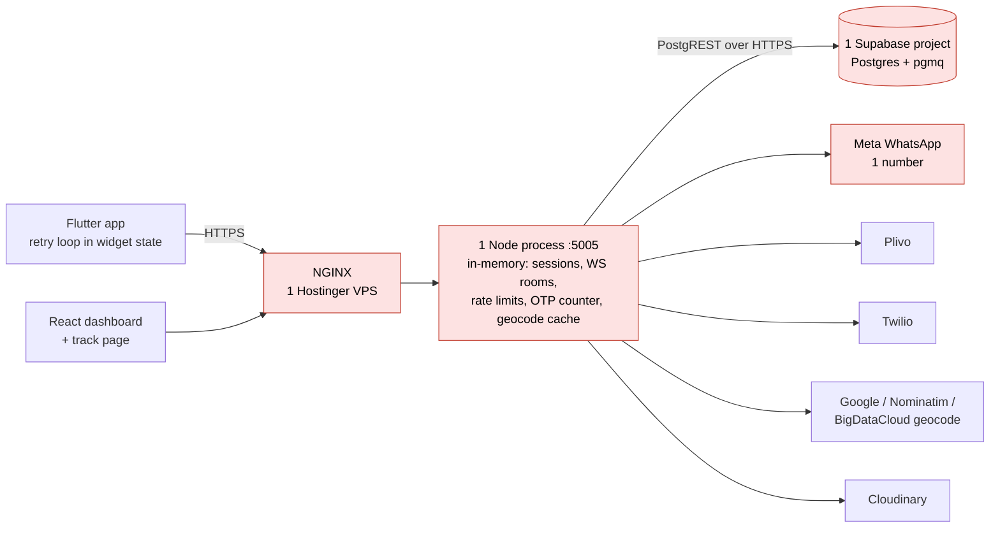
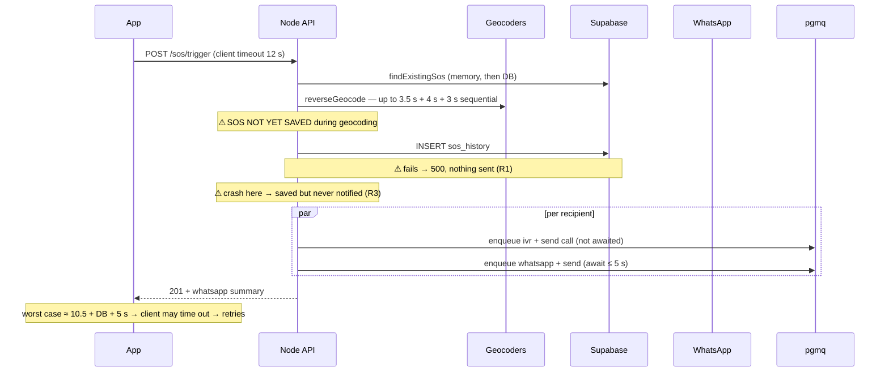
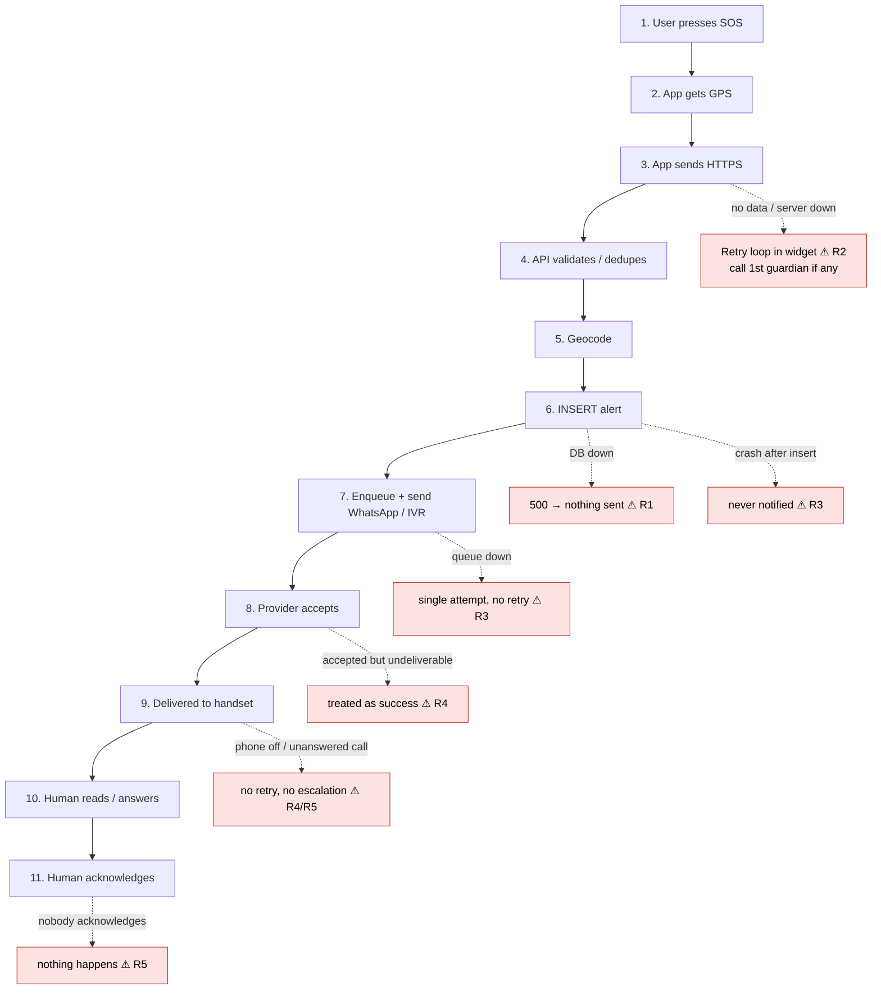
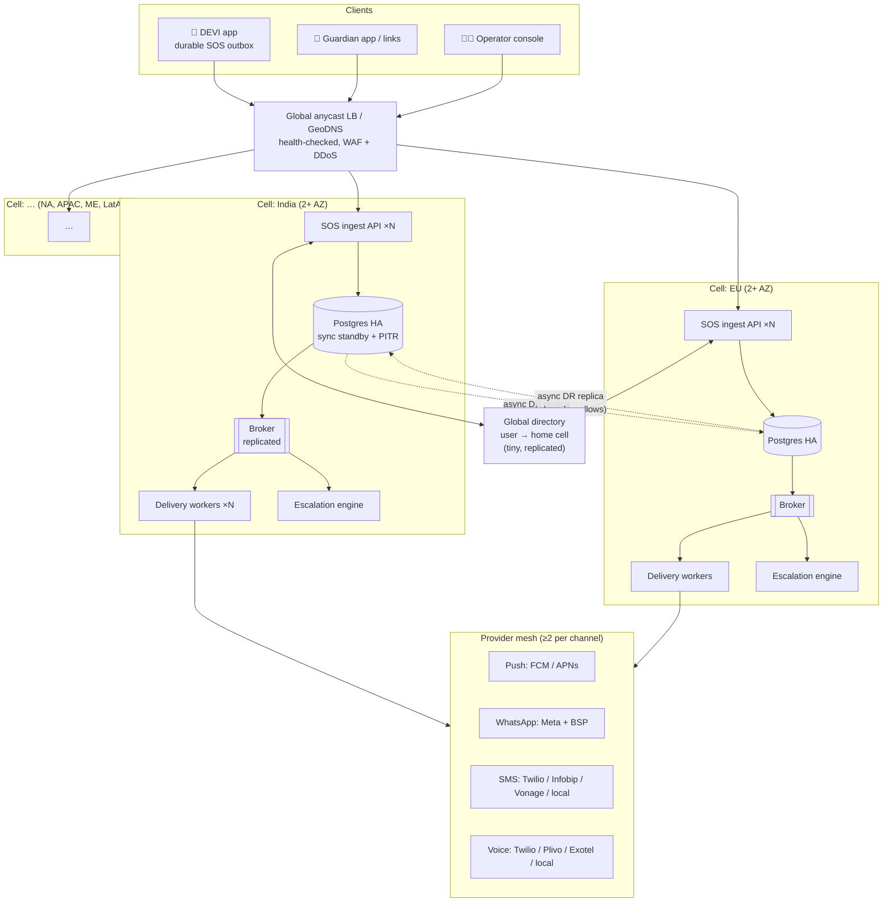
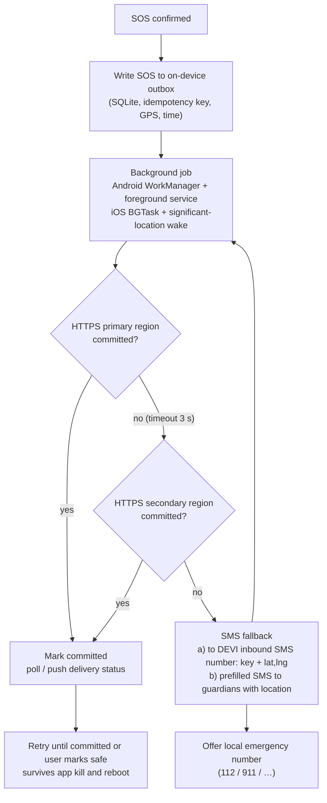
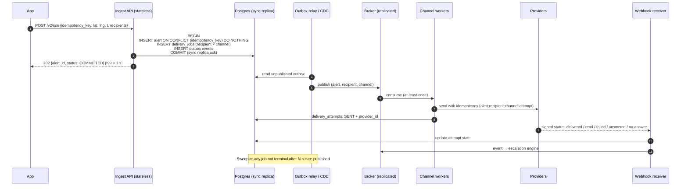
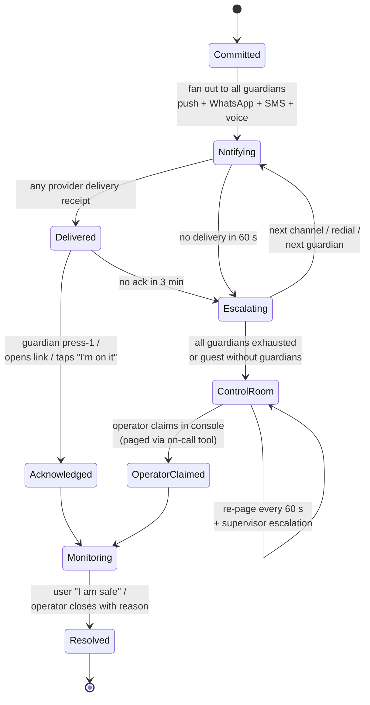
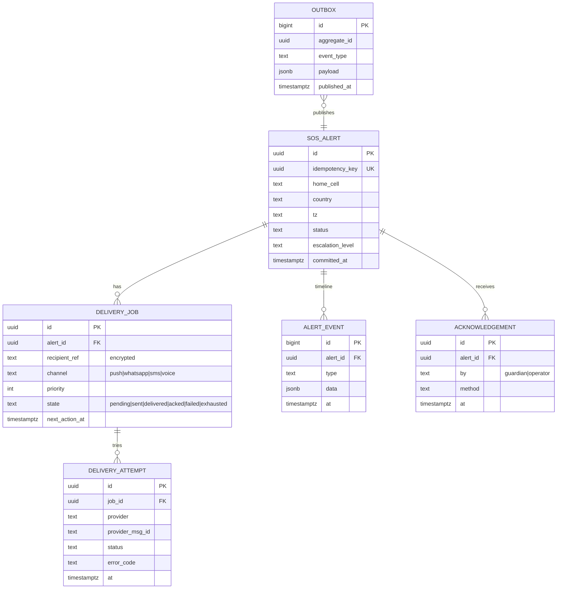
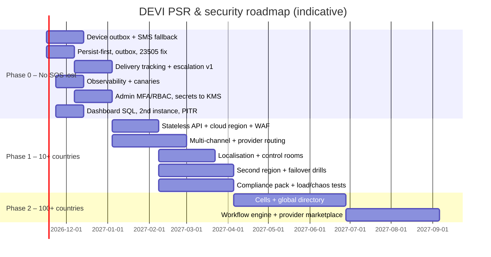
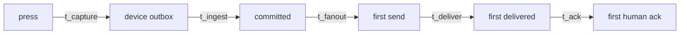

# DEVI – Performance, Scalability, Reliability (PSR) & Security Assessment

**Goal:** expand DEVI from India to 10+ countries, and design the path to 100+ countries,
with **zero tolerance for a lost SOS**.

**Basis:** the source code in this repository as of 2026-11-04 (`backend/`, `frontend/`, `web/`, `deploy/`, `backend/db/`).
File references are given as `path:line` so every finding can be checked.
Companion document: [DEVI_ARCHITECTURE_ANALYSIS.md](DEVI_ARCHITECTURE_ANALYSIS.md).

---

## Contents

1. [Executive summary](#1-executive-summary)
2. [What "no SOS is ever lost" must mean](#2-what-no-sos-is-ever-lost-must-mean)
3. [Current state](#3-current-state)
4. [SOS loss analysis: every place an SOS can be lost today](#4-sos-loss-analysis)
5. [Performance](#5-performance)
6. [Scalability](#6-scalability)
7. [Reliability & availability](#7-reliability--availability)
8. [Security](#8-security)
9. [Going multi-country: 10+ and 100+](#9-going-multi-country)
10. [Target architecture](#10-target-architecture)
11. [Recommendations & roadmap](#11-recommendations--roadmap)
12. [SLOs, observability & verification](#12-slos-observability--verification)
13. [Capacity planning](#13-capacity-planning)
14. [Appendix: findings index](#14-appendix-findings-index)

---

## 1. Executive summary

DEVI's current code is **well built for a single-country pilot**. It already has idempotent SOS
triggers, a retry queue, a fallback between voice providers, strong field-level encryption, and careful cost
and abuse limits. The architecture is still a **single server talking to a single database in one region,
with important state held in memory**, and its delivery guarantee ends at "the provider accepted the
request", not "a human received it".

**Verdict:** not ready for 10+ countries, and not "foolproof" even for India today.
The gaps can be fixed in stages without a rewrite.

### Top 10 risks (ranked by impact on "never lose an SOS")

| # | Risk | Where | Severity |
|---|---|---|---|
| R1 | **An SOS that fails to save to the database is never sent anywhere by the server.** Supabase down or slow → HTTP 500 → no WhatsApp, no call. A guest with no guardians gets nothing at all. | `sos.routes.js:101`, `sos.service.js:139-175` | 🔴 Critical |
| R2 | **The app's retry loop dies with the screen.** The idempotency key and retry loop live in `SosScreen` widget state; leaving the screen, the OS killing the app, or a reboot stops delivery for good. | `sos_screen.dart:386, 556-600` | 🔴 Critical |
| R3 | **No transactional outbox.** The alert is saved, *then* notifications are queued. If the process crashes between the two, the alert sits in the DB and nobody is notified. If queueing fails, the send goes out once with no retry. | `sos.routes.js:101-180`, `sosNotify.service.js:51-60` | 🔴 Critical |
| R4 | **"Sent" means the provider accepted it, not that it was delivered.** WhatsApp delivery or failure webhooks are logged and discarded. A message Meta accepts but cannot deliver is never retried. A voice call counts as successful once *placed*, even if unanswered or busy. | `server.js:83-99`, `sosNotify.service.js:94-120`, `ivr.service.js` | 🔴 Critical |
| R5 | **No escalation.** If no guardian acknowledges (press 1), nothing happens: no next guardian, no control room, no operator alarm. | `ivr.routes.js`, no escalation code | 🔴 Critical |
| R6 | **Single point of failure everywhere:** one Node process on one Hostinger VPS, one Supabase project and region, one WhatsApp number, one Meta app. | `deploy/`, `.env.example` | 🔴 Critical |
| R7 | **Probable duplicate-alert bug:** a race on the same idempotency key raises a unique-violation error whose message contains `idempotency_key`. The "schema fallback" then *removes the key and inserts again*, creating a second alert and a second round of WhatsApp messages and calls. | `sos.service.js:154-160` | 🟠 High |
| R8 | **The dashboard loads entire tables into memory on every request and silently stops at 20,000 rows.** Past 20k alerts, incidents disappear from the dashboard. | `dashboard.service.js:8-24, 57-62` | 🟠 High |
| R9 | **India is hard-coded:** `Asia/Kolkata` times in WhatsApp messages, history and dashboard; `+91` assumed for 10-digit numbers; `en_US` template and `en-IN` voice only. | `whatsapp.service.js:51-56`, `ivr.service.js:66-73`, `phone.js:7`, `dashboard.service.js:26` | 🟠 High (multi-country blocker) |
| R10 | **No observability.** Console logs only: no metrics, no alerting, no tracing. A silent delivery failure is noticed only if a user complains. | whole backend | 🟠 High |

### What "foolproof" looks like (target in one line)

> Write the SOS durably on the phone **and** in a replicated server log *before* anything else happens.
> Deliver it over several channels and providers. Track each recipient until a **human confirms**, and
> escalate automatically to the next guardian, then the control room, then a human operator whenever confirmation does not arrive in time.
> Every step is measured and alarmed.

---

## 2. What "no SOS is ever lost" must mean

No system is literally infallible: a phone with no battery, no signal and no SIM cannot send anything.
The engineering target therefore has to be stated precisely, so it can be tested.

**DEVI delivery guarantee (proposed contract):**

1. **Capture:** the moment SOS is confirmed, the alert is written to durable storage *on the device* before any network call.
2. **Ingestion:** the device keeps trying every available path (HTTPS to any region, then SMS) until the server confirms the alert is *durably committed* (replicated). There is no time limit while the alert is active.
3. **Durability:** once committed, the alert survives the loss of any single server, availability zone, provider, or region (**RPO = 0** for committed alerts).
4. **Delivery:** each recipient is tracked through `queued → sent → delivered → acknowledged`. Every recipient-channel pair stays in a retry and escalation loop until a terminal state.
5. **Human closure:** an alert is never "done" until a human acknowledges it (guardian press-1, guardian link opened, operator claim) or the user marks herself safe. Otherwise it **escalates** to the control room and an on-call operator.
6. **Honesty to the user:** the app always shows the true state (saving / delivered / acknowledged by X / not reached) and offers the local emergency number.

### Proposed SLOs

| SLI | Target |
|---|---|
| Alert durably committed after the server first receives it | p99 < 1 s |
| SOS API availability (successful commit, any region) | 99.99 % |
| First guardian notification *sent* after commit | p99 < 5 s |
| First notification *delivered* (provider receipt) | p95 < 30 s |
| Unacknowledged alert escalated to the control room | ≤ 3 min |
| Committed alerts lost | **0** (RPO = 0) |
| Regional failover (RTO) | < 5 min, automatic |

---

## 3. Current state

*Red = single point of failure.*

### Current SOS request path and where time goes

### Current-state scorecard

| Area | Score (1–5) | Summary |
|---|---|---|
| Performance | 3 | Fine at pilot volume; blocking geocode and WhatsApp in the request path; the dashboard is O(all rows) per request |
| Scalability | 1.5 | One process; in-memory state prevents a second instance; dashboard has a 20k-row cap |
| Reliability | 2 | Good ideas (idempotency, retry queue, provider fallback) but no durable ingestion, outbox, delivery tracking or escalation |
| Security | 3.5 | Strong encryption design, RLS, rate limits, careful tokens; weaker on admin auth, secret management, webhook verification, PII in URLs |
| Multi-country readiness | 1.5 | Country allow-lists exist; time zone, language, number defaults, providers and data residency are India-only |

### What is already good (keep it)

- Client-generated idempotency key, reused on retry (`sos_screen.dart:386`), and a unique `idempotency_key` column.
- Dashboard is notified *before* WhatsApp finishes (`sos.routes.js:122`).
- Retry queue with permanent and transient error classification, encrypted job payloads, archive on give-up (`sosNotify.service.js`).
- Voice provider fallback, Plivo ↔ Twilio (`ivr.service.js:79`).
- Guardian press-1 acknowledgement with an unforgeable token (`ivr.service.js:11-19`).
- AES-256-GCM field encryption with AAD binding, key IDs, rotation tooling, blind indexes (`utils/encryption.js`).
- RLS lock-down; production refuses to start with missing or duplicate secrets (`config/security.js`).
- Cost and abuse controls on every paid channel (`sosRecipients.js`, `otp.service.js`, `rateLimiter.js`).
- Honest UI: the app shows *who was not reached* and suggests calling them (`sos_screen.dart:484-535`).

---

## 4. SOS loss analysis

Each step of an SOS's life, what can go wrong, and what happens today.

| Stage | Failure | Today | Data/SOS lost? | Fix (section 11 ref) |
|---|---|---|---|---|
| Device | App killed, user leaves the SOS screen, reboot while undelivered | Retry loop (`_retrySosDelivery`) needs `mounted`; key only in memory | **Yes**: alert never reaches server | P0-1 durable device outbox + background worker |
| Device | No mobile data | One phone call to the first guardian only; guest without guardians: nothing | **Partially** | P0-2 SMS fallback with location + local emergency number |
| Device | GPS slow | `getCurrentLocation` awaited before send | Delay | P0-3 send immediately with last-known position, update later |
| Network | Single API hostname / VPS down | Nothing else to try | **Yes** until restored | P1 multi-region endpoints + client failover list |
| API | Geocoding providers slow | Up to ~10.5 s *before* the insert | Delay; crash window | P0-4 persist first, geocode async |
| API | Supabase unavailable | 500, no notifications | **Yes** (server side) | P0-5 notify-before-persist fallback + durable log |
| API | Crash between insert and enqueue | Alert saved, never notified | **Yes** | P0-6 transactional outbox + sweeper |
| API | pgmq enqueue fails | Logged; single attempt | **Yes** if that attempt fails | P0-6 |
| API | Same-key race → unique violation → schema fallback | Second alert + second notification round | Duplicate (noise, cost, trust) | P0-7 handle `23505` explicitly |
| Provider | WhatsApp accepted, later `failed` | Webhook logged and dropped | **Yes** for that recipient | P0-8 delivery-receipt tracking |
| Provider | WhatsApp tier or quality limit, number banned, token expired | Permanent failure → archived | **Yes** for all users | P1 second sender / BSP, SMS channel |
| Provider | Call placed but not answered or busy | Counted as success | **Yes** (no human reached) | P0-8 call-status tracking + redial |
| Human | No acknowledgement | Nothing happens | Alert effectively lost | P0-9 escalation engine + operator alarm |
| Control room | `ADMIN_WHATSAPP` unset or unreachable | Logged; dashboard only | Only visible if someone is watching | P0-9 + operator paging |
| Retry worker | Alert resolved only in memory (DB update failed) | Worker trusts in-memory status → stops retries | Possibly | P0-10 status from DB only |
| Data | Dashboard > 20,000 alerts | Rows beyond the cap invisible | **Visibility lost** | P0-11 SQL pagination and aggregates |

---

## 5. Performance

### Findings

| ID | Finding | Evidence | Impact |
|---|---|---|---|
| PF1 | Reverse geocoding runs **before** the insert, through up to three providers in sequence (3.5 s + 4 s + 3 s timeouts) | `sos.service.js:94-98`, `geocode.service.js` | SOS commit latency up to ~11 s; widens the crash window |
| PF2 | The SOS response waits for WhatsApp (≤ 5 s per recipient, in parallel) | `sos.routes.js:180`, `whatsapp.service.js:8` | p99 trigger latency ≈ geocode + DB + 5 s; near the client's 12 s timeout |
| PF3 | Every DB call is PostgREST over HTTPS from a VPS that may be far from the Supabase region | `config/supabase.js` | 50–250 ms per round trip; 3–5 round trips per SOS |
| PF4 | Dashboard `loadData()` fetches **all** users, guardians, alerts and acks, decrypts them, then filters and paginates in JS, on every request | `dashboard.service.js:57-62` | O(N) CPU per page view; seconds at 100k rows; capped at 20k |
| PF5 | History queries use `select('*')` with no limit | `sos.service.js:217` | Grows without bound for heavy users |
| PF6 | Geocode cache is an unbounded in-process `Map` | `geocode.service.js:4` | Memory leak over time; lost on restart |
| PF7 | Twilio caller ID is looked up via an API call when `TWILIO_CALLER_ID` is unset | `ivr.service.js:30-33` | Extra latency on every call |
| PF8 | Times are formatted with `toLocaleTimeString` per row in hot loops | `dashboard.service.js`, `sos.service.js` | Minor CPU |
| PF9 | Encryption and decryption are synchronous on the event loop | `utils/encryption.js` | Fine now; at scale, dashboard decryption blocks SOS requests on the same process |

### Recommendations

1. **Commit first, enrich later.** Insert the alert with raw coordinates immediately; do geocoding in a worker and push the place name to the dashboard over WS. Target commit p99 < 300 ms within the region.
2. **Return 202 right after commit.** Do not wait on WhatsApp. The app learns delivery status by polling `GET /sos/:id/status` (or by FCM/APNs push and SSE). This removes provider latency from the critical path.
3. **Co-locate compute with the database** (same cloud region, private network). Use a direct Postgres connection pool (PgBouncer/Supavisor) for hot paths instead of PostgREST.
4. **Move dashboard queries into SQL:** `count(*) … group by date_trunc('day', created_at at time zone :tz)`, keyset pagination, indexes on `(status, created_at)`, `(user_id, created_at)`, `(country, created_at)`. Search encrypted fields through blind-index columns, not in-memory scans.
5. **Separate workloads:** SOS ingestion, delivery workers, and dashboard/reporting should run as separate processes or services so a heavy dashboard query can never slow an SOS.
6. Bounded LRU or Redis geocode cache (geohash precision 7). Configure `TWILIO_CALLER_ID` per country. Use read replicas for dashboard and reporting.

---

## 6. Scalability

### Findings

| ID | Finding | Evidence | Why it blocks scale |
|---|---|---|---|
| SC1 | `liveTrackSessions` in-memory `Map` used for dedupe, status and resolve | `live-sessions.js`, `sos.service.js:17-30, 473-490` | A second instance will not see the first's sessions: dedupe and resolve break |
| SC2 | WebSocket rooms in memory | `socket.service.js` | Admins connected to instance A miss events raised on instance B |
| SC3 | Rate limiters use the default in-memory store | `rateLimiter.js` | Limits multiply by the instance count; reset on restart |
| SC4 | Recipient hourly limit and foreign-OTP daily counter in memory | `sosRecipients.js:75`, `otp.service.js:45` | Same issue; cost controls bypassed after restart or scale-out |
| SC5 | One Supabase project (one region, one primary) | `config/supabase.js` | Vertical ceiling; cross-continent latency; data-residency conflicts |
| SC6 | One WhatsApp sender number and Meta app | `.env.example` | Throughput is capped by Meta's per-number rate and messaging-limit tier; a quality-rating drop or ban stops *all* alerts |
| SC7 | Voice concurrency limits per provider account (calls per second) | `ivr.service.js` | A burst (disaster, festival, mass event) queues calls behind provider limits |
| SC8 | pgmq worker: one poller, batch 10, every 15 s, one process | `sosNotify.service.js:24-26` | ≈ 40 retries/min ceiling; a provider outage creates a retry backlog that takes hours to drain |
| SC9 | Dashboard has a 20k-row cap and O(N) load | `dashboard.service.js:9` | Breaks at modest scale |
| SC10 | Single admin account from `.env` | `admin.routes.js`, `.env.example` | One shared login cannot serve per-country control rooms |

### Recommendations

1. **Make the API stateless.** Move sessions, dedupe, rate limits, counters and WS fan-out to **Redis** (managed, replicated), or to Postgres where durability matters. Then run N instances behind a load balancer.
2. **Dedupe in the database, not memory:** a partial unique index such as `unique (user_id) where status='ACTIVE'` (if one active alert per user is the rule) plus the idempotency key. Use `INSERT … ON CONFLICT (idempotency_key) DO NOTHING RETURNING` for an atomic upsert.
3. **Replace polling pgmq with a real broker for delivery** (e.g. Amazon SQS/SNS, Google Pub/Sub, or Kafka/Redpanda) with per-channel consumer groups that autoscale on queue depth. Keep the existing `QueueService` abstraction, which was designed for this swap.
4. **Shard senders:** several WhatsApp sender numbers (per region and country) and at least two WhatsApp providers (Meta Cloud API direct + a BSP such as Infobip, Twilio, Gupshup or 360dialog), with health-based routing.
5. **Cell-based deployment** (section 10): each region is an independent cell (API + DB + queue + workers). Users are pinned to a home cell by country. Blast radius = one cell.
6. **Load-shedding priorities:** SOS ingestion and delivery > guardian link > login/OTP > dashboard > reporting. Dashboard and OTP can degrade; SOS never does.

---

## 7. Reliability & availability

### Findings (beyond the loss analysis in section 4)

| ID | Finding | Evidence |
|---|---|---|
| RL1 | Single VPS, single process, no process manager or container definition in repo | `README.md` "restart Node process" |
| RL2 | No health checks beyond a static `/api/health`; dependencies (DB, queue, providers) not probed | `health.routes.js` |
| RL3 | Supabase errors partly swallowed: `resolveSosAlert` logs and continues; `getSosHistory` returns `[]` on error | `sos.service.js:487-490, 232` |
| RL4 | Schema-tolerant fallbacks hide misconfiguration (missing columns → silently degraded behaviour, even plaintext coordinates) | `sos.service.js:154-169` |
| RL5 | Manual SQL migrations with no version tracking; order matters (RLS note) | `backend/db/*.sql` |
| RL6 | No backups or PITR policy documented; no restore drill | — |
| RL7 | WhatsApp access token expiry is a "permanent" failure, which stops all retries | `sosNotify.service.js:30` |
| RL8 | No CI, no load tests, no chaos tests; 12 backend unit tests, 2 Flutter tests | repo |
| RL9 | Guest Instant SOS without guardians relies only on `ADMIN_WHATSAPP` (one number, one channel) | `sos.routes.js:144-156` |

### Reliability design principles to adopt

1. **Durable before acknowledged:** the server answers "committed" only after the alert is in a replicated store (sync replica or quorum log).
2. **At-least-once delivery + idempotent consumers:** every message carries `(alert_id, recipient, channel, attempt)`. Duplicates are acceptable; losses are not.
3. **Transactional outbox:** the alert row and its delivery jobs are written in **one DB transaction**. A relay (or CDC such as Debezium/Supabase Realtime) publishes them to the broker. A sweeper re-publishes anything older than N seconds that is not in a terminal state.
4. **End-to-end tracking:** store provider message and call IDs. Ingest **signed** delivery webhooks (WhatsApp statuses; Twilio/Plivo call status: answered, no-answer, busy, failed) into a `delivery_attempts` table.
5. **Escalation is code, not hope:** a timer-driven state machine per alert (section 10.4).
6. **Redundancy at every layer:** ≥ 2 AZs per region, ≥ 2 regions per continent for failover, ≥ 2 providers per channel, ≥ 3 channels.
7. **Fail loud:** a missing schema or column is a deploy failure, not a runtime fallback. Expired tokens page on-call.
8. **Reconciliation:** a job that every minute finds alerts in `ACTIVE` with no `delivered` or `ack` within SLO and pages a human. This is the final safety net.

---

## 8. Security

### Current strengths

- AES-256-GCM per-field encryption, AAD bound to table, column and row, key IDs, HKDF-derived keys, rotation scripts, blind-index lookups.
- RLS with no policies plus `REVOKE` from `anon` and `authenticated`; the backend is the only DB client.
- Distinct secrets for user JWT, admin JWT, SOS link and admin key; production start-up checks.
- Meta webhook HMAC verification; timing-safe comparisons; masked logs.
- OTP: hashed codes, TTL, attempt and send limits; recipient abuse limits; country allow-lists.
- Evidence private on Cloudinary, served through an authorized proxy.

### Findings

| ID | Severity | Finding | Evidence | Recommendation |
|---|---|---|---|---|
| SE1 | 🟠 High | **Single shared admin account**, username + bcrypt-style hash in `.env`; no per-operator identity, no MFA, no RBAC, no audit trail of who viewed or resolved what | `admin.routes.js`, `.env.example` | SSO (OIDC) + MFA for operators; roles (`global_admin`, `country_admin`, `operator`, `auditor`) scoped by country; immutable audit log of every view, export and resolve |
| SE2 | 🟠 High | Admin JWT stored in `localStorage`: any XSS steals a 12-hour token with access to all victims' PII | `web/src/config/api.js:17-50` | httpOnly, Secure, SameSite=strict cookie session + CSRF token; short access token + refresh; strict CSP on the web app |
| SE3 | 🟠 High | IVR webhooks (`/api/ivr/*`) do not verify Twilio/Plivo request signatures; victim name and location are sent in the **query string** to providers (end up in provider logs and CDRs) | `ivr.service.js:21-23`, `ivr.routes.js` | Validate `X-Twilio-Signature` / Plivo `X-Plivo-Signature-V3`; replace name/location in URLs with one opaque, short-lived token resolved server-side |
| SE4 | 🟠 High | Secrets in a plain `.env` file on the VPS (DB service key, encryption key, provider tokens) | `.env.example` | Secret manager (AWS Secrets Manager / GCP Secret Manager / Vault). Move `ENCRYPTION_KEY` into a **KMS** with envelope encryption and per-region keys |
| SE5 | 🟡 Medium | Supabase **service-role** key bypasses RLS; compromise of the single VPS = full DB access | `config/supabase.js` | Least-privilege DB roles per service (ingestion can insert alerts but not read users, etc.); network-restrict DB access to the service subnet |
| SE6 | 🟡 Medium | API `helmet` CSP disabled; CORS allow-list from env | `server.js:24-30` | Acceptable for a JSON API; ensure the web origin has a strict CSP (snippet exists in `deploy/nginx/snippets`) and verify it is applied |
| SE7 | 🟡 Medium | Paid-send abuse: Instant SOS needs no login; limits are per-IP or in-memory | `sosRecipients.js`, `rateLimiter.js` | Device attestation (Play Integrity / App Attest) on `/sos/trigger` and `/auth/otp/send`; distributed rate limits; anomaly detection on spend. **Never block a real SOS:** degrade to "dashboard + control room only" instead of rejecting |
| SE8 | 🟡 Medium | User JWT lives 30 days with no revocation list | `auth.middleware.js:15-24` | Short access token (15–60 min) + rotating refresh token stored server-side; revoke on logout or device loss |
| SE9 | 🟡 Medium | No WAF or DDoS protection in front of NGINX | `deploy/nginx` | Cloud WAF/CDN (Cloudflare, AWS WAF + Shield, Cloud Armor), with a rule that SOS endpoints are never challenged by CAPTCHA |
| SE10 | 🟡 Medium | No dependency or container scanning, SAST, or secret scanning in a pipeline | repo | CI with `npm audit`/Dependabot, `flutter pub outdated`, CodeQL/Semgrep, gitleaks, SBOM |
| SE11 | 🟢 Low | Guardian link (`/track/:id?k=`) is a bearer link; anyone it is forwarded to sees the location for up to 24 h after resolve | `auth.middleware.js:159-180` | Acceptable trade-off for an emergency; add view logging, an optional per-guardian link, and a manual revoke button |
| SE12 | 🟢 Low | Mobile app: no certificate pinning; JWT in secure storage (good) | `api_service.dart` | Consider pinning with a backup pin; obfuscate release builds; root and jailbreak signals as a risk score (do not block SOS) |

### Compliance (required before multi-country launch)

| Regime | Applies to | Key obligations for DEVI |
|---|---|---|
| India DPDP Act 2023 | Indian users | Consent notices, data-principal rights, breach reporting, possible significant-data-fiduciary duties |
| EU/UK GDPR | EU/UK users | Lawful basis (vital interests for SOS), DPIA, DPO, data residency preferences, SCCs for transfers, 72 h breach notice |
| US state laws (CCPA/CPRA etc.), location-data rules | US users | Sensitive-data (precise geolocation) consent, opt-out rights |
| Data-localisation laws (e.g. Russia, China, Indonesia, Vietnam, Saudi Arabia, others) | Those markets | In-country storage or processing; may require a separate in-country cell or exclusion |
| Telecom / messaging rules | Each country | India TRAI DLT registration for SMS; US A2P 10DLC / toll-free verification; sender-ID registration in many countries; caller-ID (CLI) rules for voice; WhatsApp opt-in rules for guardians |
| App stores | All | Google Play SMS/Call-log permission policy (prefer intents over `SEND_SMS`), background-location justification |

> Treat this table as a checklist for legal review, not legal advice. Requirements change and should be confirmed per country.

---

## 9. Going multi-country

### 9.1 India-specific assumptions in the code today

| Assumption | Location | Required change |
|---|---|---|
| Alert time formatted in `Asia/Kolkata` | `whatsapp.service.js:51-56`, `sos.service.js:225`, `dashboard.service.js:26-37` | Use the **victim's local time zone** (from device or GPS) in messages; recipient local time optional; dashboard in operator time zone; store UTC |
| 10-digit number ⇒ `+91` | `whatsapp.service.js:47-49`, `ivr.service.js:66-73`, `phone.js:7` | Require E.164 everywhere (already canonical in `phone.js`); remove India defaults from send paths; app always sends E.164 with country picker |
| WhatsApp template `devi_safety`, `en_US` only | `whatsapp.service.js:82-86` | Approved templates per language (Meta approves each language separately); choose language from the recipient's locale, falling back to English |
| IVR voice `en-IN` (Plivo WOMAN / Polly.Aditi) | `ivr.routes.js` | TTS voice and language per country; pre-recorded prompts for top languages; DTMF instructions localized |
| Plivo for `+91`, Twilio for the rest | `ivr.service.js:79` | Data-driven **routing table** per country × channel × provider with priorities, cost, health and regulatory caller-ID |
| `ADMIN_WHATSAPP` single control room | `.env.example`, `sos.routes.js:147` | Per-country (or per-region) control rooms with schedules, languages and escalation lists |
| Emergency number not used | app | Show and offer to dial the **local emergency number** (112 / 911 / 999 / 000 / 100…) from a country table; optional integration with national PSAP/ECall APIs where available |
| Dashboard and history day boundaries in IST | `dashboard.service.js:36` | Time zone–aware aggregation |
| `GUEST_SOS_COUNTRIES=IN` default, cost-driven | `phone.js` | Keep the concept; manage per country in config, not env |

### 9.2 Channel reality across countries

WhatsApp dominance differs by country. In several large markets (e.g. the US, China, Japan, South Korea), WhatsApp is not the
primary messenger, and in some it is restricted. A guardian who does not use WhatsApp currently receives only a voice call.

**Recommendation: multi-channel by default.** Per recipient, send in parallel:

1. **Push notification** to a DEVI guardian app (if installed: free, instant, rich, acknowledgeable)
2. **WhatsApp** (or the dominant OTT in that country, e.g. LINE, Viber, Telegram, via a BSP)
3. **SMS** (most universal; needs sender registration per country)
4. **Voice call** with press-1 acknowledgement

Escalate across channels and recipients on a timer (section 10.4).

### 9.3 10+ countries vs 100+ countries

| Concern | 10+ countries (Phase 1) | 100+ countries (Phase 2) |
|---|---|---|
| Deployment | 2 cloud regions (primary + hot standby), multi-AZ | Cell-based: 4–6 regional cells (e.g. India, EU, North America, APAC, Middle East, LatAm) + in-country cells where law requires |
| Data | One primary Postgres with sync standby + cross-region async replica; country column on every row | Each user's data in their home cell; global directory service maps user → cell; per-cell keys in KMS |
| Delivery providers | 2 per channel, routing table in DB | Provider marketplace per country with automatic health-based failover, cost optimisation, local sender IDs |
| Control room | Shared 24×7 operator pool with country tags | Follow-the-sun operations, per-country partners or NGOs, PSAP integrations where possible |
| Localisation | Top ~10 languages for templates and IVR | ICU message catalogue, RTL support, 40+ languages, translator workflow |
| Compliance | DPIA + per-country legal check | Compliance-as-code: per-country policy (retention, residency, channels allowed, consent text) |
| Ops | On-call rota, runbooks, synthetic SOS every 5 min | Regional SRE, game days, error budgets per cell |

---

## 10. Target architecture

### 10.1 Global topology (cells)

**Any cell accepts an SOS from anyone** ("accept anywhere, route home"). If the home cell is down, the
nearest healthy cell commits the alert in a *foreign-alert* table and delivers it. Durability beats data
residency for the seconds of an emergency; reconcile it back to the home cell afterwards. Confirm this with legal per country.

### 10.2 Guaranteed ingestion on the device

Key points:
- The idempotency key is **persisted** with the outbox entry (fixes R2). Retries continue after app kill or reboot (`RECEIVE_BOOT_COMPLETED`, WorkManager).
- **Send immediately with the last-known location**; follow up with a better fix (fixes PF/latency).
- An **inbound SMS gateway** (a DEVI long code or short code per country) lets the server receive an SOS when the phone has signal but no data. The server parses `DEVI <key> <lat>,<lng>` and treats it exactly like an HTTPS SOS.
- A client-side list of API endpoints (primary, secondary, a different domain or CDN) avoids a single DNS or hostname failure.

### 10.3 Durable server pipeline (transactional outbox)

If the DB itself is unreachable (both primary and standby down), the ingest API writes the alert to the **broker
directly** (or to a local append-only disk journal) and a "degraded path" worker delivers it **without waiting for the DB**,
backfilling the DB later. This removes R1.

### 10.4 Per-alert delivery and escalation state machine

All timers are **durable** (stored in the DB or a workflow engine such as Temporal, AWS Step Functions or Cloud Workflows), never `setTimeout` in a process.

### 10.5 Data model additions

`ALERT_EVENT` is an append-only timeline: it doubles as the audit log and the evidence trail.

### 10.6 Technology options (pick one stack per row)

| Need | Managed AWS | Managed GCP | Stay closer to today |
|---|---|---|---|
| Compute | ECS Fargate / EKS, multi-AZ | Cloud Run / GKE | Fly.io / Render multi-region + PM2 |
| Database | Aurora PostgreSQL (Multi-AZ, Global Database) | Cloud SQL / AlloyDB HA + cross-region replica | Supabase **Pro/Team with read replicas + PITR**, one project per cell |
| Broker | SQS (+ FIFO DLQ) / MSK | Pub/Sub | pgmq for outbox + Redis Streams (interim) |
| Durable timers | Step Functions / Temporal Cloud | Cloud Workflows / Temporal | Temporal Cloud |
| Cache / rate limits | ElastiCache Redis | Memorystore | Upstash Redis |
| Secrets / keys | Secrets Manager + KMS | Secret Manager + Cloud KMS | Doppler / Vault + KMS |
| Edge | CloudFront + WAF + Shield + Route 53 health checks | Cloud LB + Cloud Armor | Cloudflare (WAF, LB, health checks) |
| Observability | CloudWatch + X-Ray / Grafana | Cloud Monitoring + Trace | Grafana Cloud + OpenTelemetry + Sentry |
| Paging | PagerDuty / Opsgenie | same | same |

---

## 11. Recommendations & roadmap

Effort: S ≤ 1 week, M 2–4 weeks, L 1–3 months (indicative, for a small team).

### Phase 0: "No SOS lost" hardening on the current stack (do now, before any new country)

| ID | Recommendation | Fixes | Effort |
|---|---|---|---|
| P0-1 | **Durable device outbox:** persist the SOS (idempotency key, GPS, time) to local storage on press; deliver from a background worker (WorkManager / foreground service on Android, BGTask on iOS) that survives screen changes, app kill and reboot | R2 | M |
| P0-2 | **SMS fallback with location** when HTTPS fails: prefilled SMS intent to guardians + one-tap local emergency number; for guests, include the control-room SMS number | R1, R2 | S |
| P0-3 | Send immediately with last-known GPS; update the position after the fix | latency | S |
| P0-4 | **Persist first:** insert the alert before geocoding; geocode asynchronously | PF1, R3 window | S |
| P0-5 | **Notify even if the DB insert fails:** on DB error, still dispatch WhatsApp and voice from memory with a generated alert ID, write to a local disk journal, backfill later; return 202 `{degraded:true}` | R1 | M |
| P0-6 | **Transactional outbox** (alert + jobs in one transaction via a Postgres function/RPC) + **sweeper** that re-dispatches any alert without delivery jobs or with stale jobs | R3 | M |
| P0-7 | Handle unique violation `23505` on `idempotency_key` explicitly (return the existing alert); delete the "drop columns and retry" fallbacks: missing schema must fail the deploy | R7, RL4 | S |
| P0-8 | **Delivery tracking:** store WhatsApp message IDs and Twilio/Plivo call SIDs; process status webhooks (`failed` → retry or another channel; `no-answer`/`busy` → redial); verify provider signatures | R4, SE3 | M |
| P0-9 | **Escalation engine v1:** durable timers in the DB plus the worker; no ack in 3 min → next guardian / control room; page an on-call human (PagerDuty/Opsgenie) for unacknowledged alerts | R5 | M |
| P0-10 | Retry worker reads alert status from the DB only; `resolveSosAlert` must surface DB errors | RL3 | S |
| P0-11 | Dashboard: SQL pagination, aggregates and indexes; remove the 20k cap | R8, PF4 | M |
| P0-12 | Process manager (systemd/PM2) with auto-restart, a **second instance** behind NGINX, real health checks (DB, queue, providers) | RL1, RL2 | S |
| P0-13 | Supabase: enable PITR, daily restore test, upgrade plan for HA; migration tool (e.g. `dbmate`, Supabase CLI migrations) in CI | RL5, RL6 | S |
| P0-14 | Observability: OpenTelemetry traces, metrics (`sos_committed`, `delivery_sent/delivered/failed{channel,provider,country}`, `ack_latency`), Sentry for app and API, alert rules on SLO breaches | R10 | M |
| P0-15 | **Synthetic SOS canary** every 5 min per provider and country to test numbers, end-to-end to "delivered" | R4, R10 | S |
| P0-16 | Admin: per-operator accounts with MFA, httpOnly cookie sessions, audit log | SE1, SE2 | M |
| P0-17 | Move secrets to a secret manager and `ENCRYPTION_KEY` to KMS envelope encryption | SE4 | M |

### Phase 1: 10+ countries

| ID | Recommendation | Effort |
|---|---|---|
| P1-1 | **Stateless API:** move sessions, dedupe, rate limits, counters and WS fan-out to Redis or Postgres; ≥ 3 instances across 2 AZs | M |
| P1-2 | **Move to a managed cloud region** next to the DB (private networking); WAF + DDoS edge; blue/green deploys via CI/CD | M |
| P1-3 | **Hot-standby second region** with cross-region DB replica and automated DNS/LB failover; quarterly failover drills | L |
| P1-4 | **Multi-channel delivery:** add SMS (≥ 2 providers) and push (guardian app or web push); WhatsApp via a second sender/BSP | L |
| P1-5 | **Provider routing table** (country × channel → ordered providers, caller ID/sender ID, cost caps) in the DB with health-based failover | M |
| P1-6 | **Localisation:** victim-local time zone, templates per language, localized IVR prompts, E.164 everywhere, remove `+91`/IST defaults | M |
| P1-7 | Per-country control rooms with schedules, languages and escalation lists; operator console with claim/ack | M |
| P1-8 | Local emergency numbers table + one-tap dial; partner/PSAP integration where available | S–M |
| P1-9 | Compliance pack: DPIA, consent texts per country, data-retention policy, guardian opt-in flow, sender registrations (DLT, 10DLC, etc.) | M |
| P1-10 | Device attestation + distributed rate limiting for paid-send abuse (never blocking real SOS) | M |
| P1-11 | Load test (k6/Gatling) at 10× expected peak; chaos tests: kill DB primary, kill provider, kill region | M |
| P1-12 | Replace the pgmq poller with a broker with autoscaling consumers and DLQ + alarm | M |

### Phase 2: 100+ countries

| ID | Recommendation | Effort |
|---|---|---|
| P2-1 | **Cell-based architecture** with a global directory (user → home cell); 4–6 regional cells + in-country cells where law requires | L |
| P2-2 | "Accept anywhere, route home" ingestion with foreign-alert reconciliation | L |
| P2-3 | Per-cell KMS keys, data residency enforcement, compliance-as-code per country | L |
| P2-4 | Workflow engine (Temporal or equivalent) for durable escalation timers across cells | M |
| P2-5 | Provider marketplace with automatic cost and quality routing, local sender IDs, OTT channels (LINE, Viber, Telegram, KakaoTalk) where dominant | L |
| P2-6 | Follow-the-sun 24×7 operations, regional SRE, error budgets per cell, game days | ongoing |
| P2-7 | i18n at scale: ICU catalogs, RTL, 40+ languages, translation pipeline | M |
| P2-8 | Disaster mode: when a regional mass event floods the system, prioritise first notifications over retries, auto-raise provider limits, show a status banner in the app | M |

### Roadmap view

---

## 12. SLOs, observability & verification

### Golden signals per alert (tie every metric to `alert_id` in traces)

| Alarm | Condition | Action |
|---|---|---|
| **Unacknowledged alert** | `ACTIVE` with no ack after 3 min | Page on-call + control room (this alarm must never be muted) |
| **Undelivered alert** | No `delivered` receipt after 60 s | Escalate channel; page if > 2 min |
| Commit errors | Any 5xx on `/sos` | Page |
| Provider health | Failure rate > 5 % over 5 min per provider and country | Auto-failover + notify |
| Canary failure | 2 consecutive synthetic SOS not delivered | Page |
| Queue depth / age | Oldest message > 30 s | Scale workers + notify |
| WhatsApp quality / tier | Quality rating drops, or tier usage > 70 % | Notify; switch sender |
| Token / credential expiry | < 14 days to expiry | Ticket; < 3 days → page |

### Verification programme

- **Unit / contract tests** for the delivery state machine (every transition), idempotency, `23505`, and webhook signature verification.
- **Integration tests** against provider sandboxes in CI.
- **Load tests:** 10× expected peak SOS rate with fan-out; measure commit p99 and time to first delivery.
- **Chaos / game days (quarterly):** kill DB primary, block WhatsApp, revoke a provider token, drop a region, kill the app mid-send, airplane-mode device. Expected result each time: **0 lost alerts** and an escalation within SLO.
- **Reconciliation report (daily):** every alert has a terminal delivery state and a human closure; exceptions are reviewed.
- **Penetration test** before each new-country launch; bug bounty once at scale.

---

## 13. Capacity planning

These are illustrative planning numbers; replace them with real adoption forecasts.

| Assumption | 10+ countries | 100+ countries |
|---|---|---|
| Registered users | 5 M | 50 M |
| Daily SOS (incl. tests and false alarms) | 5,000 | 50,000 |
| Avg / peak SOS per second | 0.06 / 5 | 0.6 / 50 (regional disaster burst) |
| Recipients per SOS | 3 | 3 |
| Channel sends per recipient (initial) | 3 (push, WhatsApp, voice) | 4 (push, OTT, SMS, voice) |
| **Peak outbound messages/s** | ≈ 45 | ≈ 600 |
| Peak concurrent voice calls | ≈ 15–50 | ≈ 150–500 |
| Alert rows / year | ≈ 1.8 M | ≈ 18 M |

Implications:
- SOS volume is small for databases and APIs. **The real constraints are provider throughput and limits during bursts**:
  WhatsApp per-number throughput and the business-initiated messaging tier, voice calls-per-second per account and caller ID,
  and SMS sender throughput. Pre-negotiate raised limits, spread sends across several sender numbers and accounts,
  and verify each provider's current published limits before launch.
- Design the ingestion tier for **≥ 100× average** (bursts during disasters, protests, festivals).
- Keep the dashboard on read replicas and pre-aggregated tables so it cannot affect ingestion.

---

## 14. Appendix: findings index

| ID | Title | Section |
|---|---|---|
| R1–R10 | Top risks | 1 |
| PF1–PF9 | Performance | 5 |
| SC1–SC10 | Scalability | 6 |
| RL1–RL9 | Reliability | 7 |
| SE1–SE12 | Security | 8 |
| P0-1…P0-17 | Phase 0 actions | 11 |
| P1-1…P1-12 | Phase 1 actions | 11 |
| P2-1…P2-8 | Phase 2 actions | 11 |

### Suggested first sprint (highest value, lowest effort)

1. P0-7: fix the `23505` duplicate-alert path and remove the schema fallbacks.
2. P0-4: persist before geocoding.
3. P0-10: worker reads status from the DB.
4. P0-12: auto-restart plus a second instance and dependency health checks.
5. P0-13: enable PITR and a migration tool.
6. P0-15: synthetic SOS canary with alerting.
7. P0-2: SMS fallback with location in the app.

Then start P0-1 (device outbox), P0-6 (outbox + sweeper), P0-8 (delivery tracking) and P0-9 (escalation) in parallel: together they close the critical "lost SOS" gaps.
