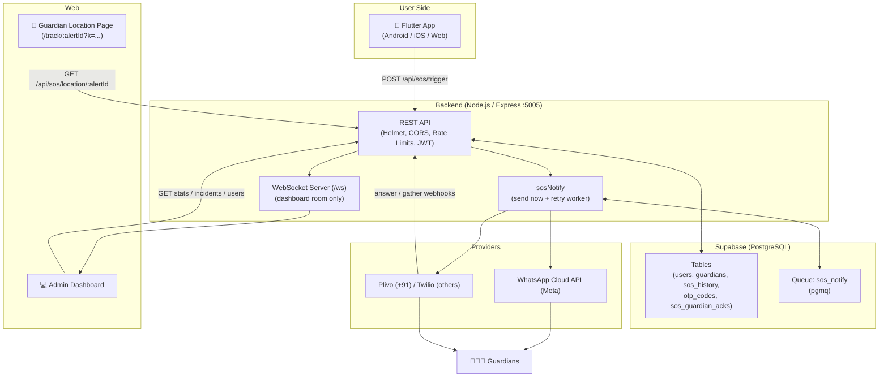
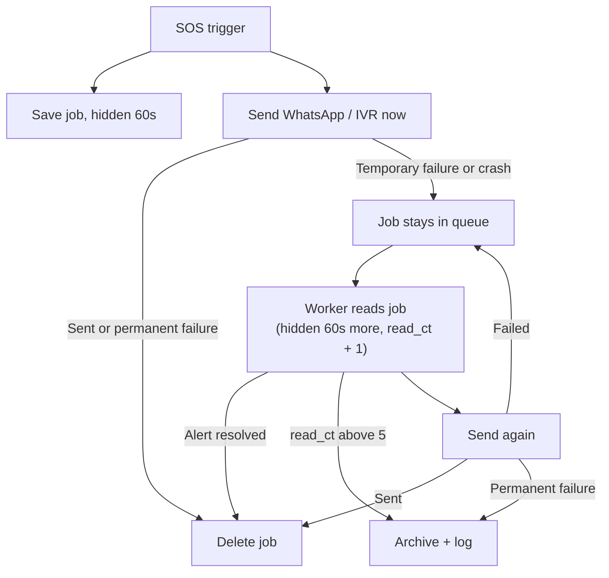
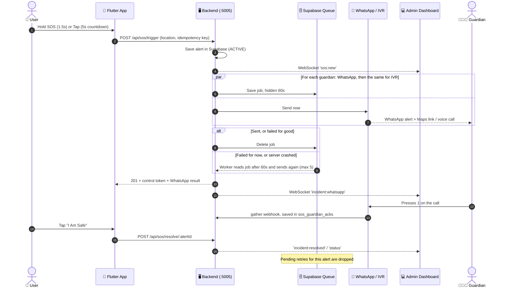

# 🛡️ DEVI (Digital Emergency Verification Interface)
## System Architecture & End-to-End Workflow

*Checked against the code at commit `8c549fc` (5 Nov 2026). This describes the code, not what is deployed.*

---

## 📑 Table of Contents
1. [Overview](#1-overview)
2. [High-Level Architecture](#2-high-level-architecture)
3. [Repository Structure](#3-repository-structure)
4. [Mobile App (Flutter)](#4-mobile-app-flutter)
5. [Backend (Node.js + Express + WebSocket)](#5-backend-nodejs--express--websocket)
6. [SOS Retry Queue (Supabase Queues)](#6-sos-retry-queue-supabase-queues)
7. [Admin Dashboard (React + Vite)](#7-admin-dashboard-react--vite)
8. [Database (Supabase)](#8-database-supabase)
9. [End-to-End SOS Flow](#9-end-to-end-sos-flow)
10. [Security](#10-security)
11. [Local Development](#11-local-development)

---

## 1. Overview

**DEVI** is a women's safety system with two sides:

- **User side (Flutter app):** The user presses SOS. One GPS location and their details are sent to the backend.
- **Admin side (React web dashboard):** A view-only panel of SOS records, users and delivery status.

Guardians are alerted by WhatsApp (with a Google Maps link) and by an automated IVR voice call.

> **Current scope:** DEVI is records-only. There is **no live tracking** and no responder map: an SOS sends one location.
> **Evidence recording is off until Phase 2.** The code is kept behind `kEvidenceRecordingEnabled` (`frontend/lib/config/features.dart`).
> The field agent / responder module has been removed.

### Key Features
- **Instant SOS:** A guest can trigger SOS without registering or logging in.
- **False-alarm protection:** Tap → 5-second cancelable countdown. Hold for ~1.5s → instant alert.
- **WhatsApp alert:** Guardians receive the Meta template `devi_safety` with a Google Maps link and a location pin.
- **IVR call:** Guardians get a voice call and can press 1 to acknowledge. Plivo handles +91 numbers, Twilio the rest, and each backs up the other.
- **Automatic retry:** A failed WhatsApp or call is retried through a Supabase queue, even if the server crashes.
- **WhatsApp OTP login:** Sign in and sign up need a 6-digit code.

---

## 2. High-Level Architecture



---

## 3. Repository Structure

```text
DEVI_APP/
├── docs/                            # This document + provider comparison files
├── deploy/nginx/                    # Hostinger NGINX configs + web security headers snippet
├── backend/                         # Node.js Express REST API + WebSocket
│   ├── src/
│   │   ├── config/
│   │   │   ├── cloudinary.js        # Evidence media storage
│   │   │   ├── env.js               # Loads backend/.env by absolute path
│   │   │   ├── security.js          # Secrets, production checks, CORS allow-list
│   │   │   └── supabase.js          # Database client
│   │   ├── middlewares/
│   │   │   ├── auth.middleware.js   # User JWT, admin token, SOS control and view tokens
│   │   │   ├── error.js
│   │   │   └── rateLimiter.js       # Global, auth, OTP, admin, guest, evidence, SOS limits
│   │   ├── routes/
│   │   │   ├── admin.routes.js      # Admin login & token verify
│   │   │   ├── auth.routes.js       # OTP send, login, token refresh, verify
│   │   │   ├── dashboard.routes.js  # Admin: stats, incidents, users, notes, resolve
│   │   │   ├── health.routes.js
│   │   │   ├── index.js             # Route aggregator
│   │   │   ├── ivr.routes.js        # Plivo / Twilio call webhooks (press 1)
│   │   │   ├── sos.routes.js        # SOS trigger, location, evidence, resolve, claim, history
│   │   │   └── user.routes.js       # Countries, profile, guardians, guest users
│   │   ├── services/
│   │   │   ├── dashboard.service.js # Admin stats, incidents, users, notes
│   │   │   ├── geocode.service.js   # GPS -> place name (cached)
│   │   │   ├── ivr.service.js       # Emergency calls: provider routing + fallback
│   │   │   ├── live-sessions.js     # In-memory cache of open alerts (name kept from older code)
│   │   │   ├── otp.service.js       # WhatsApp login codes
│   │   │   ├── queue.service.js     # Queue storage (only file that knows about pgmq)
│   │   │   ├── socket.service.js    # WebSocket rooms & broadcasts
│   │   │   ├── sos.service.js       # SOS alerts, evidence, history, guardian acks, resolve
│   │   │   ├── sosNotify.service.js # WhatsApp + IVR send with retry worker
│   │   │   ├── user.service.js      # Users & guardians (encrypted fields)
│   │   │   └── whatsapp.service.js  # Emergency alert and OTP messages
│   │   ├── utils/
│   │   │   ├── coords.js, evidence.js, logMask.js, password.js
│   │   │   ├── encryption.js        # AES-256-GCM database field encryption
│   │   │   ├── phone.js             # E.164 numbers, open countries
│   │   │   └── sosRecipients.js     # Who gets an SOS, per-number limits
│   │   └── server.js                # Entry point (port 5005), starts the retry worker
│   ├── test/                        # npm test (node:test)
│   ├── scripts/                     # Migrations (see npm scripts) + test call scripts
│   ├── db/                          # SQL files, see section 8
│   ├── .env.example
│   └── package.json
│
├── frontend/                        # Flutter user app
│   └── lib/
│       ├── main.dart
│       ├── config/features.dart     # kEvidenceRecordingEnabled (off until Phase 2)
│       ├── legal/terms_content.dart # Terms of Use & Privacy notice
│       ├── screens/
│       │   ├── splash_screen.dart   # Start-up check
│       │   ├── onboarding/          # Terms → quick setup → SOS as a guest
│       │   ├── login_screen.dart    # Phone + OTP sign in, Sign Up
│       │   ├── profile_screen.dart  # Sign up / edit profile & guardians
│       │   ├── sos_screen.dart      # SOS button, countdown, delivery status
│       │   ├── history_screen.dart  # Past SOS alerts
│       │   └── settings_screen.dart # Profile, guardians, logout
│       ├── services/
│       │   ├── api_service.dart     # HTTP client
│       │   ├── app_state.dart       # Global state, session (token in secure storage)
│       │   ├── location_service.dart# One GPS fix for the SOS
│       │   ├── onboarding_service.dart
│       │   ├── sms_service.dart     # Phone call to a guardian
│       │   ├── sound_service.dart   # Siren
│       │   ├── permission_service.dart
│       │   ├── emergency_media_service.dart, emergency_foreground_service.dart  # Phase 2 recording
│       │   └── *_mobile / *_web / *_stub.dart  # Platform implementations
│       ├── theme/                   # Colors & theme
│       ├── utils/                   # map_utils.dart, phone_utils.dart
│       └── widgets/                 # SOS cards, OTP sheet, sign-in prompt, country picker, dialogs
│   └── android/.../EmergencyService.kt     # Native recording service (Phase 2)
│
└── web/                             # React admin dashboard (Vite)
    └── src/
        ├── pages/
        │   ├── LoginPage.jsx        # Admin sign in
        │   ├── TrackPage.jsx        # Public guardian location page
        │   └── admin/               # Dashboard, SOS list + detail, Users + detail, Settings
        ├── components/admin/        # AdminLayout (WebSocket + toasts), SosBarChart, ui
        ├── config/api.js            # API & WebSocket URLs, admin session (adminFetch)
        ├── utils/theme.js
        ├── App.jsx                  # Routes
        ├── admin.css, index.css
        └── main.jsx
```

---

## 4. Mobile App (Flutter)

### 4.1 User Modes

| | 👤 Registered User | ⚡ Instant SOS (Guest) |
|---|---|---|
| **Entry** | Phone number + WhatsApp OTP | First run: terms → quick setup (name + one guardian) → SOS |
| **Setup** | Name, phone, address, guardians (up to 3) | Name + guardian stored on the phone |
| **SOS goes to** | The app's guardian list | The app's guardian list, with limits (see 5.5) |
| **No guardians** | Control room number (`ADMIN_WHATSAPP`) | Control room number (`ADMIN_WHATSAPP`) |
| **Session** | 30-day JWT in secure storage, renewed by `/auth/refresh` | Random guest ID (`GUEST_` + 32 hex characters) |

If `ADMIN_WHATSAPP` is not set, an SOS with no guardians reaches only the dashboard.

After an SOS, once the guest is safe, the app offers sign in. Their alerts then move to the account through `/sos/claim`.

### 4.2 SOS Trigger (`sos_screen.dart`)
1. **Tap:** Starts a 5-second countdown. The user can **Cancel** or **Send Now**.
2. **Hold (~1.5s):** Sends the alert instantly.
3. **Demo Mode card:** Shows a preview of the alert message only. Nothing is sent.
4. **I Am Safe:** While an alert is active the big card turns green. Tapping it (with confirmation) resolves the alert.

### 4.3 When Delivery Fails
- **Server not reachable:** The app retries with the same idempotency key (after 3, 5, 10, 15, then every 30 seconds) until it is delivered or the user marks safe. It also calls the first guardian from the phone.
- **Delivered:** No phone call from the app, because the server's IVR call would find the line busy.
- **WhatsApp problem:** The app stays open, warns the user and shows a Call button.
- **All good:** The app minimizes to the home screen (Android) so the alert is not visible on screen.

### 4.4 Phone Numbers
Numbers are E.164 (`+919876543210`) in the app and on the server. The picker lists only the countries the server has open (`GET /api/user/countries`). With one country open it shows no dropdown.

### 4.5 Evidence Recording (Phase 2)
Off today: no recording, no upload, and camera, microphone and notification permissions are not asked for.

To turn it on, set `kEvidenceRecordingEnabled` to true and restore the lines marked `PHASE 2` in `AndroidManifest.xml` and `MainActivity.kt`. Then add recording back to the terms and privacy text, and bump the terms version.

---

## 5. Backend (Node.js + Express + WebSocket)

### 5.1 REST API

All routes are under `/api`.

#### Auth (`/api/auth`), rate-limited: 15 requests / 15 min
| Method | Route | Purpose |
|---|---|---|
| POST | `/auth/otp/send` | Send a WhatsApp code. `purpose`: `login` or `signup` |
| POST | `/auth/login` | Phone + code. Returns a 30-day JWT |
| POST | `/auth/refresh` | Swap a valid token for a fresh 30-day token |
| GET | `/auth/verify` | Check that a token is valid |

#### User (`/api/user`)
| Method | Route | Purpose |
|---|---|---|
| GET | `/user/countries` | Countries open for sign up and guardians |
| GET | `/user/profile/:phone` | Own profile + guardians (**token required**) |
| PUT | `/user/profile` | Sign up (new numbers only, needs `otp`, returns a token) or update own profile |
| POST | `/user/guest` | Sync a guest session. Rate-limited: 30 / 15 min |

#### SOS (`/api/sos`)
| Method | Route | Purpose |
|---|---|---|
| POST | `/sos/trigger` | Create alert (idempotent), send WhatsApp + IVR, notify dashboard. Never refused: over 30 / min per IP, unverified numbers are not sent to |
| GET | `/sos/location/:alertId?k=` | Saved SOS location for the guardian page (view key or admin). Hidden 24h after resolve |
| GET | `/sos/evidence/:alertId?k=` | Streams the private evidence file (view key or admin) |
| POST | `/sos/upload-evidence` | Upload evidence to Cloudinary (control token, Phase 2). Rate-limited: 10 / 10 min |
| POST | `/sos/resolve/:alertId` | Resolve alert ("I Am Safe") |
| POST | `/sos/claim` | Move a guest's alerts to the signed-in account (control token per alert) |
| POST | `/sos/history/guest` | A guest's history, proved by control tokens |
| GET | `/sos/history/:phone` | User's own history (token required) |
| GET | `/sos/history` | All history (admin key) |

#### Admin Auth (`/api/admin`)
| Method | Route | Purpose |
|---|---|---|
| POST | `/admin/login` | Username + password (`ADMIN_USERNAME` / `ADMIN_PASSWORD_HASH`). Returns a 12-hour admin token. Rate-limited: 10 / 15 min |
| GET | `/admin/verify` | Check that the admin token is valid |

#### Admin Dashboard (`/api/dashboard`), requires admin token (or `x-admin-key` header for scripts)
| Method | Route | Purpose |
|---|---|---|
| GET | `/dashboard/stats` | Totals, daily SOS counts, latest SOS |
| GET | `/dashboard/incidents` | SOS records (paged, with filters) |
| GET | `/dashboard/incidents/:alertId` | One SOS record with the user's guardians |
| GET | `/dashboard/users` | Users (paged) |
| GET | `/dashboard/users/:userId` | One user |
| POST | `/dashboard/add-note` | Add an operator note (the web panel does not use it) |
| POST | `/dashboard/resolve/:alertId` | Mark resolved (the web panel does not use it) |

#### IVR webhooks (`/api/ivr`), called by the providers
| Method | Route | Purpose |
|---|---|---|
| ANY | `/ivr/plivo/answer`, `/ivr/twilio/answer` | Returns the XML the call speaks |
| ANY | `/ivr/plivo/gather`, `/ivr/twilio/gather` | Guardian pressed a key. Press 1 is saved with the call's ack token |
| ANY | `/ivr/plivo/status` | Call ended (logged) |

#### Others
| Method | Route | Purpose |
|---|---|---|
| GET | `/health` | Health check |
| GET, POST | `/webhook`, `/api/webhook` | WhatsApp webhook. POST events must carry Meta's signature |

### 5.2 WebSocket (`/ws`)
Plain WebSocket (`ws` library), JSON messages. Only the dashboard uses it. The app does not.

**Client → Server**
| Type | Purpose |
|---|---|
| `join` / `leave` | Join a room. Only `dashboard` exists, and it needs `token` = admin token |
| `ping` | Keep-alive |

**Server → Client** (all sent to the `dashboard` room)
| Type | Purpose |
|---|---|
| `sos:new` | New SOS: the dashboard shows a toast and refreshes |
| `incident:whatsapp` | WhatsApp send result for an alert |
| `incident:evidence` | Evidence uploaded |
| `incident:resolved` / `status` | Alert resolved |

The server also sends `connected`, `joined`, `left`, `pong` and `error` to a single client.

### 5.3 WhatsApp Alert (`whatsapp.service.js`)
- Sent through the Meta approved template **`devi_safety`** with the name, a Google Maps link and the time.
- A WhatsApp location pin follows when the coordinates are valid.
- The `/track` guardian page exists, but this message does not link to it today.

### 5.4 IVR Call (`ivr.service.js`, `ivr.routes.js`)
- **Routing:** `+91` numbers go through Plivo, others through Twilio. If one is missing or fails, the other is tried.
- **Call:** Speaks the name and an easy-to-hear place ("Anna Nagar, Chennai"). Coordinates, plus codes and door numbers are dropped.
- **Press 1:** Saved in `sos_guardian_acks` and shown on the dashboard. The encrypted ack token, bound to the alert, means a fake request saves nothing.
- `PUBLIC_API_URL` must point to the backend. `PUBLIC_BASE_URL` is the web site and voice webhooks fail there.
- "Call dispatched" in the log means the provider accepted the call, not that it was answered.

### 5.5 Recipients and Paid-Send Limits (`sosRecipients.js`, `phone.js`)
Every SOS message and call costs money, and Instant SOS needs no login.

- **Verified numbers:** saved on the logged-in user's account. No limit inside the Instant SOS countries.
- **Unverified numbers:** all others. At most 3, each alerted at most 3 times an hour, and only in `GUEST_SOS_COUNTRIES`.
- **Saved guardians abroad:** verified, but limited to 3 alerts an hour.
- **Blocked sends:** the reason (`FOREIGN_NEEDS_LOGIN`, `RECIPIENT_LIMIT`, `IP_LIMIT`) is reported to the app and dashboard. The alert itself is never refused.
- **Who owns an alert:** the token decides. Without one, only a valid guest ID is accepted, otherwise a new guest ID is created.

### 5.6 OTP (`otp.service.js`)
- 6 digits, valid for 5 minutes, single use, 5 wrong tries and the code is dead.
- One code a minute and 5 an hour per number. Only a keyed hash is stored.
- Sign up codes to numbers outside `GUEST_SOS_COUNTRIES` have a daily total (`FOREIGN_OTP_DAILY_LIMIT`, default 50). It is counted in memory.
- Template: `devi_agent_pin`.

---

## 6. SOS Retry Queue (Supabase Queues)

The queue makes sure a failed WhatsApp or IVR call is sent again, even if the backend crashes. Retries kept in server memory would be lost on a restart, so jobs are stored in the database.

**Supabase Queues** is the `pgmq` extension. It keeps jobs in Postgres tables, so it needs no extra server. The code is in `queue.service.js` and `sosNotify.service.js`.

| Item | Value |
|---|---|
| Queue name | `sos_notify` |
| Job table / archive table | `pgmq.q_sos_notify` / `pgmq.a_sos_notify` |
| Setup | `backend/db/sos-queue.sql` |
| First retry after | 60 seconds |
| Worker checks every | 15 seconds, up to 10 jobs at a time |
| Maximum retries | 5 (the last is about 5–6 minutes after the SOS) |

### How it works
1. **Dispatch:** For each guardian, the route calls `sosNotify.dispatch()` once for WhatsApp and once for IVR.
2. **Two things at once:** The job is saved to the queue, hidden for 60 seconds, and the real send goes out. The SOS never waits for the queue. The place name is looked up after the alert is saved, and the send waits for it at most 1 second.
3. **After the first send:**
   - Success or permanent failure (such as not on WhatsApp): the job is deleted.
   - Temporary failure (timeout, rate limit, provider down): the job is left alone.
   - Server crash: the job is safe in the database.
4. **Worker:** Jobs whose 60 seconds are over become visible. Reading a job hides it for another 60 seconds and adds 1 to `read_ct`.
5. **Each job read:**
   - Alert already resolved: job deleted, nothing sent.
   - `read_ct` above 5: job archived, `🚨 [SOS QUEUE GAVE UP]` logged.
   - Otherwise it is sent again. Success deletes it, permanent failure archives it, failure leaves it to come back.



A job needs no "retry" command: **it comes back by itself until something deletes it.**

### Good to know
- **Encrypted:** The phone number, name and location in a job are encrypted, bound to the alert ID. The queue is closed to the `anon` and `authenticated` roles.
- **Queue down:** The first send still goes out, only the retry is lost. An error is logged.
- **Duplicates:** A send can go out twice if its job is deleted too late. This is accepted: better twice than not at all.
- **An empty `q_sos_notify` is normal:** Successful jobs are deleted within moments.
- **Permanent failures:** only a failure of that one number: WhatsApp `NOT_ON_WHATSAPP`, `PHONE_EMPTY`, or an invalid number for IVR. An expired token, template problem or missing provider settings keep retrying, so a quick fix can still save the alert.
- **Worker location:** It runs inside the backend, so retries pause while the backend is down and continue after restart.

### Check it
```sql
select msg_id, read_ct, vt, message->>'kind' as kind from pgmq.q_sos_notify;  -- waiting
select msg_id, read_ct, message->>'kind' as kind from pgmq.a_sos_notify;      -- gave up
```
Do not add test jobs to `sos_notify`. The worker archives them as unreadable and logs an error. Use a separate queue for demos.

### Moving to another queue later
Only the four functions in `queue.service.js` (`send`, `read`, `delete`, `archive`) know about pgmq. Moving to Redis (BullMQ) means rewriting that file, not the SOS code.

---

## 7. Admin Dashboard (React + Vite)

Runs at `https://devi.macvelsoftware.com` (local: `http://localhost:5173`). It is a **view-only panel**: no map, no siren, and no resolve or note buttons.

| Route | Page |
|---|---|
| `/login` | Admin sign in. The token is kept for 12 hours |
| `/dashboard` | Totals, SOS per day chart, latest SOS |
| `/sos` | SOS list with filters |
| `/sos/:alertId` | Alert details, notes, user, guardians, press-1 acknowledgements, WhatsApp status |
| `/users`, `/users/:userId` | Users and their SOS history |
| `/settings` | Account, appearance, sign out |
| `/track/:alertId?k=` | Public guardian page: where the SOS was pressed |

- **New SOS:** a small toast, and the open page refreshes.
- **Guardian page:** Refreshes every 20 seconds while the alert is active. It shows ACTIVE, SAFE (the user pressed "I'm safe") or CLOSED (shown like an alert, never as safe). The link expires 24h after the alert is resolved.

---

## 8. Database (Supabase)

| Table | Key columns |
|---|---|
| `users` | `id`, `mobile_number`, `mobile_hash`, `full_name`, `address_1`, `address_2`, `is_guest`, `created_at` |
| `guardians` | `id`, `user_id`, `name`, `mobile_number`, `created_at` |
| `sos_history` | `id`, `user_id`, `coords`, `latitude`, `longitude`, `accuracy`, `location_address`, `status`, `idempotency_key`, `evidence_url`, `audio_url`, `operator_notes`, `resolved_at`, `resolved_by`, `created_at` |
| `otp_codes` | `phone_hash`, `code_hash`, `expires_at`, `attempts`, `sent_at`, `window_start`, `send_count` |
| `sos_guardian_acks` | `id`, `alert_id`, `phone`, `phone_hash`, `provider`, `acknowledged_at` |
| `pgmq.q_sos_notify`, `pgmq.a_sos_notify` | Queue and archive, see section 6 |

- `status` is `ACTIVE` or `RESOLVED`. Older rows may have `DISPATCHED` or lowercase `active`, and the dashboard treats these as open.
- `resolved_by` is `user` (marked safe) or `admin`.
- New alerts keep GPS encrypted in `coords` and leave `latitude` / `longitude` empty.
- Open alerts are also cached in backend memory and rebuilt from the database when missing.

### SQL files (`backend/db/`)
Run in Supabase Dashboard → SQL Editor.

| File | Purpose |
|---|---|
| `schema.sql` | Main tables for a new project |
| `rls.sql` | Locks tables to the backend. Put the secret key in `.env` first, or every SOS fails |
| `sos-coords.sql` | Encrypted `coords` column |
| `resolved-by.sql` | `resolved_at`, `resolved_by` |
| `otp.sql` | `otp_codes`. Nobody can sign in until it is run |
| `guardian-acks.sql` | `sos_guardian_acks` |
| `sos-queue.sql` | `sos_notify` queue. First install Queues in Dashboard → Integrations, with "Expose Queues via PostgREST" on |
| `fresh-start-2026-10-27.sql` | **Deletes all data.** Testing phase only, do not run on real data |

---

## 9. End-to-End SOS Flow



---

## 10. Security

### In place
- **HTTPS** for the live API (`https://devi-api.macvelsoftware.com`).
- **OTP login:** Sign in and sign up need a WhatsApp code.
- **JWT auth:** Users can read and update only their own profile and history.
- **Sign up protection:** A registered number cannot be overwritten without login.
- **Secure token storage:** Android Keystore / iOS Keychain (`flutter_secure_storage`).
- **Rate limits:** Global 5000 / 15 min, auth 15 / 15 min, OTP 30 / 15 min, admin login 10 / 15 min, guest sync 30 / 15 min, evidence 10 / 10 min. SOS trigger never refuses: over 30 / min per IP only unverified sends stop.
- **Helmet** security headers on the API. CSP, HSTS and others on the web site through `deploy/nginx/snippets/devi-web-security-headers.conf`.
- **CORS allow-list:** `devi.macvelsoftware.com`, `devi-api.macvelsoftware.com`, plus `CORS_ORIGINS`. Localhost is allowed only in development.
- **Production secret check:** The server refuses to start without `JWT_SECRET`, `ADMIN_JWT_SECRET`, `SOS_LINK_SECRET`, `ADMIN_SECRET_KEY`, `ENCRYPTION_KEY` and `ADMIN_PASSWORD_HASH`. One secret per purpose.
- **Admin login:** The password is stored only as a scrypt hash (`npm run admin:hash`). A new hash logs out every session. All dashboard APIs and the WebSocket room require an admin token (12h).
- **Database access:** The backend uses the Supabase secret key. RLS is on with no policies, and public roles have no table rights (`db/rls.sql`).
- **Idempotency key** on SOS trigger, to prevent duplicate alerts.
- **Per-alert control token:** `/sos/trigger` returns a `controlToken` (HMAC-SHA256 of the alert ID) to the creating device only. `/sos/resolve` and `/sos/upload-evidence` need it (header `X-SOS-Token`). Upload headers are checked before the file is read.
- **Per-alert view key:** `?k=` on the guardian location and evidence links. Evidence stays private on Cloudinary and is served through the API.
- **Public responses are trimmed:** the idempotency key and phone are never returned by SOS responses.
- **Webhook signature:** WhatsApp events must be signed with `WHATSAPP_APP_SECRET`.
- **Log masking:** Phone numbers and link keys are masked in logs.

### Encryption (AES-256-GCM)
- **Encrypted fields:** `users.mobile_number`, `full_name`, `address_1`, `address_2`; `guardians.name`, `mobile_number`; `sos_history.location_address`, `operator_notes`, `coords`; `sos_guardian_acks.phone`; queue job data.
- **Lookups:** `users.mobile_hash` is a keyed HMAC, so a number can be found without decrypting.
- **Key:** `ENCRYPTION_KEY` (32+ random characters) lives only in the backend `.env`.
- **Format:** `enc:v3:<keyId>:<iv>:<tag>:<ciphertext>`. Each value is bound to its column and row, so a value copied elsewhere does not decrypt.
- **Key rotation:** Move the old key to `ENCRYPTION_OLD_KEYS` (`<id>:<secret>`), set a new `ENCRYPTION_KEY` and `ENCRYPTION_KEY_ID`, then run `npm run rotate:key -- --apply`.
- **Older values:** `enc:v2`, `enc:v1` and plain text are still readable and converted by the same script. `ENCRYPTION_ALLOW_V1=false` refuses v1.
- **Transport:** App ↔ server traffic relies on HTTPS / WSS. The old app-side AES with a hardcoded key was removed.

### Not encrypted
- `sos_history.latitude` / `longitude` on older rows, until `npm run rotate:key -- --apply` moves them into `coords`.

### Pending
- **Token revoke:** A leaked user token cannot be cancelled, and `/auth/refresh` can keep renewing it.
- **Admin accounts:** One shared admin login, no per-operator accounts.
- **Dev / production separation:** The team shares the production database and `.env`.
- **IVR webhooks:** Provider signatures are not checked.
- **Call URL:** The name and area travel in the call's URL to the provider.
- **Compliance:** Support email, account delete flow and data retention.

The full tracked list is the security report kept in Claude Docs.

---

## 11. Local Development

### Prerequisites
- Node.js ≥ 18, Flutter SDK ≥ 3.x, Chrome

### 1. Backend
```bash
cd backend
npm install
npm run dev        # http://localhost:5005
npm test           # unit tests (no database needed)
```
Copy `.env.example` to `.env`. It explains every value.

Other commands: `npm run admin:hash`, `npm run rotate:key`, `npm run migrate:phone`. Migration scripts are dry runs until you add `-- --apply`.

On the server use `npm ci --omit=dev`, not `npm install`.

### 2. Admin Dashboard
```bash
cd web
npm install
npm run dev        # http://localhost:5173
npm run lint       # ESLint
```

### 3. Flutter App
```bash
cd frontend
flutter pub get
flutter run -d chrome                        # web debug → local backend
flutter run --dart-define=SERVER=live        # force live server
flutter run --dart-define=SERVER=local       # force local server
```

---
*Maintained for the DEVI Women Safety Project.*
