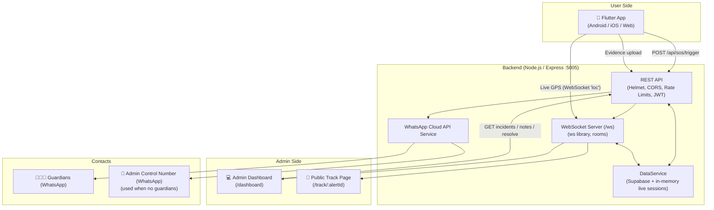
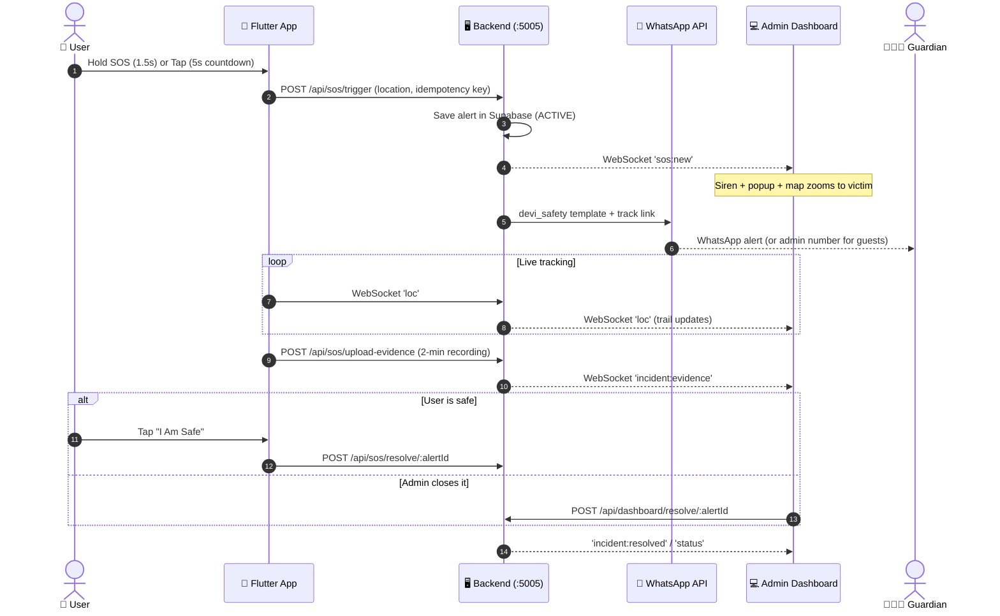

# 🛡️ DEVI (Digital Emergency Verification Interface)
## System Architecture & End-to-End Workflow

---

## 📑 Table of Contents
1. [Overview](#1-overview)
2. [High-Level Architecture](#2-high-level-architecture)
3. [Repository Structure](#3-repository-structure)
4. [Mobile App (Flutter)](#4-mobile-app-flutter)
5. [Backend (Node.js + Express + WebSocket)](#5-backend-nodejs--express--websocket)
6. [Admin Control Room Dashboard (React + Vite)](#6-admin-control-room-dashboard-react--vite)
7. [Database (Supabase)](#7-database-supabase)
8. [End-to-End SOS Flow](#8-end-to-end-sos-flow)
9. [Security](#9-security)
10. [Local Development](#10-local-development)

---

## 1. Overview

**DEVI** is a women's safety system with two sides:

- **User side (Flutter app):** The user presses SOS. Their live location, details and evidence are sent to the backend.
- **Admin side (React web dashboard):** The control room sees every SOS on a live map with the victim's details and live movement, and resolves the incident.

> **Phase 1 scope:** User SOS → Admin dashboard (location, details, live tracking).
> The field agent / responder module (agent portal, duty page, auto-assign, dispatch) has been **removed**.

### Key Features
- **Instant SOS:** A guest can trigger SOS without registering.
- **False-alarm protection:** Tap → 5-second cancelable countdown. Hold for ~1.5s → instant alert.
- **Live tracking:** GPS updates stream to the dashboard and the public track page in real time.
- **Evidence:** A 2-minute recording is uploaded to Cloudinary and attached to the incident.
- **WhatsApp alert:** Guardians (or the admin control number for guests) receive a WhatsApp message with the live tracking link.

---

## 2. High-Level Architecture



---

## 3. Repository Structure

```text
DEVI_APP/
├── docs/                            # This architecture document
├── deploy/nginx/*.nginx.conf        # Hostinger NGINX configs (API + web)
├── backend/                         # Node.js Express REST API + WebSocket
│   ├── src/
│   │   ├── config/
│   │   │   ├── cloudinary.js        # Evidence media storage
│   │   │   ├── security.js          # Secrets, production checks, CORS allow-list
│   │   │   └── supabase.js          # Database client
│   │   ├── middlewares/
│   │   │   ├── auth.middleware.js   # User JWT, admin key
│   │   │   ├── error.js
│   │   │   └── rateLimiter.js       # Global, login, SOS trigger limits
│   │   ├── routes/
│   │   │   ├── admin.routes.js      # Admin dashboard login & token verify
│   │   │   ├── auth.routes.js       # Phone login, token verify
│   │   │   ├── dashboard.routes.js  # Admin: incidents, notes, resolve
│   │   │   ├── health.routes.js
│   │   │   ├── index.js             # Route aggregator
│   │   │   ├── sos.routes.js        # SOS trigger, live location, evidence, history
│   │   │   └── user.routes.js       # Profile, guardians, guest users
│   │   ├── services/
│   │   │   ├── user.service.js      # Users & guardians (encrypted fields)
│   │   │   ├── sos.service.js       # SOS alerts, live tracking, evidence, history, signal state
│   │   │   ├── dashboard.service.js # Admin incident list & operator notes
│   │   │   ├── geocode.service.js   # GPS -> place name (cached)
│   │   │   ├── live-sessions.js     # In-memory live tracking sessions (shared)
│   │   │   ├── signal.watchdog.js   # Flags alerts whose live location stopped
│   │   │   ├── socket.service.js    # WebSocket rooms & broadcasts
│   │   │   └── whatsapp.service.js  # Emergency alert dispatch
│   │   ├── utils/encryption.js      # AES-256-GCM database field encryption
│   │   └── server.js                # Entry point (port 5005)
│   ├── test/                        # npm test (node:test): encryption, auth, CORS
│   ├── scripts/encrypt-existing-data.js  # One-time DB field encryption migration
│   ├── db/schema.sql                # Supabase tables (users, guardians, sos_history)
│   ├── .env.example
│   └── package.json
│
├── frontend/                        # Flutter user app
│   └── lib/
│       ├── main.dart
│       ├── screens/
│       │   ├── splash_screen.dart   # Auto-login check
│       │   ├── login_screen.dart    # Phone login, Sign Up, Instant SOS
│       │   ├── profile_screen.dart  # Sign up / edit profile & guardians
│       │   ├── sos_screen.dart      # SOS button, countdown, Demo Mode note
│       │   ├── history_screen.dart  # Past SOS alerts
│       │   └── settings_screen.dart # Profile, guardians, logout
│       ├── services/
│       │   ├── api_service.dart     # HTTP client (+ silent token refresh)
│       │   ├── app_state.dart       # Global state, session (token in secure storage)
│       │   ├── location_service.dart# GPS fix + live tracking stream
│       │   ├── socket_service.dart  # WebSocket client
│       │   ├── emergency_media_service.dart # 2-min evidence recording
│       │   ├── emergency_foreground_service.dart # Bridge to native EmergencyService (Android)
│       │   ├── sms_service.dart     # Guardian phone call
│       │   ├── sound_service.dart   # Siren
│       │   ├── permission_service.dart
│       │   └── *_mobile / *_web / *_stub.dart  # Platform implementations
│       ├── theme/                   # Colors & theme
│       ├── utils/map_utils.dart     # Google Maps link for SOS
│       └── widgets/
│           ├── sos_top_bar.dart, sos_guide_card.dart, sos_action_card.dart  # SOS home pieces
│           ├── location_prompt_dialog.dart  # "Turn on location" prompt
│           └── devi_button, devi_logo, input_field, emergency_sound_card, add_guardian_dialog
│   └── android/.../EmergencyService.kt     # Native SOS foreground service (recording + location)
│
└── web/                             # React admin dashboard (Vite)
    └── src/
        ├── pages/
        │   ├── LoginPage.jsx        # Admin sign in
        │   ├── DashboardPage.jsx    # Admin control room (login required)
        │   └── TrackPage.jsx        # Public live tracking page
        ├── components/dashboard/    # DashboardHeader, IncidentSidebar, IncidentMap,
        │                            # IncidentDrawer, EmergencyAlertBanner
        ├── config/api.js            # API & WebSocket URLs, admin session (adminFetch)
        ├── utils/
        │   ├── mapMarkers.js        # Victim & guardian map markers
        │   ├── incidents.js         # isActiveIncident, distance, signal-lost label
        │   └── alertSounds.js       # Siren tone & spoken alerts
        ├── App.jsx                  # Routes: /login, /, /dashboard, /track/:alertId
        └── index.css
    └── eslint.config.js             # npm run lint
```

---

## 4. Mobile App (Flutter)

### 4.1 User Modes

| | 👤 Registered User | ⚡ Instant SOS (Guest) |
|---|---|---|
| **Entry** | Phone number login (no OTP) | One tap from login screen |
| **Setup** | Name, phone, address, guardians (up to 5) | None |
| **WhatsApp alert goes to** | Saved guardians | Admin control number |
| **Session** | JWT stored in secure storage, auto-login | Local guest ID (`GUEST_xxx`) |

### 4.2 SOS Trigger (`sos_screen.dart`)
1. **Tap:** Starts a 5-second countdown. The user can **Cancel** or **Send Now**.
2. **Hold (~1.5s):** Sends the alert instantly.
3. **Demo Mode card:** Shows a preview of the alert message only. Nothing is sent.
4. **I Am Safe:** While an alert is active the big card turns green. Tapping it (with confirmation) stops live tracking, finalizes evidence and resolves the alert.

### 4.3 Background Services
- **EmergencyService (Android native foreground service, `EmergencyService.kt`):** Started the moment SOS is pressed. Types `camera|microphone|location`. Records 2 minutes of front-camera video + audio with CameraX (audio-only fallback), and keeps live location allowed while the app is minimized or a call is in progress. Shows one discreet ongoing notification ("Daily Reminder — Your reminder is active"). Stopped on "I Am Safe". Dart bridge: `emergency_foreground_service.dart`.
- **LocationService:** Takes a high-accuracy GPS fix, then streams live location (about every 2s / 2m) over WebSocket. Asks the user to turn location on (or allow permission) when the app opens or resumes.
- **EmergencyMediaService:** Controls the 2-minute evidence recording and uploads the file to the backend (Cloudinary).
- **SmsService:** Calls the first guardian. The direct `112` call is on hold during testing.

After SOS is sent, the app minimizes itself to the home screen (Android) so the alert is not visible on screen.

**Signal monitoring:** While an SOS is active the app re-sends its latest position every 20s (heartbeat), even when standing still. If the server gets no update for 60s, the dashboard marks the incident **"⚠️ Signal lost • last seen HH:MM"**. If the user swipes the app away from recent apps, `EmergencyService.onTaskRemoved` reports it immediately (`POST /api/sos/app-closed/:alertId`) and the dashboard shows **"App closed by user"**. The map keeps the last known location. The flag clears automatically when updates resume.

---

## 5. Backend (Node.js + Express + WebSocket)

### 5.1 REST API

All routes are under `/api`.

#### Auth (`/api/auth`), rate-limited: 15 requests / 15 min
| Method | Route | Purpose |
|---|---|---|
| POST | `/auth/login` | Login with a registered phone number. Returns a 30-day JWT |
| GET | `/auth/verify` | Check that a token is valid |

#### User (`/api/user`)
| Method | Route | Purpose |
|---|---|---|
| GET | `/user/profile/:phone` | Own profile + guardians (**token required**) |
| PUT | `/user/profile` | Sign up (new numbers only, returns a token) or update own profile |
| POST | `/user/guest` | Track a guest session |

#### SOS (`/api/sos`)
| Method | Route | Purpose |
|---|---|---|
| POST | `/sos/trigger` | Create alert (idempotent), send WhatsApp, notify dashboard. Rate-limited: 10 / min |
| POST | `/sos/live-update` | Live location update (HTTP fallback) |
| GET | `/sos/live/:alertId` | Current live session (used by the track page) |
| POST | `/sos/upload-evidence` | Upload evidence file to Cloudinary |
| POST | `/sos/resolve/:alertId` | Resolve alert from the app ("I Am Safe") |
| POST | `/sos/app-closed/:alertId` | Phone reports the app was swiped away during an SOS (control token required) |
| GET | `/sos/history/:phone` | User's own history (token required, except guests) |
| GET | `/sos/history` | All history (admin key) |
| GET | `/sos/geocode` | Reverse geocode lat/lng to an address |

#### Admin Auth (`/api/admin`)
| Method | Route | Purpose |
|---|---|---|
| POST | `/admin/login` | Username + password (`ADMIN_USERNAME` / `ADMIN_PASSWORD` in `.env`). Returns a 12-hour admin token. Rate-limited: 10 / 15 min |
| GET | `/admin/verify` | Check that the admin token is valid |

#### Admin Dashboard (`/api/dashboard`), requires admin token (or `x-admin-key` header for scripts)
| Method | Route | Purpose |
|---|---|---|
| GET | `/dashboard/incidents` | Latest 100 incidents with user + guardian details and live trail |
| POST | `/dashboard/add-note` | Add an operator note to an incident |
| POST | `/dashboard/resolve/:alertId` | Mark an incident resolved |

### 5.2 WebSocket (`/ws`)
Plain WebSocket (`ws` library), JSON messages.

**Client → Server**
| Type | Purpose |
|---|---|
| `join` / `leave` | Join a room: `dashboard` (needs `token` = admin token) or `alert:<alertId>` |
| `loc` | Live GPS packet from the app (`alertId`, `lat`, `lng`, `accuracy`, `speed`, `heading`, `seq`) |
| `ping` | Keep-alive |

**Server → Client**
| Type | Sent to | Purpose |
|---|---|---|
| `sos:new` | `dashboard` | New SOS: dashboard plays the siren and zooms to the victim |
| `loc` | `dashboard`, `alert:<id>` | Live location update |
| `incident:evidence` | `dashboard` | Evidence video uploaded |
| `incident:signal_lost` / `incident:signal_restored` | `dashboard` | Live location stopped (no updates for 60s, or app closed) / resumed |
| `incident:resolved` / `status` | `dashboard`, `alert:<id>` | Alert resolved |
| `ack` | sender | Confirms a `loc` packet was received |

### 5.3 WhatsApp Alert (`whatsapp.service.js`)
- Sent through the Meta approved template **`devi_safety`** with the victim's name, live tracking link and time.
- A WhatsApp location pin is also sent when the coordinates are valid.
- **Recipients:** the user's guardians. If there are none (guest), the admin control number (`ADMIN_WHATSAPP`) receives it.

---

## 6. Admin Control Room Dashboard (React + Vite)

Runs at `https://devi.macvelsoftware.com` (local: `http://localhost:5173`). Uses **Google Maps** (`@react-google-maps/api`).

0. **Admin login (`/login`):** Username + password. The token is kept in the browser for 12 hours. When it expires, or when Logout is pressed, the admin is sent back to the login page.

1. **Incident list:** Search, stats (Total / Active / Resolved) and filter tabs (All / Active / Resolved).
2. **Live map:** Victim markers, the live movement trail with direction arrows, the SOS start point and a GPS accuracy circle.
3. **New SOS alert:** Siren sound, spoken announcement, a pop-up banner and auto-zoom to the victim.
4. **Incident drawer:** Evidence video, victim details (name, phone, location, GPS accuracy), Call Victim / Call 112, operator notes and Mark Resolved.
5. **Public track page (`/track/:alertId`):** The link sent on WhatsApp. Shows the victim's live location and trail.

---

## 7. Database (Supabase)

| Table | Key columns |
|---|---|
| `users` | `id`, `mobile_number`, `full_name`, `address_1`, `address_2`, `is_guest`, `created_at` |
| `guardians` | `id`, `user_id`, `name`, `mobile_number`, `created_at` |
| `sos_history` | `id`, `user_id`, `latitude`, `longitude`, `accuracy`, `location_address`, `status` (`ACTIVE` / `RESOLVED`), `idempotency_key`, `evidence_url` / `audio_url`, `operator_notes`, `created_at` |

- Live breadcrumbs (the movement trail) are kept in backend memory per active alert. They are not stored in the database.
- Older rows may have status `DISPATCHED`. The dashboard treats these as active.

---

## 8. End-to-End SOS Flow



---

## 9. Security

### In place
- **HTTPS** for the live API (`https://devi-api.macvelsoftware.com`).
- **JWT auth:** Users can read and update only their own profile and history.
- **Sign up protection:** A registered number cannot be overwritten without login.
- **Secure token storage:** Android Keystore / iOS Keychain (`flutter_secure_storage`).
- **Rate limits:** Global 5000 / 15 min, login 15 / 15 min, SOS trigger 10 / min.
- **Helmet** security headers.
- **CORS allow-list:** `devi.macvelsoftware.com`, plus `CORS_ORIGINS`. Localhost is allowed only in development.
- **Production secret check:** The server refuses to start without `JWT_SECRET`, `ADMIN_SECRET_KEY` and `ENCRYPTION_KEY` when `NODE_ENV=production`.
- **Idempotency key** on SOS trigger, to prevent duplicate alerts.
- **Admin login:** All dashboard APIs and the WebSocket `dashboard` room require an admin token (12h). Credentials are compared in constant time. New SOS events go to the dashboard room only.
- **Per-alert control token:** `/sos/trigger` returns a `controlToken` (HMAC-SHA256 of the alert ID) to the creating device only. `/sos/resolve`, `/sos/live-update`, `/sos/upload-evidence` (header `X-SOS-Token`) and WebSocket `loc` packets (`controlToken`) are rejected without it. Knowing the alert ID or the WhatsApp track link is not enough to change an alert.
- **Public responses are trimmed:** the idempotency key and phone are never returned by `/sos/live/:alertId` or the other SOS responses.

- **Database field encryption (AES-256-GCM):** `users.full_name`, `address_1`, `address_2`; `guardians.name`, `mobile_number`; `sos_history.location_address`, `operator_notes` are encrypted by the server before saving. The key (`ENCRYPTION_KEY`, 32+ random chars) lives only in the backend `.env`. GCM detects tampering. Stored format: `enc:v1:<iv>:<tag>:<ciphertext>`. Older plain-text rows are still readable and can be encrypted with `npm run migrate:encrypt -- --apply`.
- **Transport:** App ↔ server traffic relies on HTTPS / WSS. The old app-side AES with a hardcoded key was removed (it gave no real protection).

### Not encrypted (by design)
- `users.mobile_number`: used as the login lookup key.
- `sos_history.latitude` / `longitude`: numeric columns used for the live map.

### Pending
- Login has no OTP (product decision for easy login).
- Admin password is a single plain value in `.env` (no hash, no per-operator accounts).
- Backend uses the Supabase publishable key; switching to the secret key with Row Level Security enabled would limit damage if the key leaks.

---

## 10. Local Development

### Prerequisites
- Node.js ≥ 18, Flutter SDK ≥ 3.x, Chrome

### 1. Backend
```bash
cd backend
npm install
npm run dev        # http://localhost:5005
npm test           # unit tests (no database needed)
```
Key `.env` values: `NODE_ENV`, `PORT`, `SUPABASE_URL`, `SUPABASE_KEY`, `JWT_SECRET`, `ADMIN_SECRET_KEY`, `ENCRYPTION_KEY`, `ADMIN_USERNAME`, `ADMIN_PASSWORD`, `WHATSAPP_PHONE_NUMBER_ID`, `WHATSAPP_ACCESS_TOKEN`, `WHATSAPP_VERIFY_TOKEN`, `ADMIN_WHATSAPP`, `CLOUDINARY_*`, `GOOGLE_MAPS_API_KEY`, `WEB_BASE_URL`, `CORS_ORIGINS` (optional).

### 2. Admin Dashboard
```bash
cd web
npm install
npm run dev        # http://localhost:5173
npm run lint       # ESLint
```
Needs `VITE_GOOGLE_MAPS_API_KEY`.

### 3. Flutter App
```bash
cd frontend
flutter pub get
flutter run -d chrome                        # web debug → local backend
flutter run --dart-define=SERVER=live        # force live server
```

---
*Maintained for the DEVI Women Safety Project.*
